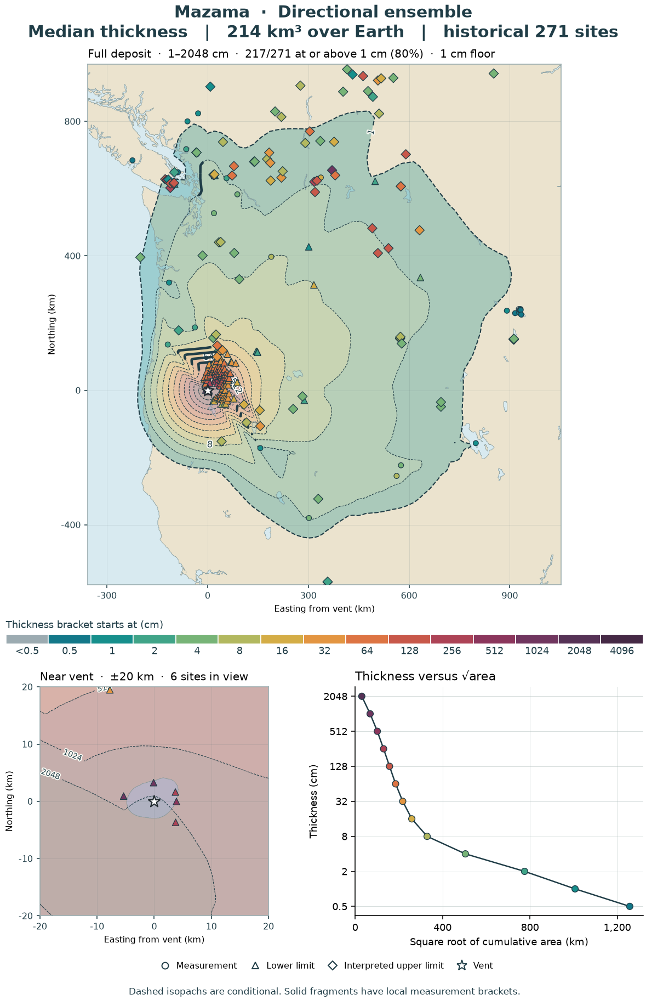
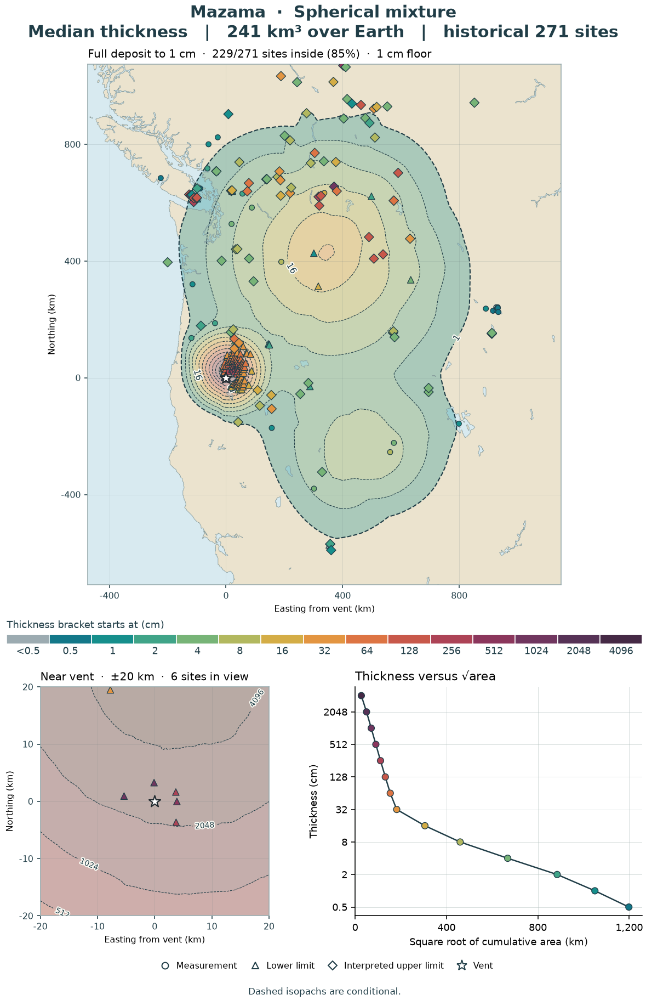
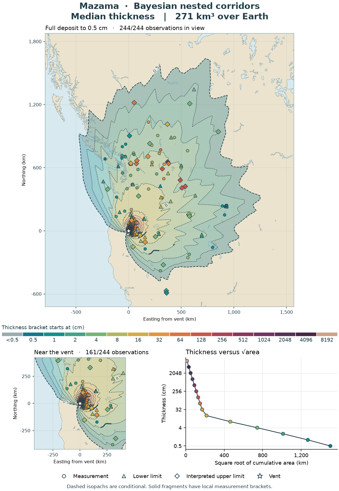
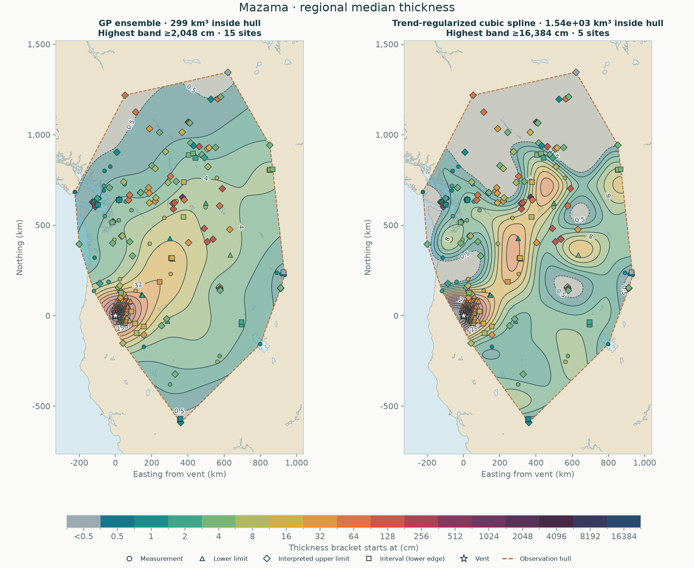
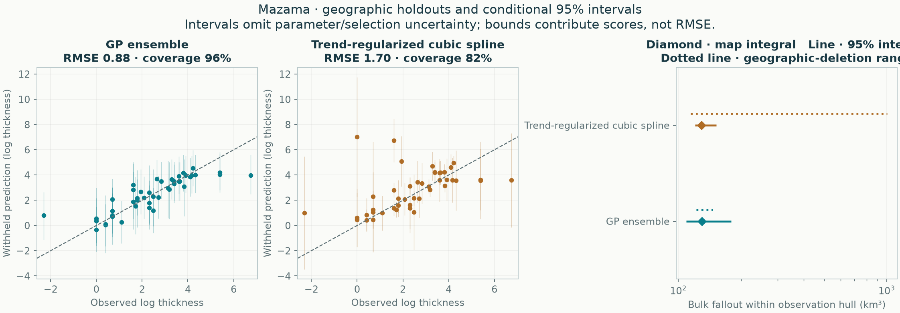

# Mazama fallout reconstruction

## Volumes and geographic prediction

Each volume integrates its method’s median-thickness map. The GP and spline cover the same observation hull. The other three methods cover Earth, including fallout below 0.5 cm. Conditional 95% intervals describe variation in whole-deposit volume across posterior draws.

| Method | Median-map volume (km³) | Conditional 95% interval (km³) | Held-out score ↓ | 95% coverage |
|---|---:|---:|---:|---:|
| GP ensemble | **409** | 332–835 | 1.166 | 74.1% |
| Cubic spline | **2,138** | 1.13e+03–4.72e+03 | 2.634 | 81.0% |
| [Directional ensemble](directional/README.md) | **332** | 257–1.04e+03 (provisional) | 0.813 † | 87.9% |
| [Spherical mixture](spherical-mixture/README.md) | **370** | 212–7.17e+03 | 1.000 | 72.4% |
| [Bayesian nested corridors](nested-isopachs/README.md) | **271** | 187–724 | 1.011 | 72.4% |

Lower scores indicate better predictions in withheld geographic regions. Coverage counts exact withheld measurements. A dagger marks a numerical or geographic validation warning. Provisional intervals retain their fit or integration warnings.

## Full deposits and near-vent detail

The outer line is 0.5 cm. Contours and observation colours double from there. All three methods use the same near-vent window for this eruption. Each curve counts the combined area of all patches at or above a thickness.







## Inside the observation hull



The dashed boundary encloses all accepted sites. Gaps inside it can still be poorly constrained.

[Volume and geographic prediction plot](overview.png)

## Regional fit details

All methods use the same accepted observations, geographic holdouts and integration area. No method is designated preferred.

**58 exact measurements, 153 lower bounds, 33 upper limits.** The observation hull covers 1,556,082 km². The automatic validation buffer is 6.40 km.


The full observation hull and every accepted location are in view. The coloured field is clipped to the exact hull; fine coastlines are context only. [Map frame and rendering provenance](map-display.json).

| Quantity | GP ensemble | Trend-regularized cubic spline |
|---|---:|---:|
| Principal median-map volume inside hull (km³) | 409.47 | 2138.33 |
| Conditional 95% volume interval (km³) | 332.36–835.00 | 1125.17–4716.92 |
| Outer equal-region negative log score ↓ | 1.166 | 2.634 |
| Outer log-thickness RMSE ↓ | 3.262 | 3.200 |
| Outer 95% observation-interval coverage | 74.1% | 81.0% |

Lower predictive score and RMSE are better. Coverage must be read with interval width and predictive score; wider intervals alone are not improvement.



## Scope

The footprint is the convex hull of measured/bounded locations, with no source point or invented observations added. It can contain large unsampled gaps and can exclude proximal deposits. These are **regional bulk fallout volumes, not total eruption volumes or dense-rock equivalents**. No global extrapolation enters this comparison.

Volume integrates pointwise median thickness over the observation hull. The interval uses the 2.5th and 97.5th percentiles of spatially correlated volume draws.

## Fitted methods

### GP ensemble

```json
{
  "candidate": {
    "tail": "stacked"
  },
  "components": [
    {
      "weight": 0.641510041124064,
      "model": {
        "candidate": {
          "tail": "power",
          "length_factor": 0.25,
          "noise_ratio": 1.5
        },
        "beta": [
          3.775238093396962,
          7.591052115881068,
          2.9997628887209427,
          4.0941651448151966
        ],
        "radius_scale_km": 692.0364043435014,
        "length_km": 146.35806286165646,
        "amplitude_log": 1.2069514418781737,
        "noise_log": 1.8104271628172606,
        "jitter": 1.4567317830518027e-09,
        "trend_on_constraint_boundary": false,
        "uncertainty": "conditional Laplace"
      }
    },
    {
      "weight": 0.358489958875936,
      "model": {
        "candidate": {
          "tail": "power",
          "length_factor": 1.5,
          "noise_ratio": 1.5
        },
        "beta": [
          3.775238093396962,
          7.591052115881068,
          2.9997628887209427,
          4.0941651448151966
        ],
        "radius_scale_km": 692.0364043435014,
        "length_km": 878.1483771699388,
        "amplitude_log": 1.2069514418781737,
        "noise_log": 1.8104271628172606,
        "jitter": 1.4567317830518027e-09,
        "trend_on_constraint_boundary": false,
        "uncertainty": "conditional Laplace"
      }
    }
  ],
  "dominant_tail": "power",
  "observation_discrepancy_variance_log": 4.059499213403358,
  "trend_on_constraint_boundary": false,
  "uncertainty": "Predictive mixture; includes disagreement among retained candidates, conditional on each fit and estimated weights. Fitted-parameter uncertainty is not integrated."
}
```

### Trend-regularized cubic spline

```json
{
  "method": "spline",
  "candidate": {
    "tail": "power",
    "knot_intervals": 6,
    "tension": 0.5,
    "smoothing": 0.01,
    "trend_strength": 1.0,
    "noise_ratio": 3.0
  },
  "bounds_km": [
    -300.0945890444195,
    -687.459353964966,
    992.9053834297671,
    1442.1579015925247
  ],
  "knot_intervals_xy": [
    4,
    6
  ],
  "n_coefficients": 63,
  "noise_log": 3.6208543256358787,
  "amplitude_log": 1.2069514418786262,
  "trend_beta": [
    3.775238751003492,
    7.591059557129289,
    2.9997686132808896,
    4.094170507417859
  ],
  "trend_radius_scale_km": 692.0364043435014,
  "trend_on_constraint_boundary": false,
  "effective_df_exact": 2.2318062153770235,
  "newton_decrement": 7.915336936583728e-17,
  "newton_iterations": 4,
  "quadrature_order": 6,
  "uncertainty": "Conditional Laplace",
  "uncertainty_omits": [
    "fitted trend",
    "noise and smoothing estimation",
    "knot/trend selection",
    "sampling and preservation bias",
    "vent location error"
  ],
  "pseudo_observations": 0
}
```

Every explored candidate is retained in the selection tables. All response-dependent choices are retuned within training folds; no hand-placed pseudo-data enter the likelihood.

## Reliability checks

- All probability intervals condition on fitted parameters and selected settings; they omit parameter/selection and preservation/sampling uncertainty.
- Four geographic outer folds evaluate the entire tuning procedure; this is development evidence, not independent external validation.
- Geographic-deletion volume ranges show refitting sensitivity and are not confidence intervals.
- GP ensemble: held-out 95% observation coverage is only 74.1%; uncertainty is undercovered.
- Trend-regularized cubic spline: held-out 95% observation coverage is only 81.0%; uncertainty is undercovered.

## Reproduce and inspect

```sh
tephra-isopachs compare Mazama --output results/new-regional-run
```

[Complete numerical report](report.json) · [Withheld predictions](heldout_predictions.csv) · [Accepted observation semantics](accepted_observations.csv) · [Selection tables](selection/README.md)

The JSON records input/source hashes, package versions, all fold memberships, regional integration refinements, conditional-volume sampling precision and geographic-deletion sensitivity. Historical GP global calculations remain separate.

## Which parts are actually supported?

Read the [local support and complete-contour audit](support/README.md) before extrapolating these hull volumes. It screens unsampled gaps, tests closure under geographic deletion, and separates interpolation from proximal/distal assumptions.
