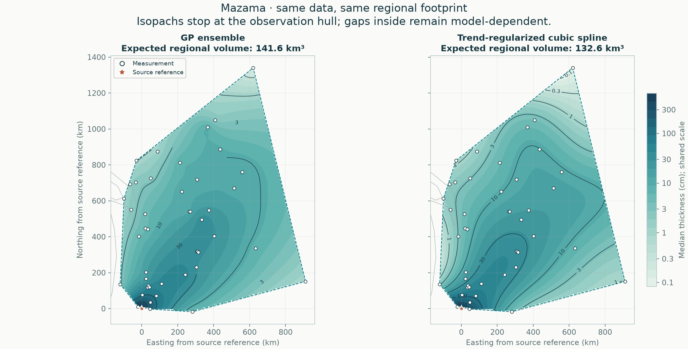
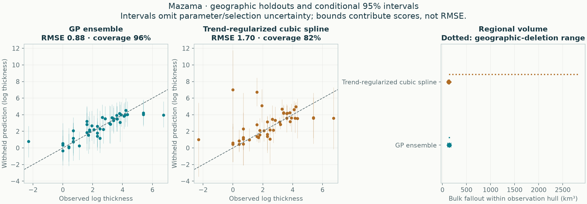

# Mazama: empirical methods on one regional footprint

All methods use the same accepted observations, geographic holdouts and integration area. No method is designated preferred.

**45 exact measurements, 0 lower bounds, 0 upper limits.** The observation hull covers 930,447 km². The automatic validation buffer is 66.22 km.



| Quantity | GP ensemble | Trend-regularized cubic spline |
|---|---:|---:|
| Expected regional bulk fallout (km³) | 141.64 | 132.61 |
| Integral of median thickness surface (km³) | 129.65 | 128.90 |
| Conditional 95% volume interval (km³) | 109.26–179.21 | 120.25–151.97 |
| Outer equal-region negative log score ↓ | 1.272 | 1.971 |
| Outer log-thickness RMSE ↓ | 0.884 | 1.700 |
| Outer 95% observation-interval coverage | 95.6% | 82.2% |

Lower predictive score and RMSE are better. Coverage must be read with interval width and predictive score; wider intervals alone are not improvement.



## Scope

The footprint is the convex hull of measured/bounded locations, with no source point or invented observations added. It can contain large unsampled gaps and can exclude proximal deposits. These are **regional bulk fallout volumes, not total eruption volumes or dense-rock equivalents**. No global extrapolation enters this comparison.

The mean volume integrates expected thickness. The median-surface integral is a separate quantity; it is not the median volume. Volume intervals come from complete correlated surface draws, not sums of pointwise interval endpoints.

## Fitted methods

### GP ensemble

```json
{
  "candidate": {
    "tail": "stacked"
  },
  "components": [
    {
      "weight": 0.31005095800345295,
      "model": {
        "candidate": {
          "tail": "exponential",
          "length_factor": 0.75,
          "noise_ratio": 0.75
        },
        "beta": [
          4.717198847480004,
          8.65193980723798,
          4.753527897128573,
          5.376543933599053
        ],
        "radius_scale_km": 553.2198097244386,
        "length_km": 346.8586337276871,
        "amplitude_log": 0.7986654127669229,
        "noise_log": 0.5989990595751922,
        "jitter": 6.378664415501594e-10,
        "trend_on_constraint_boundary": false,
        "uncertainty": "conditional Gaussian"
      }
    },
    {
      "weight": 0.5715383943378977,
      "model": {
        "candidate": {
          "tail": "power",
          "length_factor": 0.25,
          "noise_ratio": 0.25
        },
        "beta": [
          5.217819491801614,
          13.610660721558487,
          6.948797735450461,
          7.899979774941364
        ],
        "radius_scale_km": 553.2198097244386,
        "length_km": 115.6195445758957,
        "amplitude_log": 0.790949875206687,
        "noise_log": 0.19773746880167176,
        "jitter": 6.256017050894738e-10,
        "trend_on_constraint_boundary": false,
        "uncertainty": "conditional Gaussian"
      }
    },
    {
      "weight": 0.11841064765864946,
      "model": {
        "candidate": {
          "tail": "power",
          "length_factor": 1.5,
          "noise_ratio": 0.75
        },
        "beta": [
          5.217819491801614,
          13.610660721558487,
          6.948797735450461,
          7.899979774941364
        ],
        "radius_scale_km": 553.2198097244386,
        "length_km": 693.7172674553742,
        "amplitude_log": 0.790949875206687,
        "noise_log": 0.5932124064050153,
        "jitter": 6.256017050894738e-10,
        "trend_on_constraint_boundary": false,
        "uncertainty": "conditional Gaussian"
      }
    }
  ],
  "dominant_tail": "power",
  "observation_discrepancy_variance_log": 0.0,
  "trend_on_constraint_boundary": false,
  "uncertainty": "Predictive mixture; includes disagreement among retained candidates, conditional on each fit and estimated weights. Fitted-parameter uncertainty is not integrated."
}
```

### Trend-regularized cubic spline

```json
{
  "method": "spline",
  "candidate": {
    "tail": "power",
    "knot_intervals": 2,
    "tension": 0.0,
    "smoothing": 0.0001,
    "trend_strength": 1.0,
    "noise_ratio": 0.25
  },
  "bounds_km": [
    -171.54997973245918,
    -85.79501947513727,
    962.5499786089027,
    1407.8949640790706
  ],
  "knot_intervals_xy": [
    2,
    2
  ],
  "n_coefficients": 25,
  "noise_log": 0.19773746880169063,
  "amplitude_log": 0.7909498752067625,
  "trend_beta": [
    5.217819735996884,
    13.610663104407939,
    6.948799630064574,
    7.8999817745899215
  ],
  "trend_radius_scale_km": 553.2198097244386,
  "trend_on_constraint_boundary": false,
  "effective_df_exact": 16.196320280224153,
  "newton_decrement": 2.920018852230996e-25,
  "newton_iterations": 0,
  "quadrature_order": 6,
  "uncertainty": "Conditional Gaussian",
  "uncertainty_omits": [
    "fitted trend",
    "noise and smoothing estimation",
    "knot/trend selection",
    "sampling and preservation bias",
    "vent location error"
  ],
  "pseudo_observations": 0
}
```

Every explored candidate is retained in the selection tables. All response-dependent choices are retuned within training folds; no hand-placed pseudo-data enter the likelihood.

## Reliability checks

- All probability intervals condition on fitted parameters and selected settings; they omit parameter/selection and preservation/sampling uncertainty.
- Four geographic outer folds evaluate the entire tuning procedure; this is development evidence, not independent external validation.
- Geographic-deletion volume ranges show refitting sensitivity and are not confidence intervals.
- Trend-regularized cubic spline: held-out 95% observation coverage is only 82.2%; uncertainty is undercovered.

## Reproduce and inspect

```sh
tephra-isopachs compare Mazama --output results/new-regional-run
```

[Complete numerical report](report.json) · [Withheld predictions](heldout_predictions.csv) · [Accepted observation semantics](accepted_observations.csv) · [Selection tables](selection/README.md)

The JSON records input/source hashes, package versions, all fold memberships, regional integration refinements, conditional-volume sampling precision and geographic-deletion sensitivity. Historical GP global calculations remain separate.

## Which parts are actually supported?

Read the [local support and complete-contour audit](support/README.md) before extrapolating these hull volumes. It screens unsampled gaps, tests closure under geographic deletion, and separates interpolation from proximal/distal assumptions.
