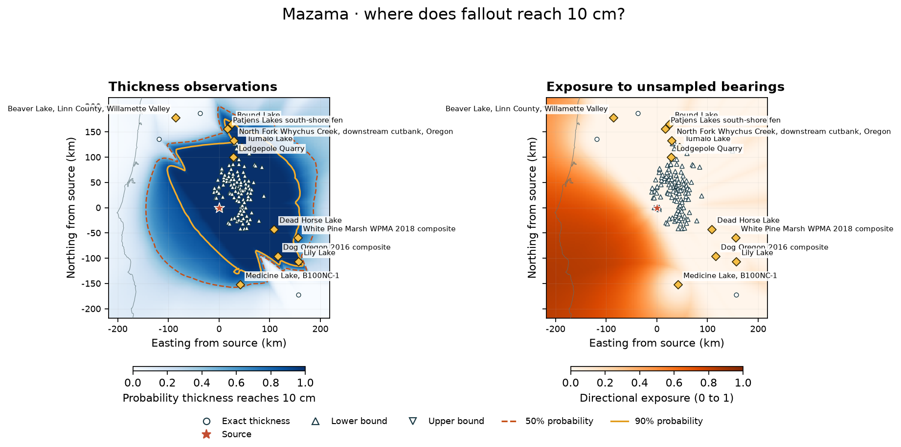

# Mazama · Directional ensemble

The principal bulk volume is **214 km³**, the whole-Earth integral of the median-thickness map. The conditional 95% interval for total fallout volume is **154–642 km³** across complete posterior draws. **Numerical warning on the fitted deposit distribution.**

Each circle shows a measurement. Bounded sites take the colour of their stated limit. The curve counts every patch at or above each thickness. The volume also includes thinner fallout beyond the 0.5 cm line. [Thickness and cumulative area](thickness-area.csv) · [Map integral, resolution and source hashes](deposit.json)

The principal map uses the geographic continuation evaluated on all registered eruptions. [Geographic holdouts, structural alternatives and numerical checks](extent/report.json) · [Complete contour decisions](extent/support.json.gz) · [Predictions at withheld observations](extent/heldout.csv.gz)

## Earlier continuation and its diagnostics

The following figures and statistics describe the fitted parent and its broader continuation. The principal estimate and its interval appear above.

## Reach from the volcano

Distances are great-circle kilometres to the first outward crossing on each compass ray. The area columns give the entire 10 cm footprint in the corresponding 45° sector, including detached areas. Together they distinguish a long point on a contour from an entire broad lobe.

| Bearing | Fixed 10 cm reach (km) | Uncertain 10 cm reach (km) | Fixed ≥10 cm area (km²) | Uncertain ≥10 cm area (km²) |
|---|---:|---:|---:|---:|
| N | 145.6 | 145.6 | 10,722 | 10,678 |
| NE | 198.2 | 198.1 | 16,047 | 16,020 |
| E | 187.0 | 186.4 | 14,673 | 14,573 |
| SE | 174.6 | 174.5 | 12,120 | 12,120 |
| S | 158.1 | 154.1 | 10,013 | 9,456 |
| SW | 165.3 | 150.4 | 10,378 | 8,770 |
| W | 153.3 | 144.3 | 9,257 | 8,274 |
| NW | 136.3 | 136.2 | 8,764 | 8,572 |

The 50% and 90% probability lines answer different questions. At a location on the 90% line, nine in ten model draws reach 10 cm. These are pointwise probabilities conditional on the model. Joint confidence over an entire region requires a different calculation.

## Withheld observations

Each row averages negative log predictive scores over equally weighted folds. Lower scores predict the withheld thicknesses and limits better. The passing-only columns exclude numerical failures. Coverage counts exact withheld thicknesses inside the uncertain-direction 95% predictive interval. A dash marks an unavailable score or coverage.

| Deletion | All estimable folds | Fixed | Uncertain | Passing folds | Fixed, passing | Uncertain, passing | Exact-site 95% coverage |
|---|---:|---:|---:|---:|---:|---:|---:|
| Geographic regions | 4 | 0.539 | 0.539 | 2 | 0.406 | 0.400 | 30/31 (96.8%) |
| Source quadrants | 3 | 0.574 | 0.583 | 1 | 0.717 | 0.725 | 30/31 (96.8%) |

[Predictions for every estimable held-out site](azimuth/heldout.csv). The numerical record includes all planned folds, row identities, unscorable directions, fit warnings and phase-integration checks.

## Inspected archives

The principal fit includes the interpreted upper limits below. Each core enters once. Other sites provide an occurrence check. The interval describes the modeled latent thickness at each site.

| Site | Interpreted upper limit (cm) | Median thickness (cm) | Conditional 95% interval (cm) |
|---|---:|---:|---:|
| Fish Lake | 5 | 5.28 | 1.63–11.1 |
| Jenny Lake, Wyoming | 54.5 | 0.674 | 0.187–1.68 |
| Tumalo Lake | 50 | 21.2 | 10.9–41.3 |
| Round Lake | 14 | 14.9 | 8.62–26.1 |
| Davis Lake | 6 | 3.58 | 1.91–7.32 |
| Bonaparte Meadows | 12 | 1.5 | 0.00317–3.05 |
| Twobit Creek | 8 | 1.14 | 0.11–2.51 |
| Lavington | 10 | 0.893 | 0.000751–1.84 |
| Independence Lake | 6 | 1.25 | 0.0453–2.8 |
| Lake Cleveland | 6 | 1.26 | 0.0351–2.75 |
| Jesmond Bog | 1 | 0.641 | 0.28–1.47 |
| Lofty Lake | 0.2 | 0.183 | 0.022–0.733 |
| Shadow Lake SL11C | 14 | 3.07 | 1.63–5.25 |
| Sunrise Lake UL11D | 8 | 3 | 1.6–5.15 |
| Round Lake A17/A18 composite, Washington | 60 | 1.6 | 0.00668–3.21 |
| Long Lake LOL14C composite, eastern Cascades | 7 | 3.03 | 0.822–6.02 |
| Cleland Lake F-09 intermediate core | 5 | 0.76 | 0.196–1.81 |
| Patjens Lakes south-shore fen | 4 | 15.6 | 8.65–28.9 |
| Dog Lake Oregon 2016 composite | 13 | 23 | 11.1–52.4 |
| White Pine Marsh WPMA 2018 composite | 30 | 14.4 | 6.97–30.8 |
| Skull Creek dunes, Catlow Valley | 5 | 6.32 | 3.02–13.5 |
| Deep Creek peat pit, North Okanagan | 5 | 0.839 | 0.00395–1.72 |
| Beaver Lake, Linn County, Willamette Valley | 2 | 4.01 | 1.89–8.66 |
| Medicine Lake, B100NC-1 | 13.75 | 11.3 | 2.65–28.5 |
| Mahoney Lake, deep basin | 63 | 1.25 | 0.00521–2.44 |
| Lodgepole Quarry | 50 | 65.9 | 39.1–120 |
| Simon Young Site 24 | 5 | 2.45 | 0.967–5.93 |
| Banff National Park, Saskatchewan Crossing | 25 | 0.47 | 0.000871–1.3 |
| Beverley | 5 | 0.292 | 0.0513–0.965 |
| South Saskatchewan River | 5 | 0.363 | 0.00653–3.95 |
| Willapa Canyon terrace, Brown Bear BB326-36-PC | 4 | 0.968 | 0.086–2.97 |
| Thunder Lake, North Cascades, Washington | 119.5 | 1.61 | 0.701–3.28 |
| Ridley Lake, North Cascades, Washington | 111 | 1.25 | 0.467–2.39 |
| Windy Lake, British Columbia | 86 | 1.02 | 0.0863–2.29 |
| Thunder Lake, Cariboo Mountains, British Columbia | 32 | 0.365 | 0.0111–0.96 |
| Redmountain Lake, British Columbia | 111 | 0.222 | 0.0617–0.669 |
| Dismal Lake, Idaho | 141 | 1.96 | 0.0918–14.3 |
| Rocky Ridge Lake, Idaho | 161 | 2.16 | 0.163–19.7 |
| Horseshoe Lake, Idaho | 211 | 1.96 | 0.157–19.3 |
| Lower Frozen Lake, British Columbia | 8 | 1.09 | 0.512–2 |
| Eagle Lake, Mount Revelstoke, British Columbia | 15 | 0.665 | 8.28e-06–1.54 |
| Mount Baker RS–15, Pratt Creek upstream of Ridley Creek | 20 | 3.8 | 1.59–9.59 |
| Mount Baker south-flank pits between Easton and Squak glaciers | 30 | 3.53 | 1.59–8.19 |
| Pocket Lake, Mount Baker | 38 | 3.69 | 1.59–8.94 |
| North Fork Whychus Creek, downstream cutbank, Oregon | 66 | 17.3 | 8.13–37.7 |
| Redfish Lake, RDF07-1A, Idaho | 8 | 2.25 | 1.25–3.97 |
| Redfish Lake, RDF07-4A, Idaho | 8 | 2.28 | 1.26–4.01 |
| Little Redfish Lake, LRFL08-02, Idaho | 8 | 2.29 | 1.27–4.04 |
| Pettit Lake | 6 | 2.14 | 1.14–3.84 |
| Marion Lake | 5 | 1.55 | 0.505–4.06 |
| Surprise Lake | 3.5 | 1.53 | 0.51–3.96 |
| Hager Pond | 105 | 1.82 | 0.719–4.23 |
| Waits Lake | 141 | 2.17 | 0.904–4.56 |
| Huff Lake | 1080 | 1.74 | 0.688–3.9 |
| Fish Lake Valley, Leidy Creek peat core 1 | 2 | 0.435 | 0.0537–1.99 |
| Fish Lake Valley, Leidy Creek peat core 7 | 2.5 | 0.439 | 0.0543–1.99 |
| Fish Lake Valley, Furnace Creek hand auger | 1 | 0.378 | 0.0397–1.84 |
| Lily Lake | 45 | 22 | 12.5–42 |
| Dead Horse Lake | 27 | 325 | 192–615 |
| Carp Lake | 4 | 4.1 | 0.172–8.66 |
| Copper Lake, core COPL1 | 1 | 0.651 | 0.161–1.62 |
| Lower Burstall Lake, core LBSL2 | 5 | 0.825 | 0.238–2.01 |
| Lake Louise, core LL1 | 7 | 0.587 | 0.104–1.53 |
| Sibbald Lake, core SIBL1 | 50 | 0.752 | 0.212–1.91 |
| Summit Lake, Waterton, core SUML1 | 143 | 0.864 | 0.1–3.58 |
| Begbie Lake, Greater Victoria water supply core | 1 | 0.938 | 0.429–1.82 |
| Sheep Mountain Bog | 42 | 1.43 | 0.112–17.7 |
| Matheson Lake | 313 | 1.24 | 0.53–2.61 |
| Dailey Lake Bog | 345 | 1.95 | 0.789–3.97 |
| Starvation Flat bog | 210 | 1.93 | 0.779–3.99 |
| Prior Lake | 127 | 1.2 | 0.573–2.36 |
| Pike Lake  | 329 | 1.17 | 0.559–2.31 |
| Maltby Lake  | 244 | 1.15 | 0.55–2.27 |
| Upper Kananaskis Lake | 2 | 0.874 | 0.262–2.18 |
| Frederick Lake | 28 | 0.738 | 0.205–1.89 |
| Johnson Lake | 156 | 0.701 | 0.194–1.71 |
| Nordegg Bridge | 5 | 0.392 | 0.00594–1.19 |
| Hasse Lake | 1 | 0.273 | 0.0335–0.958 |
| Lake of the Woods, Cathedral Park core A12 | 4 | 1.27 | 0.071–2.51 |
| Pyramid Lake, Cathedral Park core B7b | 20 | 1.27 | 0.072–2.52 |
| Glacier Lake, Cathedral Park core C5 | 13 | 1.27 | 0.0764–2.51 |
| Quiniscoe Lake, Cathedral Park core D8 | 28 | 1.26 | 0.0751–2.51 |
| E.L. Smith project, southwest Edmonton | 100 | 0.296 | 0.0504–0.978 |
| Goldeye Lake, winter 1981 lake core | 575 | 0.387 | 0.00239–1.18 |
| Mt. Kobau Lake near Osoyoos | 10 | 1.33 | 0.00719–2.57 |
| Mica Creek, Columbia River peat terrace | 5 | 0.453 | 0.000715–1.12 |
| West Calgary, Harrison high-terrace pit | 5 | 0.732 | 0.199–1.98 |
| Upper Elk Valley terrace, north of Elkford | 10 | 0.919 | 0.264–2.17 |
| Kilpoola Lake, 1996 core 2 | 33 | 1.38 | 0.00276–2.69 |
| Frog Lake, Greater Victoria water supply core | 225 | 1.15 | 0.501–2.42 |
| Swanson Lake, Greater Victoria water supply core | 268 | 0.932 | 0.42–1.85 |
| Worley Lake, Greater Victoria water supply core | 190 | 0.878 | 0.386–1.76 |
| Stowell Lake, Salt Spring Island | 2 | 0.716 | 0.251–1.92 |
| Jenny Lake, JEN13-2E | 4 | 0.674 | 0.19–1.68 |
| Jenny Lake, JEN15-3A | 63 | 0.675 | 0.188–1.68 |
| Jenny Lake, JEN16-1A | 48 | 0.674 | 0.189–1.68 |
| Jenny Lake, JEN16-2 | 54 | 0.675 | 0.19–1.68 |
| On-off Lake core 08-Onoff02 | 82 | 0.264 | 0.0532–0.722 |
| NEL01, small lake near Nelson | 6 | 1.23 | 0.394–2.56 |
| NEL03, subalpine lake near Nelson | 27 | 1.32 | 0.472–2.77 |
| Castor Lake, 2003 recovery | 30 | 1.64 | 0.000843–3.19 |
| Foy Lake, core A, drive 4 | 8 | 1.28 | 0.0585–9.12 |
| Foy Lake, core C | 109 | 1.28 | 0.0585–9.13 |
| Simon Young Site 22 | Occurrence only | 0.441 | 0.0546–2.21 |
| Osgood Swamp | Occurrence only | 0.454 | 0.000114–4.11 |
| Simon Young Site 21 | Occurrence only | 0.843 | 0.33–3.01 |
| Paisley Cave | Occurrence only | 23.6 | 11.5–47.7 |
| Toketee Falls | Occurrence only | 101 | 51.4–201 |
| Prineville Reservoir | Occurrence only | 13.3 | 6.17–29.2 |
| Simon Young Site 20 | Occurrence only | 0.478 | 0.136–1.36 |
| Mitchell | Occurrence only | 7.52 | 3.4–15.9 |
| West Stayton | Occurrence only | 3.15 | 1.26–8.01 |
| Hubbard | Occurrence only | 2.97 | 1.49–5.89 |
| Palouse Falls | Occurrence only | 2.94 | 1.09–5.8 |
| Lake Superior | Occurrence only | 0.0164 | 0.00039–0.544 |
| Simon Young Site 19 | Occurrence only | 0.681 | 0.0185–16.6 |
| Arrow Lake | Occurrence only | 2.53 | 1.38–5.19 |
| Bow Lake | Occurrence only | 2.53 | 1.39–5.13 |
| Galata | Occurrence only | 0.647 | 0.00455–15.7 |
| Rithets Bog, Vancouver Island | Occurrence only | 1.26 | 0.591–2.55 |
| Nordans Pond bog | Occurrence only | 3.52e-05 | 1.69e-09–0.996 |
| Burnaby Lake | Occurrence only | 1.27 | 0.535–2.93 |
| Lower Arrow Lake | Occurrence only | 1.28 | 0.338–2.68 |
| Fraser Canyon | Occurrence only | 1.1 | 0.507–1.97 |
| Friday's Site | Occurrence only | 0.421 | 0.00137–9.67 |
| Drynoch Slide Archaeological Site | Occurrence only | 0.808 | 0.33–1.66 |
| Chase | Occurrence only | 0.651 | 0.025–1.5 |
| Cobb Lake, Kootenay National Park | Occurrence only | 0.858 | 0.253–2 |
| Bow River | Occurrence only | 0.736 | 0.2–1.85 |
| Lake Louise | Occurrence only | 0.587 | 0.104–1.53 |
| James Pass | Occurrence only | 0.536 | 0.117–1.43 |
| Goldeye Lake Fen | Occurrence only | 0.387 | 0.00239–1.18 |
| Boss Hill near Buffalo Lake | Occurrence only | 0.409 | 0.0812–1.31 |
| Upper Pinto Fen | Occurrence only | 0.209 | 0.000255–0.93 |
| Keephills Fen | Occurrence only | 0.264 | 0.023–0.949 |
| GISP2, Greenland | Occurrence only | 8.43e-06 | 4.42e-10–0.00438 |
| Camp Century, Greenland | Occurrence only | 9.5e-06 | 3.05e-26–0.00496 |
| Lake Superior, Isle Royale core | Occurrence only | 0.0192 | 0.000441–1.14 |
| Bloomingdale Bog | Occurrence only | 0.00094 | 6.49e-06–0.0497 |
| Sidney Bog core2 | Occurrence only | 0.000662 | 2.04e-06–0.0671 |
| Thin-Ice Pond | Occurrence only | 0.000402 | 6.37e-07–0.0655 |
| Balsam Creek kettle lake, BCK-284 | Occurrence only | 0.0039 | 3.29e-05–0.242 |
| NGRIP ice core | Occurrence only | 4.78e-06 | 1.01e-15–0.00415 |
| Placentia Bay AI07-10G | Occurrence only | 4.8e-05 | 1.12e-08–0.687 |
| Redden Springs central wetland | Occurrence only | 0.835 | 0.102–5.93 |
| North Redden Springs | Occurrence only | 0.843 | 0.108–5.88 |
| An Loch Mor, Inis Oirr, MOR-T12 | Occurrence only | 3.25e-08 | 1.06e-17–0.000276 |
| Nuangola Lake | Occurrence only | 0.000215 | 8.74e-07–0.0282 |
| Pound Cove Bog | Occurrence only | 3.52e-05 | 1.65e-09–0.999 |
| Southwest Pond Bog | Occurrence only | 3.56e-05 | 1.85e-09–0.993 |
| Beaver Lake | Occurrence only | 0.91 | 0.31–2.15 |
| Lake Sawyer | Occurrence only | 2.7 | 1.5–5.08 |
| Tarboo Lake | Occurrence only | 1.85 | 0.974–4.01 |
| Bull Run Lake | Occurrence only | 5.79 | 2.86–10.6 |
| Felker Lake, core FEL01 | Occurrence only | 0.461 | 0.164–1.23 |
| Young Table 1.1 distal site 1 | Occurrence only | 3.13 | 1.24–8.04 |
| Young Table 1.1 distal site 2 | Occurrence only | 3.02 | 1.53–5.96 |
| Young Table 1.1 distal site 17 | Occurrence only | 0.557 | 0.00272–15.2 |
| Young Table 1.1 distal site 19 | Occurrence only | 0.686 | 0.0204–16.9 |
| Young Table 1.1 distal site 20 | Occurrence only | 0.48 | 0.128–1.36 |
| Young Table 1.1 distal site 21 | Occurrence only | 0.882 | 0.357–2.8 |
| Young Table 1.1 distal site 22 | Occurrence only | 0.448 | 0.0498–2.26 |
| Young Table 1.1 distal site 25 | Occurrence only | 0.374 | 3.5e-05–3.83 |
| Dry Meadow fen | Occurrence only | 1.25e+03 | 650–3.13e+03 |
| Crooked Meadow fen | Occurrence only | 1.22e+03 | 634–3.04e+03 |
| FSLR 460 fen | Occurrence only | 1.17e+03 | 622–2.81e+03 |
| Johnson Meadow fen | Occurrence only | 1.27e+03 | 693–2.93e+03 |
| Jack Creek at Skookum Butte fen | Occurrence only | 1.21e+03 | 686–2.66e+03 |
| Kootenai 24LN1125 A-776 BCV3 | Occurrence only | 1.07 | 0.194–2.78 |
| Kootenai canyon, 24LN1020 Jennings | Occurrence only | 1.07 | 0.194–2.78 |
| Sasquatch Lake NEL02 | Occurrence only | 1.17 | 0.371–2.47 |
| On-off Lake core 08-Onoff01 | Occurrence only | 0.264 | 0.0532–0.722 |
| On-off Lake core 08-Onoff03 | Occurrence only | 0.264 | 0.0532–0.722 |
| Friday's Site, UA 2704 | Occurrence only | 0.421 | 0.00137–9.67 |
| Bow River ~2 km downstream from Lac des Arcs, UA 2820 | Occurrence only | 0.736 | 0.2–1.85 |
| Bow River ~2 km downstream from Lac des Arcs, UA 2821 | Occurrence only | 0.736 | 0.2–1.85 |
| James Pass, UA 2701 | Occurrence only | 0.536 | 0.117–1.43 |
| James Pass, UA 2702 | Occurrence only | 0.536 | 0.117–1.43 |
| James Pass peel, UA 2851 | Occurrence only | 0.536 | 0.117–1.43 |
| James Pass peel, UA 2854 | Occurrence only | 0.536 | 0.117–1.43 |
| Battle River/Iron Creek valley, UA 2927 | Occurrence only | 0.243 | 0.0194–1.19 |
| Battle River/Iron Creek valley, UA 2928 | Occurrence only | 0.244 | 0.0204–1.19 |
| Brule Lake , UA 2906 | Occurrence only | 0.247 | 0.000114–0.973 |
| Maskuta Creek, Hinton, UA 2930 | Occurrence only | 0.242 | 5.04e-05–0.952 |
| near Grand Cache, UA 2861 | Occurrence only | 0.162 | 0.00343–0.694 |
| near Grand Cache, UA 2858 | Occurrence only | 0.156 | 0.00159–0.73 |
| Boss Hill Site (Buffalo Lake), UA 2963 | Occurrence only | 0.409 | 0.0812–1.31 |
| On-Off Lake (Castle Creek Glacier), Jensen S1 literature entry | Occurrence only | 0.265 | 0.0531–0.722 |
| Frenchman River Valley near Val Marie, Jensen S1 literature entry | Occurrence only | 0.286 | 0.00227–14.1 |
| Effingham Inlet, west coast Vancouver Island, Jensen S1 literature entry | Occurrence only | 0.43 | 0.111–1.86 |
| Lake Stowell, Saltspring Island, Jensen S1 literature entry | Occurrence only | 0.716 | 0.251–1.92 |
| Dog Lake, Kootenay National Park, Jensen S1 literature entry | Occurrence only | 0.814 | 0.238–1.9 |
| Upper Pinto Fen on Highway 40, Jensen S1 literature entry | Occurrence only | 0.209 | 0.000308–0.911 |
| Ponoka buried soil, Ivarson 1972 | Occurrence only | 0.418 | 0.0875–1.29 |

## Checks and reproducibility

The shared contour audit found eligible bands under none of the screened support policies. Audit status is completed. [All contour decisions and deletion failures](azimuth/complete-contour-audit.json)

The spatial integration check passed at 32,768 points per scramble. The map used up to 128 posterior draws per chain and structure. Resolved contour areas passed the split-packet check. The joint-volume quantiles passed the split check.

Full-fit sampling warnings occurred for possible_missing_fan.

[Numerical report, all sector volumes and sensitivities](azimuth/report.json) · [Complete fields and per-field volumes](azimuth/fields.npz) · [Principal map grids](azimuth/median-grids.npz) · [Near-source comparison grids](azimuth/map-grid.npz) · [Fragment decisions](azimuth/fragment-decisions.csv) · [Bracketed coordinates](azimuth/bracketed-fragments.csv) · [File hashes](azimuth/artifacts.json)

## Related directional studies

- [Earlier fixed-direction ensemble and its separate calibration](ensemble/README.md)
- [Single-structure and proximal-cap sensitivities](single-structure/README.md)
- [Measured-fan continuation and inspected-site evidence](bearing/README.md)
