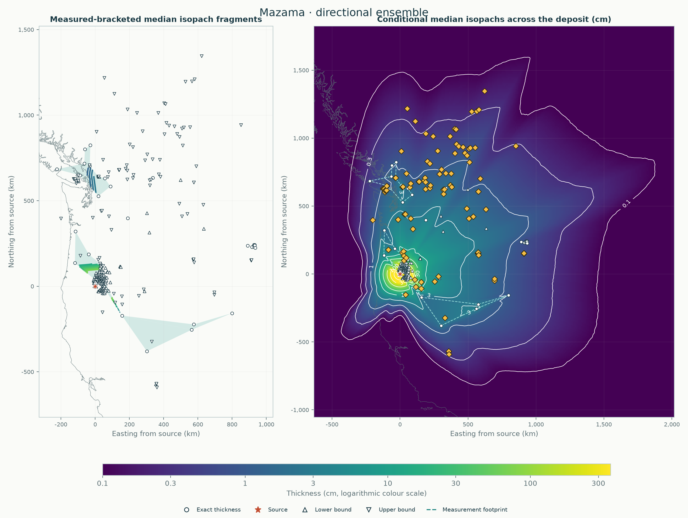
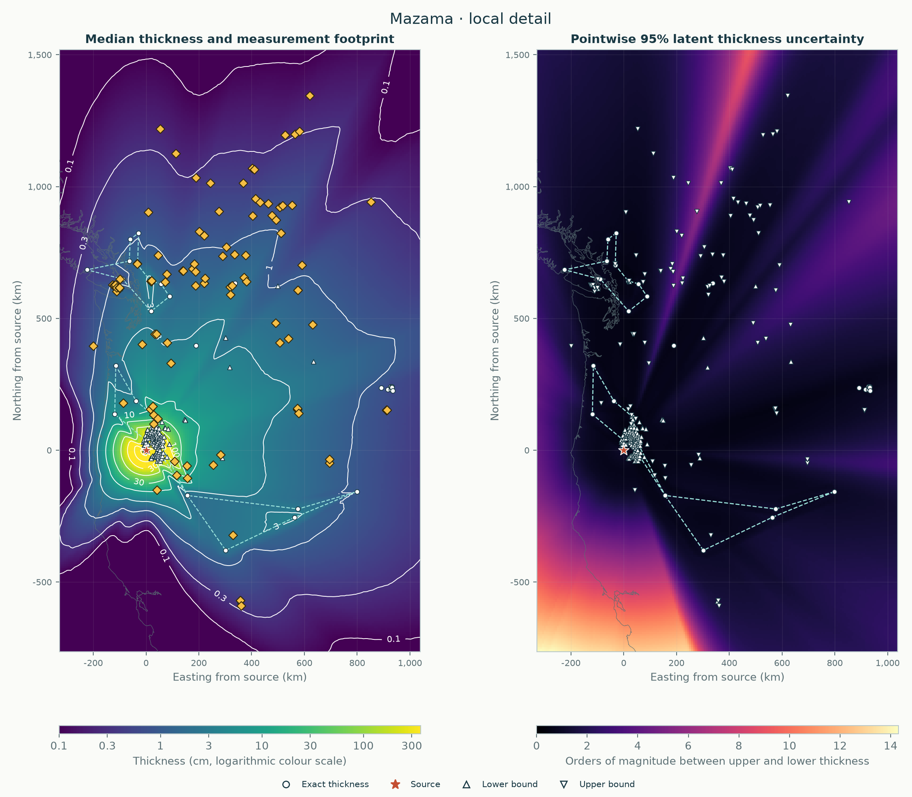

# Mazama · fixed-direction ensemble

**224.3 km³ of bulk fallout** is the whole-Earth integral of the median thickness map below. The conditional 95% volume interval is **166.0–622.8 km³**.

The measured triangles contain **34.0 km³** (15.1%) of the median map. The remaining volume depends on how thickness continues through gaps, toward the vent and beyond the sites. Each mapped contour encloses the median thickness level. Lobes and holes can remain separate.

The star marks the supplied vent. Its median thickness is 2,159.0 cm. The largest median thickness on the two display grids is 4,399.0 cm at a source distance of 11.4 km. The evidence panel contains 38 measured-bracketed triangle and level pairs. The right panel includes conditional continuation.

## Direction and observational support

| Direction | Exact rows | Bounds | Median-map volume (km³) | Conditional 95% volume interval (km³) |
|---|---:|---:|---:|---:|
| N | 13 | 89 | 18.6 | 13.9–30.0 |
| NE | 3 | 89 | 38.6 | 28.6–236.0 |
| E | 11 | 36 | 44.5 | 32.3–83.4 |
| SE | 3 | 22 | 28.7 | 18.7–62.0 |
| S | 0 | 1 | 27.6 | 12.6–82.6 |
| SW | 0 | 0 | 28.8 | 13.3–214.9 |
| W | 0 | 1 | 26.0 | 11.6–72.6 |
| NW | 1 | 2 | 11.3 | 6.8–23.5 |

| Domain | Median-map volume (km³) | Conditional 95% volume interval (km³) |
|---|---:|---:|
| Measured triangles | 34.0 | 22.6–65.7 |
| Transition at triangle edges | 75.7 | 49.3–143.9 |
| Proximal background | 42.6 | 14.8–120.7 |
| Background between sampled radii | 64.9 | 45.0–147.9 |
| Distal background | 7.1 | 3.7–290.9 |

The median-map entries add to its global volume before rounding. Each simulated deposit uses one structure everywhere. Pointwise thickness bounds describe uncertainty at a location. The volume interval comes from integrating each complete field.

## Assumptions and weights

| Fan half-width | Additional fan in largest distal gap | Predictive weight | Conditional 95% volume interval (km³) | Fit and mass checks |
|---:|---|---:|---:|---|
| 22.5° | Absent from this structure | 16.1% | 201.8–591.0 | passed |
| 45° | Absent from this structure | 15.7% | 155.9–429.7 | passed |
| 90° | Absent from this structure | 12.3% | 153.2–420.5 | passed |
| 22.5° | Possible | 15.7% | 212.8–814.3 | passed |
| 45° | Possible | 21.2% | 164.2–676.6 | **review** |
| 90° | Possible | 18.9% | 169.1–642.3 | passed |

Equal weights give a median-map volume of **223.8 km³**. Restricting to the three structures without an extra fan gives **219.6 km³**. Allowing an extra fan in all three gives **233.7 km³**. These possibilities share the same observations. A fan missed entirely by sampling remains weakly identified.

Independent calibration cases with usable folds were tambora, aso-4, b-tm, ytt, minoan. Weights describe held-out thickness prediction. They depend on the small eruption catalogue.

## Validation and numerical checks

| Held-out design | Rows scored | Ensemble score ↓ | Equal weights ↓ | Single reference ↓ | Exact-site 95% coverage |
|---|---:|---:|---:|---:|---:|
| Geographic | 271/271 | 0.550 | 0.548 | 0.670 | 93.5% |
| Quadrants | 271/271 | 0.582 | 0.581 | 0.632 | 96.8% |

Geographic sampling warnings occurred in folds 0, 2. All four folds produced predictions.

Quadrants sampling warnings occurred in folds 1, 3. Unscored folds were 2 (empty).

Full-data structures requiring numerical review were possible missing fan. The whole-Earth spatial check passed using 32,768 points in each of two scrambles. The interleaved posterior-draw check passed (largest change 0.4%). The resolved isopach-area split checks passed. The independent same-fields mean-integral discrepancy was 0.01%.

The shared complete-contour audit found **0 qualifying policies out of 3**. The conditional global estimate remains sensitive to preservation, source-region thickness, distal thinning and possible unseen fans.

[Numerical report, fold identities and weight sensitivity](report.json) · [Complete contour decisions](complete-contour-audit.json) · [All fragment decisions](fragment-decisions.csv) · [Mapped fragment vertices](supported-fragments.csv) · [Held-out predictions](heldout.csv)

[Reconstruct the median field](map-fields.npz) · [Map grids and pointwise quantiles](median-grids.npz) · [Joint volume by chain, support class and compass sector](coherent-mass.npz) · [Checksums](artifacts.json)
