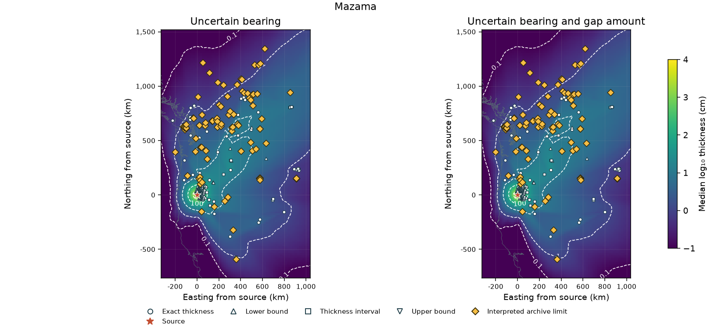

# Mazama · Uncertain amount of fallout in unsampled bearings

The conditional 95% volume interval for this sensitivity is 208.1–1,410.1 km³.

One amount multiplier is shared by the entire deposit. Its influence increases with the existing measure of unsupported bearing and vanishes at training sites. The quarter, unchanged and fourfold factors are structural scenarios. An unvisited bearing supplies no measurement of that amount.

Matched buffered geographic scores averaged 0.771 under the reference and 0.766 under the candidate. Smaller values indicate better site predictions. Both scores use the same posterior subset within each fold.

Numerical and parent sampling checks together **retained warnings**. The output includes every attempted fold and its parent status.

Dashed lines show model contours in the survey window. Both global volumes use the complete Earth. [Posterior checks, assumptions and per-site scores](report.json)
