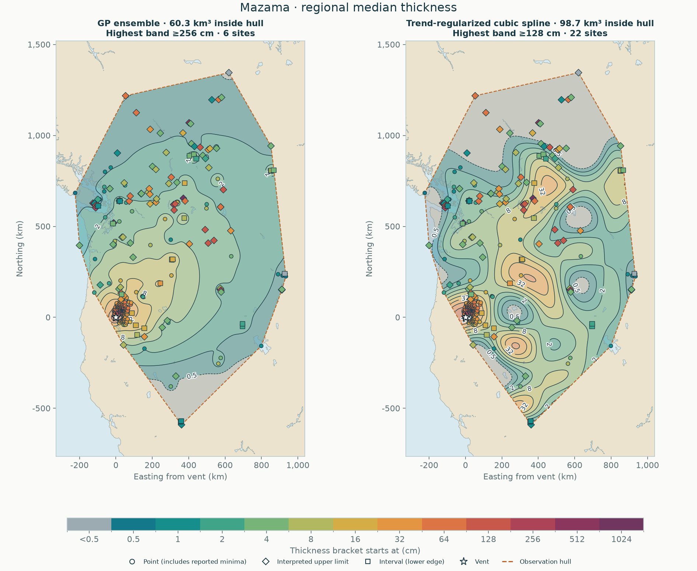
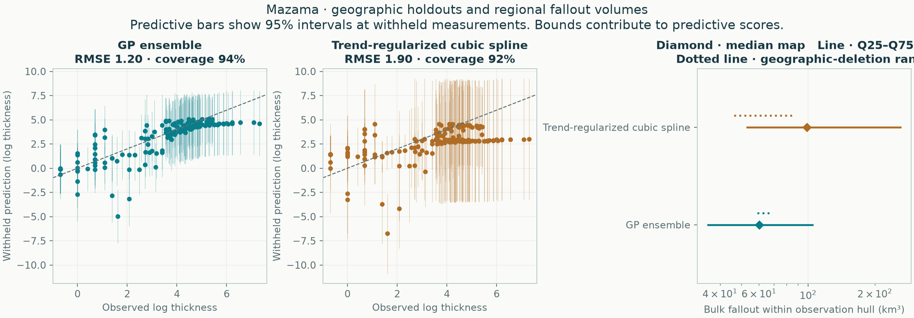

# Mazama: empirical methods on one regional footprint

All methods use the same accepted observations, geographic holdouts and integration area. No method is designated preferred.

**46 reported measurements and 129 reported minima fitted as points, 0 lower-censored fits, 96 upper limits, 29 two-sided intervals.** The observation hull covers 1,549,105 km². The automatic validation buffer is 6.50 km.



The full observation hull and every accepted location are in view. The coloured field is clipped to the exact hull; fine coastlines are context only. [Map frame and rendering provenance](map-display.json).

| Quantity | GP ensemble | Trend-regularized cubic spline |
|---|---:|---:|
| Principal median-map volume inside hull (km³) | 60.28 | 98.71 |
| Integrated Q25–Q75 thickness (km³) | 34.94–105.42 | 52.58–263.49 |
| Outer equal-region negative log score ↓ | 1.410 | 1.776 |
| Outer log-thickness RMSE ↓ | 1.200 | 1.900 |
| Outer 95% observation-interval coverage | 94.3% | 92.0% |

Lower predictive score and RMSE are better. Coverage must be read with interval width and predictive score; wider intervals alone are not improvement.



## Scope

The footprint is the convex hull of measured/bounded locations, with no source point or invented observations added. It can contain large unsampled gaps and can exclude proximal deposits. These are **regional bulk fallout volumes, not total eruption volumes or dense-rock equivalents**. No global extrapolation enters this comparison.

Volume integrates pointwise median thickness over the observation hull. The endpoints integrate the pointwise 25th and 75th percentiles of latent thickness over that same area. [Band integrals and refinements](thickness-bands.json)

## Fitted methods

### GP ensemble

```json
{
  "candidate": {
    "tail": "stacked"
  },
  "components": [
    {
      "weight": 1.0,
      "model": {
        "candidate": {
          "tail": "power",
          "length_factor": 0.25,
          "noise_ratio": 1.5
        },
        "beta": [
          5.893380999108541,
          3.065448451458463,
          0.7027053286237989,
          0.8008642162958024
        ],
        "radius_scale_km": 66.41836983978844,
        "length_km": 28.26973405454385,
        "amplitude_log": 0.9384691172031917,
        "noise_log": 1.4077036758047876,
        "jitter": 8.80724283944138e-10,
        "trend_on_constraint_boundary": true,
        "uncertainty": "conditional Laplace"
      }
    }
  ],
  "dominant_tail": "power",
  "observation_discrepancy_variance_log": 0.22687444470472695,
  "trend_on_constraint_boundary": true,
  "uncertainty": "Predictive mixture; includes disagreement among retained candidates, conditional on each fit and estimated weights. Fitted-parameter uncertainty is not integrated."
}
```

### Trend-regularized cubic spline

```json
{
  "method": "spline",
  "candidate": {
    "tail": "exponential",
    "knot_intervals": 12,
    "tension": 1.0,
    "smoothing": 0.01,
    "trend_strength": 1.0,
    "noise_ratio": 0.75
  },
  "bounds_km": [
    -281.69991384821117,
    -687.4593539649622,
    992.029446515662,
    1442.157901592529
  ],
  "knot_intervals_xy": [
    7,
    12
  ],
  "n_coefficients": 150,
  "noise_log": 0.8002651054887286,
  "amplitude_log": 1.0670201406516382,
  "trend_beta": [
    4.589257629476047,
    0.7037193714249421,
    0.3386922639381127,
    0.3234296453600839
  ],
  "trend_radius_scale_km": 66.41836983978844,
  "trend_on_constraint_boundary": false,
  "effective_df_exact": 25.19703547917569,
  "newton_decrement": 1.3801459428090336e-24,
  "newton_iterations": 7,
  "quadrature_order": 6,
  "uncertainty": "Conditional Laplace",
  "uncertainty_omits": [
    "fitted trend",
    "noise and smoothing estimation",
    "knot/trend selection",
    "sampling and preservation bias",
    "vent location error"
  ],
  "pseudo_observations": 0
}
```

Every explored candidate is retained in the selection tables. All response-dependent choices are retuned within training folds; no hand-placed pseudo-data enter the likelihood.

## Reliability checks

- All probability intervals condition on fitted parameters and selected settings; they omit parameter/selection and preservation/sampling uncertainty.
- Four geographic outer folds evaluate the entire tuning procedure; this is development evidence, not independent external validation.
- Geographic-deletion volume ranges show refitting sensitivity and are not confidence intervals.
- Spline selection reaches an explored search boundary: knot_intervals. This is a bounded-grid result, not proof of a continuous optimum.

## Reproduce and inspect

```sh
tephra-isopachs compare Mazama --output results/new-regional-run
```

[Complete numerical report](report.json) · [Withheld predictions](heldout_predictions.csv) · [Accepted observation semantics](accepted_observations.csv) · [Selection tables](selection/README.md)

The JSON records input/source hashes, package versions, all fold memberships, regional integration refinements, conditional-volume sampling precision and geographic-deletion sensitivity. Historical GP global calculations remain separate.

## Which parts are actually supported?

Read the [local support and complete-contour audit](support/README.md) before extrapolating these hull volumes. It screens unsampled gaps, tests closure under geographic deletion, and separates interpolation from proximal/distal assumptions.
