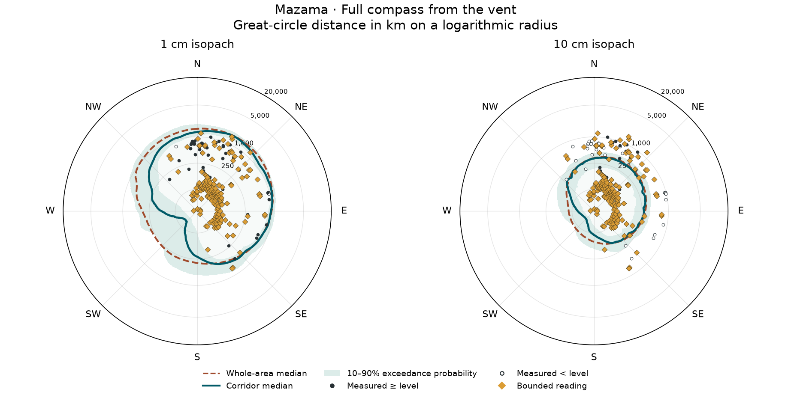

# Mazama · Bayesian nested corridors

The principal bulk volume is **271 km³**, the whole-Earth integral of the median-thickness map. The conditional 95% interval for total fallout volume is **187–724 km³** across complete posterior draws.

Each circle shows a measurement. Bounded sites take the colour of their stated limit. The curve counts every patch at or above each thickness. The volume also includes thinner fallout beyond the 0.5 cm line. [Thickness and cumulative area](thickness-area.csv) · [Map integral, resolution and source hashes](deposit.json)

The principal map uses the geographic continuation evaluated on all registered eruptions. [Geographic holdouts, structural alternatives and numerical checks](extent/report.json) · [Complete contour decisions](extent/support.json.gz) · [Predictions at withheld observations](extent/heldout.csv.gz)

## Earlier continuation and its diagnostics

The following figures and statistics describe the fitted parent and its broader continuation. The principal estimate and its interval appear above.

The buffered geographic score is 0.918 for the corridor and 0.858 for the whole-area sensitivity. Lower scores indicate better predictions at withheld sites. The corridor’s 95% predictive intervals cover 43 of 58 exact withheld readings. 4 of 4 geographic fits passed their sampling checks. The full-data proposal and importance check passed, the final volume populations passed, and the integration check passed. The shared screen accepted a complete contour band under 0 policies. [Prediction scores and row identities](report.json) · [Full fit diagnostics](full.json)

## Where the volume lies

The full-compass view includes all bearings through the antipode. Its logarithmic distance scale makes the proximal flanks visible. Areas in the table use the physical equal-area integral.

| Compass sector | Exact sites | Bounded sites | Corridor 1 cm area (km²) | Whole-area 1 cm area (km²) | Corridor conditional 95% volume interval (km³) |
|---|---:|---:|---:|---:|---:|
| N | 31 | 56 | 655,938 | 894,435 | 44.0–164.9 |
| NE | 10 | 73 | 716,195 | 885,990 | 67.1–223.1 |
| E | 13 | 30 | 378,854 | 392,718 | 36.7–176.5 |
| SE | 3 | 22 | 117,655 | 117,542 | 12.5–102.9 |
| S | 0 | 1 | 23,473 | 39,047 | 1.2–71.7 |
| SW | 0 | 0 | 715 | 29,349 | 0.088–32.3 |
| W | 0 | 1 | 9,498 | 64,268 | 0.5–73.0 |
| NW | 1 | 3 | 181,288 | 470,565 | 6.2–103.7 |

At 1 cm, the corridor median map encloses 2,083,616 km² and the whole-area sensitivity encloses 2,893,914 km². Of these, 1,837,995 and 2,648,293 km² fall outside the retained exact-site triangles. An unsampled sector can contain ash. Its allocation depends on the assumed continuation.

The prior assigns 25% to continuation across all bearings. The remaining probability spans three fan widths and three down-range extensions. The fitted probability of whole-bearing continuation is 19.2%. The widths and extensions are shared structural assumptions. A bound supplies a likelihood event. Only positive evidence supplies a potential dispersal corridor.

[Volume and sector draws](volume-budget.npz) · [Complete field draws](full.npz) · [Areas, assumptions, bounds and diagnostics](report.json)

## Structural uncertainty

[Corridor and whole-area maps on a common scale](paired-isopachs.png)

| Prior probability of broad continuation | Conditional 95% volume interval (km³) |
|---:|---:|
| 10% | 204.4–706.6 |
| 25% | 208.7–728.8 |
| 50% | 213.2–769.0 |
| 75% | 221.0–775.9 |

The prior odds vary under the same observed likelihood. The numerical report also gives the volume by individual corridor law where the saved draws resolve it.

[Whole-area sensitivity report, posterior and diagnostics](../nested-whole-area/README.md)
