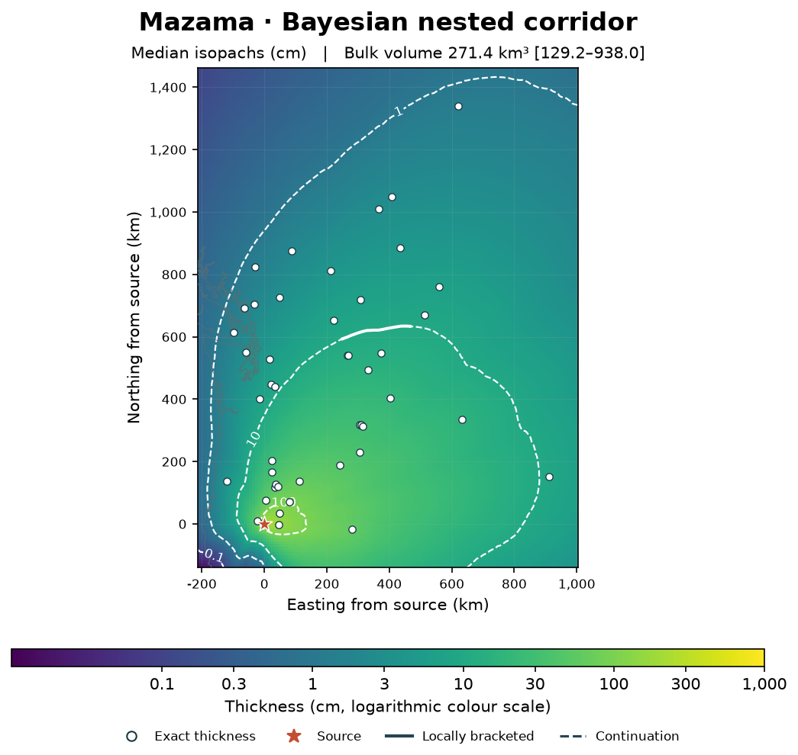

# Mazama · Bayesian nested isopachs

The principal corridor estimate of bulk fallout is **271.4 km³** (conditional 95% interval **129.2–938.0**). The median thickness map integrates to 244.6 km³. The whole-area sensitivity gives 411.2 km³ (162.2–1,663.6).

Solid portions cross a retained triangle with thicknesses on either side at distinct measured sites and at least 90% posterior crossing probability. Dashed portions depend on the continuation. The triangles diagnose spatial coverage. The shared contour screen also checks thickness bracketing and deletion stability. [Whole-Earth field](world.png) · [Every local bracket](local-brackets.csv.gz) · [Complete contour checks](support.json)

The buffered geographic score is 1.365 for the corridor and 1.503 for the whole-area sensitivity. Lower scores indicate better predictions at withheld sites. The corridor’s 95% predictive intervals cover 43 of 45 exact withheld readings. 4 of 4 geographic fits passed their sampling checks. The full-data proposal and importance check passed, the final volume populations passed, and the integration check passed. The shared screen accepted a complete contour band under 0 policies. [Prediction scores and row identities](report.json) · [Full fit diagnostics](full.json)

## Where the volume lies

The full-compass view includes all bearings through the antipode. Its logarithmic distance scale makes the proximal flanks visible. Areas in the table use the physical equal-area integral.

| Compass sector | Exact sites | Bounded sites | Corridor 1 cm area (km²) | Whole-area 1 cm area (km²) | Corridor volume (km³), median [95%] |
|---|---:|---:|---:|---:|---:|
| N | 21 | 0 | 387,064 | 416,621 | 30.2 [21.9–94.8] |
| NE | 19 | 0 | 970,609 | 1,366,297 | 103.1 [60.7–252.1] |
| E | 3 | 0 | 693,944 | 1,161,925 | 100.3 [33.2–333.3] |
| SE | 0 | 0 | 173,801 | 407,034 | 24.7 [1.4–177.3] |
| S | 0 | 0 | 13,044 | 94,921 | 1.8 [0.076–56.0] |
| SW | 0 | 0 | 5,771 | 28,185 | 1.0 [0.082–20.7] |
| W | 0 | 0 | 10,289 | 20,188 | 1.3 [0.3–16.8] |
| NW | 2 | 0 | 28,999 | 35,920 | 3.2 [1.7–28.5] |

At 1 cm, the corridor median map encloses 2,283,521 km² and the whole-area sensitivity encloses 3,531,090 km². Of these, 2,109,644 and 3,357,213 km² fall outside the retained exact-site triangles. An unsampled sector can contain ash. Its allocation depends on the assumed continuation.

The prior assigns 25% to continuation across all bearings. The remaining probability spans three fan widths and three down-range extensions. The fitted probability of whole-bearing continuation is 25.0%. The widths and extensions are shared structural assumptions. A bound supplies a likelihood event. Only positive evidence supplies a potential dispersal corridor.

[Volume and sector draws](volume-budget.npz) · [Complete field draws](full.npz) · [Areas, assumptions, bounds and diagnostics](report.json)

## Structural uncertainty

[Corridor and whole-area maps on a common scale](paired-isopachs.png)

| Prior probability of broad continuation | Median bulk volume, km³ [conditional 95%] |
|---:|---:|
| 10% | 256.4 [126.8–720.4] |
| 25% | 271.4 [129.2–938.0] |
| 50% | 304.9 [139.0–1,264.4] |
| 75% | 356.5 [149.0–1,465.2] |

The prior odds vary under the same observed likelihood. The numerical report also gives the volume by individual corridor law where the saved draws resolve it.

[Whole-area sensitivity report, posterior and diagnostics](../nested-whole-area/README.md)
