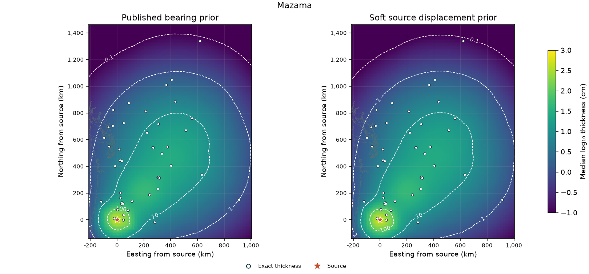

# Mazama · Soft source displacement prior

The candidate median complete-deposit volume is **217.6 km³**. The conditional 95% interval is 141.6–1,800.2 km³.

The prior favors component centres within several component widths of the source. The penalty is smooth and retains positive probability for detached maxima. Source-focused kernels receive unit weight. Effective draw counts diagnose the importance reweighting.

Matched buffered geographic scores averaged 1.539 under the reference and 1.517 under the candidate. Smaller values indicate better site predictions. Both scores use the same posterior subset within each fold.

Numerical and parent sampling checks together **retained warnings**. The output includes every attempted fold and its parent status.

Dashed lines show model contours in the survey window. Both global volumes use the complete Earth. [Posterior checks, assumptions and per-site scores](report.json)
