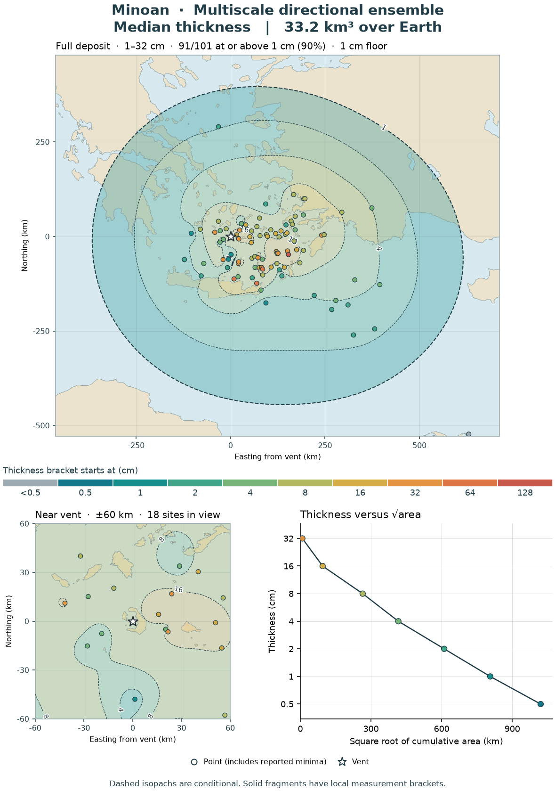
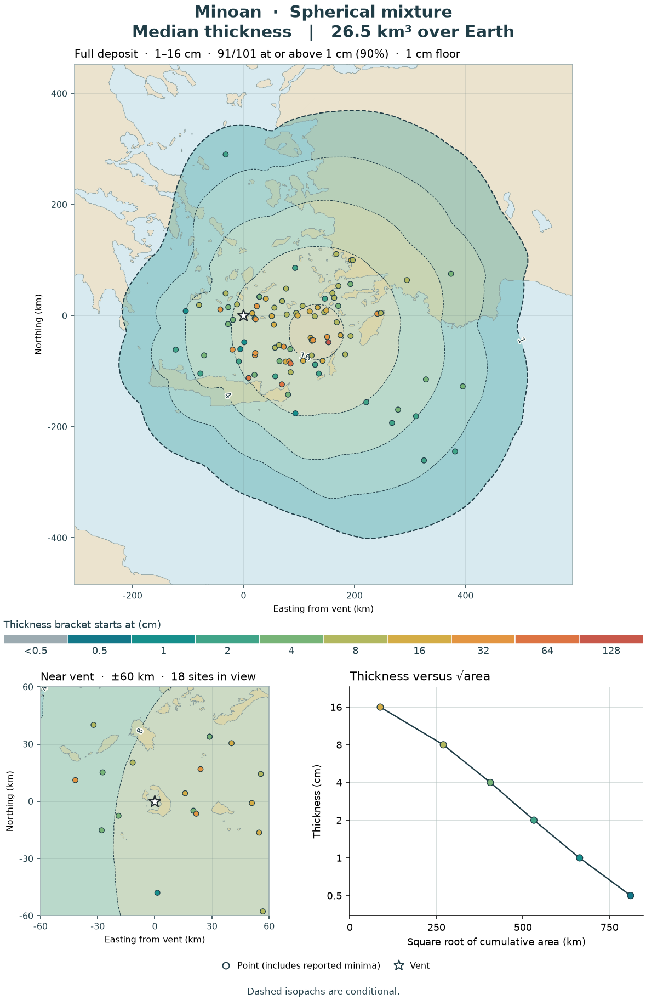

# Minoan

The five reconstructions use the same 101 accepted fallout localities. Field reports give 92 measured thicknesses, 9 lower limits, 0 upper limits and 0 two-sided ranges. Each lower limit enters the fit as a point at its reported value, including the 4 beyond 25 km. Upper limits and ranges retain their respective one-sided and two-sided probabilities. [Source audit](../../data/audits/Minoan/README.md) · [Reported table](../../data/eruptions/Minoan_tephra.csv) · [Fitting table](../../data/eruptions/Minoan_tephra_minimum_fit.csv)

The site table pairs each source classification with its fitting value, geographic fold, mapped thickness and held-out score. It includes the predictive median or cumulative probability at the site value where the method saves it. A fitted minimum can underestimate total fallout at an incomplete section. [Reported and fitted sites](results/minimum-fit-2026-11-25/reported-and-fitted-sites.csv) · [Changes by method and coverage by source type](results/minimum-fit-2026-11-25/minimum-fit-comparison.csv) · [Fitting convention](../../docs/methods/reported-minimum-fitting.md)

## Volumes and geographic prediction

Each estimate integrates the median thickness on its map. The conditional range integrates the pointwise 25th and 75th percentiles of thickness over the same area. The 50% probability refers to thickness at each location. A single probability for total volume does not follow from these endpoints.

| Method | Integration area | Median map (km³) | Q25–Q75 thickness maps (km³) | Held-out score ↓ | 95% predictive coverage |
|---|---|---:|---:|---:|---:|
| GP ensemble | observation hull | **20.4** | 12.6–34.3 | 1.542 | 97.0% |
| Cubic spline | observation hull | **24.1** | 23.1–25.1 | 1.928 | 92.1% |
| [Multiscale directional ensemble](results/minimum-fit-2026-11-25/directional/README.md) | whole Earth | **33.2** | 20.9–60.9 | 1.597 | 95.0% |
| [Spherical mixture](results/minimum-fit-2026-11-25/spherical-mixture/README.md) | whole Earth | **26.5** | 20.2–38.5 | 1.594 | 95.0% |
| [Bayesian nested footprints](results/minimum-fit-2026-11-25/nested-isopachs/README.md) | whole Earth | **43.1** | 30–72.9 | 1.711 † | 91.1% |

Lower scores indicate better geographic prediction. Coverage counts held-out measurements and reported minima fitted as points. A dagger marks a fit, integration or validation warning.

## Full deposits and near-vent detail

Each full map follows the thickest power-of-two contour enclosing at least 95% of the fitted locations, with a 1 cm minimum. The title gives the actual count, including when that minimum prevents 95% coverage. Global volumes include the thinner tail. The innermost line is the thickest doubling level enclosing an accepted location. The near-vent window expands from the proximal sites until eligible contours are visible. The curve sums all patches at each displayed thickness.

## Inside the observation hull

The GP and spline integrate over the dashed hull. Gaps inside it can still be poorly constrained. [Regional fits and numerical checks](results/minimum-fit-2026-11-25/README.md)

## Evidence and checks

[Matched predictions by locality](results/minimum-fit-2026-11-25/geographic-site-validation.csv) · [Sampling attempts and diagnostics](results/minimum-fit-2026-11-25/sampling/attempts.csv) · [Numerical checks and file identities](results/minimum-fit-2026-11-25/release.json) · [Spherical fits and computing revisions](results/minimum-fit-2026-11-25/spherical-mixture/workflow-provenance.json) · [Regional support](results/minimum-fit-2026-11-25/support/README.md) · [Whole-area sensitivity](results/minimum-fit-2026-11-25/nested-whole-area/README.md)

[Previous maps and geological assessment](previous-minimum-treatment.md) · [Change at all distances across eruptions](../../comparisons/reported-minima/README.md)
