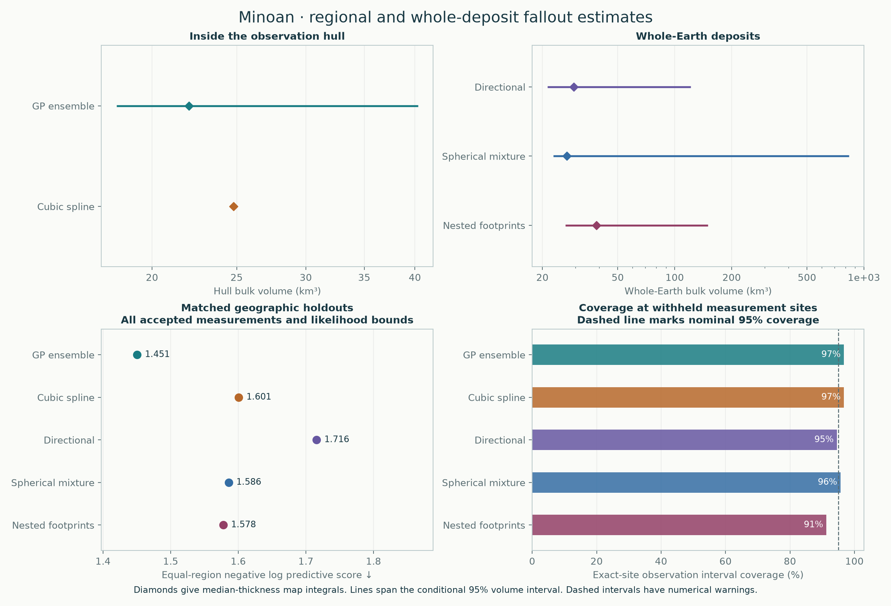

# Minoan fallout reconstruction

The accepted dataset contains 92 exact measurements and 9 lower bounds. The regional fits share an observation hull of 760,879 km². [Accepted thickness CSV](../../data/eruptions/Minoan_tephra.csv) · [Row-level source audit](../../data/audits/Minoan/README.md)

## Bulk fallout volume

| Model | Area | Volume summary (km³) | Conditional 95% volume interval (km³) |
|---|---|---:|---:|
| [Directional ensemble](results/directional/README.md) | Whole Earth | Median-map integral **33.7** · complete-field median 42.0 | 26.6–129.1 |
| [Spherical mixture](results/spherical-mixture/README.md) | Whole Earth | Posterior median **46.0** | 28.1–2,529.2 |
| GP ensemble | Observation hull | Expected **27.21** | 18.21–40.34 |
| Cubic spline | Observation hull | Expected **24.78** | 24.79–25.00 |

The directional interval summarizes complete simulated deposits. Measured interpolation triangles hold **7.3%** of the central directional map’s volume. The spline’s narrow interval conditions on its fitted trend. Its field draws used a coarser integration grid than the expected-volume calculation, which puts the reported mean just below that interval. [Paired regional maps and held-out tests](results/README.md)

## Evidence and limitations

The input combines all accepted Plinian and co-ignimbrite airborne fallout fans in one deposit. Nine totals reported with a greater-than sign enter as lower bounds. The reported volumes exclude ignimbrite flow deposits.

The standard local-support footprint covers 41,066 km². No complete isopach band passed the support and deletion checks. [Support map, partial volumes and rejected contours](results/support/README.md)
