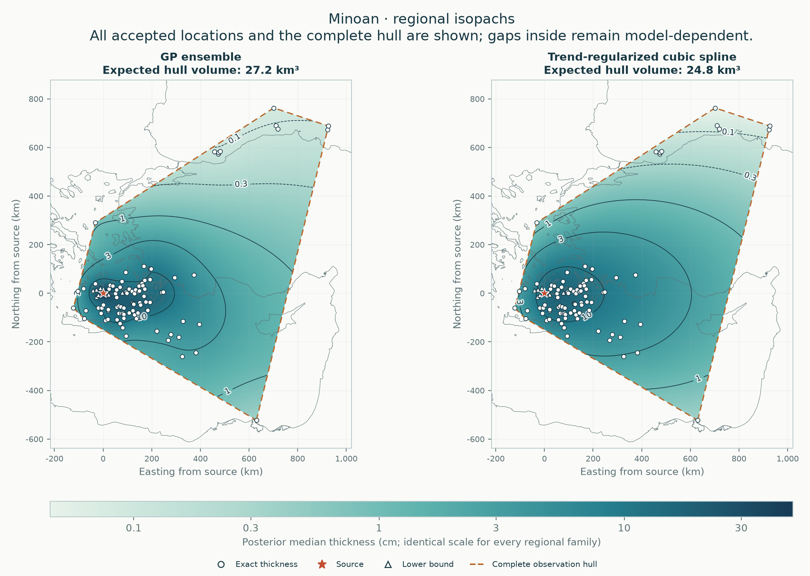

# Minoan fallout reconstruction

The accepted dataset contains 92 exact measurements and 9 lower bounds. The regional fits share an observation hull of 760,879 km². [Accepted thickness CSV](../../data/eruptions/Minoan_tephra.csv) · [Row-level source audit](../../data/audits/Minoan/README.md)

## Volumes and geographic prediction

Each volume integrates its method’s median-thickness map. The GP and spline cover the same observation hull. The other three methods cover Earth, including fallout below 0.5 cm. Conditional 95% intervals describe variation in whole-deposit volume across posterior draws.

| Method | Median-map volume (km³) | Conditional 95% interval (km³) | Held-out score ↓ | 95% coverage |
|---|---:|---:|---:|---:|
| GP ensemble | **22** | 18.2–40.3 | 1.451 | 96.7% |
| Cubic spline | **24.8** | 24.8–25 | 1.601 | 96.7% |
| [Directional ensemble](results/directional/README.md) | **29.2** | 21.2–121 | 1.716 | 94.6% |
| [Spherical mixture](results/spherical-mixture/README.md) | **26.9** | 22.9–834 | 1.586 | 95.7% |
| [Bayesian nested corridors](results/nested-isopachs/README.md) | **22.6** | 14.9–62.5 | 1.694 | 94.6% |

Lower scores indicate better predictions in withheld geographic regions. Coverage counts exact withheld measurements. A dagger marks a numerical or geographic validation warning. Provisional intervals retain their fit or integration warnings.

## Full deposits and near-vent detail

The outer line is 0.5 cm. Contours and observation colours double from there. All three methods use the same near-vent window for this eruption. Each curve counts the combined area of all patches at or above a thickness.

## Inside the observation hull

The dashed boundary encloses all accepted sites. Gaps inside it can still be poorly constrained. [Regional fits and numerical checks](results/README.md)

The current global fits use the same audited rows. [What changed in the maps, volumes and validation](../../comparisons/global-extent/README.md) · [Continuation rules](../../docs/methods/finite-spread.md)

## Evidence and limitations

The input combines all accepted Plinian and co-ignimbrite airborne fallout fans in one deposit. Nine totals reported with a greater-than sign enter as lower bounds. The reported volumes exclude ignimbrite flow deposits.

The spline’s narrow interval conditions on its fitted trend. Its complete-field draws use a coarser integration grid than the expected-volume calculation, which puts the reported mean just below that interval.

The standard local-support footprint covers 41,066 km². No complete isopach band passed the support and deletion checks. [Support map, partial volumes and rejected contours](results/support/README.md)

All accepted Plinian and co-ignimbrite fans enter the fit together. Both sets of held-out thicknesses favor the broader continuation. [Whole-area continuation sensitivity](results/nested-whole-area/README.md)
