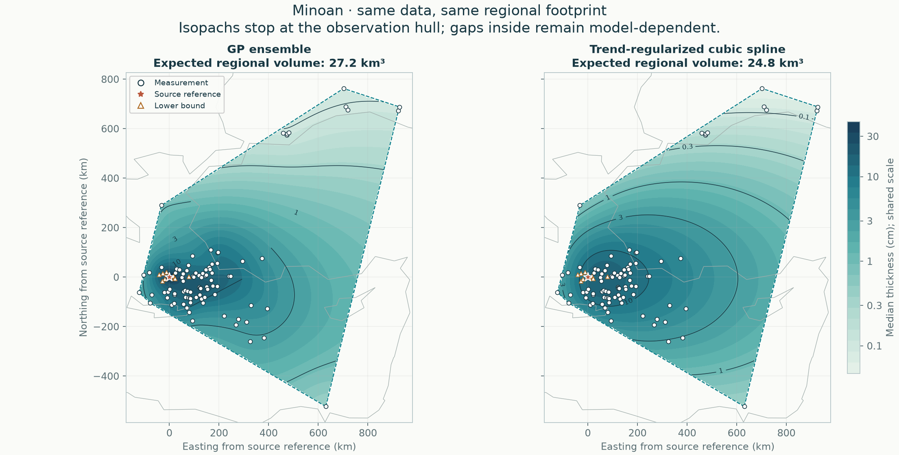

# Minoan: data and regional results

[All eruptions](../README.md) · [Active methods](../../methods/README.md) · [Add or revise data](../../docs/NEW_ERUPTION.md)

**GP ensemble and automatic cubic spline are reported as peers.** Both use the same accepted data, geographic holdouts and observation hull.

[Read the full comparison](results/README.md) · [Compare all six eruptions](../../comparisons/regional/README.md) · [Method definitions](../../docs/METHODS.md)

92 exact measurements and 9 lower bounds; regional area 760,879 km².

| Quantity | GP ensemble | Cubic spline |
|---|---:|---:|
| Expected regional bulk fallout (km³) | 27.21 | 24.78 |
| Outer equal-region negative log score ↓ | 1.451 | 1.601 |

These volumes cover only the observation hull. It can include unsampled gaps and exclude proximal deposits; it is not total eruption volume or dense-rock equivalent. Conditional intervals omit fitted-parameter and selection uncertainty. Read withheld coverage and geographic-deletion sensitivity in the full report.

All accepted Plinian and co-ignimbrite fallout fans remain combined in one field. The [source audit](../../data/audits/Minoan/README.md) and input selection are unchanged.

## Evidence and calculation

| Follow the calculation | File |
|---|---|
| Accepted input | [Thickness observations](../../data/eruptions/Minoan_tephra.csv) |
| Source decisions | [Audit or supplied-flag status](../../data/audits/Minoan/README.md) |
| Current maps and interpretation | [Regional report](results/README.md) |
| Fits, validation and provenance | [Complete numerical record](results/report.json) |
| Row-by-row outer predictions | [Held-out predictions](results/heldout_predictions.csv) |
| Automatic tuning | [Candidate tables](results/selection/README.md) |

The current published result was generated before the repository reorganization. Its numerical artifacts and recorded execution hashes are preserved unchanged; moving a file does not create a new analysis.

## Earlier calculations

[GP-only global ensemble](../../archive/reports/minoan/global/stacked/README.md) · [Earlier selected GP](../../archive/reports/minoan/global/selected/README.md) · [Rectangular regional history](../../archive/reports/minoan/regional/README.md)

Historical numerical artifacts retain their original method, source hashes and integration domain. They are not used to rank the current regional methods.
