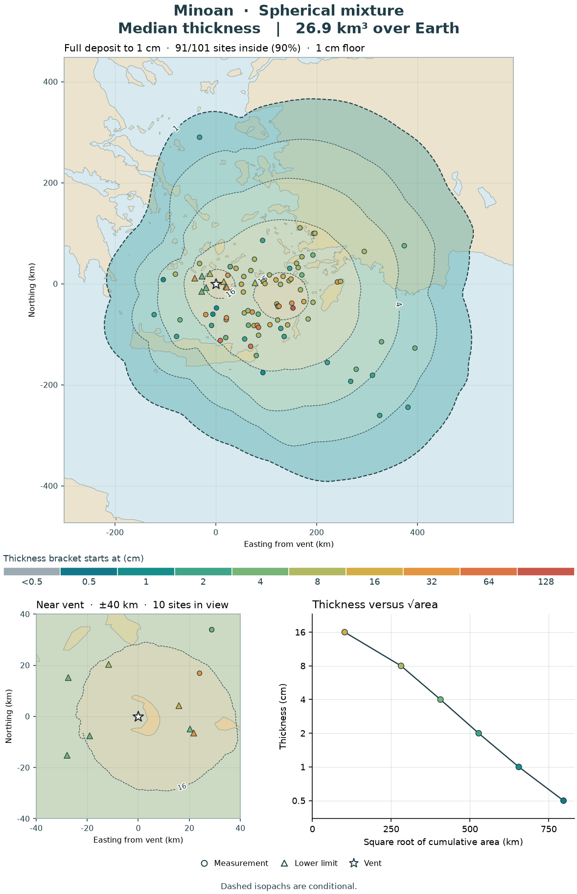
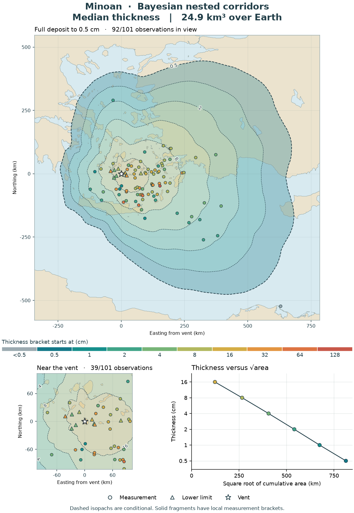

# Minoan fallout reconstruction

The accepted dataset contains 92 exact measurements and 9 lower bounds. The regional fits share an observation hull of 760,879 km². [Accepted thickness CSV](../../data/eruptions/Minoan_tephra.csv) · [Row-level source audit](../../data/audits/Minoan/README.md)

## Volumes and geographic prediction

Each estimate integrates the median thickness on its map. The conditional range integrates the pointwise 25th and 75th percentiles of thickness over the same area. The 50% probability refers to thickness at each location. A single probability for total volume does not follow from these endpoints.

| Method | Median map (km³) | Q25–Q75 thickness maps (km³) | Held-out score ↓ | 95% predictive coverage |
|---|---:|---:|---:|---:|
| GP ensemble | **22** | 15.2–32.9 | 1.451 | 96.7% |
| Cubic spline | **24.8** | 24.7–24.9 | 1.601 | 96.7% |
| [Directional ensemble](results/directional/README.md) | **29.2** | 18.6–48.4 | 1.716 | 94.6% |
| [Spherical mixture](results/spherical-mixture/README.md) | **26.9** | 20–42.9 | 1.586 | 95.7% |
| [Bayesian nested footprints](results/nested-isopachs/README.md) | **38.5** | 25.4–62 | 1.578 | 91.3% |

Lower scores indicate better geographic prediction. Coverage counts exact withheld measurements. A dagger marks a fit, integration or validation warning.

## Full deposits and near-vent detail

Each full map follows the thickest power-of-two contour enclosing at least 95% of the fitted locations, with a 1 cm minimum. The title gives the actual count, including when that minimum prevents 95% coverage. Global volumes include the thinner tail. The innermost line is the thickest doubling level enclosing an accepted location. The near-vent window expands from the proximal sites until eligible contours are visible. The curve sums all patches at each displayed thickness.

## Inside the observation hull

The GP and spline integrate over the dashed hull. Gaps inside it can still be poorly constrained. [Regional fits and numerical checks](results/README.md)

The current global fits use the same audited rows. [What changed in the maps, volumes and validation](../../comparisons/global-extent/README.md) · [Continuation rules](../../docs/methods/finite-spread.md)

## Evidence and limitations

The input combines all accepted Plinian and co-ignimbrite airborne fallout fans in one deposit. Nine totals reported with a greater-than sign enter as lower bounds. The reported volumes exclude ignimbrite flow deposits.

The spline’s narrow interval conditions on its fitted trend. Its complete-field draws use a coarser integration grid than the expected-volume calculation, which puts the reported mean just below that interval.

The standard local-support footprint covers 41,066 km². No complete isopach band passed the support and deletion checks. [Support map, partial volumes and rejected contours](results/support/README.md)

All accepted Plinian and co-ignimbrite fans enter the fit together. Both sets of held-out thicknesses favor the broader continuation. [Whole-area continuation sensitivity](results/nested-whole-area/README.md)
