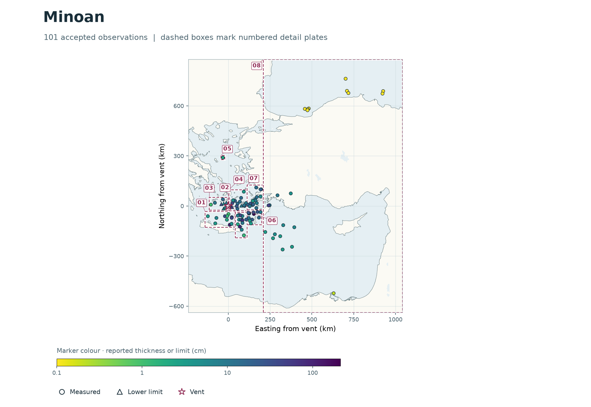

# Minoan · principal input observations

All 101 accepted rows have a symbol at their registered coordinates on the overview and a labelled reading on one numbered detail plate. The dashed boxes show the detail extents. A star marks the vent. Positions use a vent-centred equal-area grid in kilometres. The basemap uses Natural Earth land and coastlines.

[Accepted input CSV](../../../data/eruptions/Minoan_tephra_minimum_fit.csv) · [Reported CSV](../../../data/eruptions/Minoan_tephra.csv) · [Audit provenance](../../../data/audits/Minoan/provenance.json) · [Site index with coordinates and full input precision](sites.csv) · [Input hashes and panel bounds](manifest.json)

The reading column shows the reported value or interpreted field bound in centimetres. A reported lower limit appears as ≥ on these evidence figures and as a point at that value in the fit. Upper limits and ranges retain their respective events. Marker colour represents the displayed thickness or limit, using the lower endpoint for ranges. Where rows share coordinates, a single diamond uses the first CSV row as its map key and the adjacent table lists each row.

| Detail plate | Input rows | Easting × northing span |
|---|---:|---:|
| [01](detail-01.png) | 11 | 176 × 96.6 km |
| [02](detail-02.png) | 14 | 70.8 × 151 km |
| [03](detail-03.png) | 8 | 114 × 76.5 km |
| [04](detail-04.png) | 17 | 109 × 126 km |
| [05](detail-05.png) | 1 | 24.3 × 24.3 km |
| [06](detail-06.png) | 13 | 87.8 × 85.6 km |
| [07](detail-07.png) | 15 | 95.6 × 148 km |
| [08](detail-08.png) | 22 | 833 × 1.52e+03 km |
