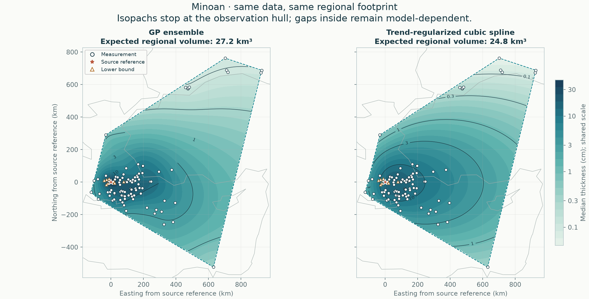
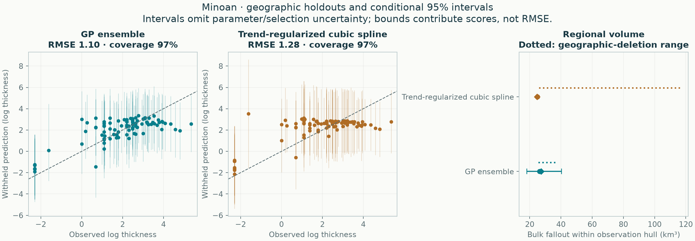

# Minoan: empirical methods on one regional footprint

All methods use the same accepted observations, geographic holdouts and integration area. No method is designated preferred.

**92 exact measurements, 9 lower bounds, 0 upper limits.** The observation hull covers 760,879 km². The automatic validation buffer is 15.34 km.



| Quantity | GP ensemble | Trend-regularized cubic spline |
|---|---:|---:|
| Expected regional bulk fallout (km³) | 27.21 | 24.78 |
| Integral of median thickness surface (km³) | 22.05 | 24.78 |
| Conditional 95% volume interval (km³) | 18.21–40.34 | 24.79–25.00 |
| Outer equal-region negative log score ↓ | 1.451 | 1.601 |
| Outer log-thickness RMSE ↓ | 1.095 | 1.282 |
| Outer 95% observation-interval coverage | 96.7% | 96.7% |

Lower predictive score and RMSE are better. Coverage must be read with interval width and predictive score; wider intervals alone are not improvement.



## Scope

The footprint is the convex hull of measured/bounded locations, with no source point or invented observations added. It can contain large unsampled gaps and can exclude proximal deposits. These are **regional bulk fallout volumes, not total eruption volumes or dense-rock equivalents**. No global extrapolation enters this comparison.

The mean volume integrates expected thickness. The median-surface integral is a separate quantity; it is not the median volume. Volume intervals come from complete correlated surface draws, not sums of pointwise interval endpoints.

## Fitted methods

### GP ensemble

```json
{
  "candidate": {
    "tail": "stacked"
  },
  "components": [
    {
      "weight": 0.6803934351956458,
      "model": {
        "candidate": {
          "tail": "power",
          "length_factor": 0.75,
          "noise_ratio": 0.75
        },
        "beta": [
          4.00620667252305,
          3.9134130909123734,
          1.8434671527932711,
          -0.5126155345122995
        ],
        "radius_scale_km": 141.98492108106356,
        "length_km": 134.20930255161414,
        "amplitude_log": 1.0481065616678016,
        "noise_log": 0.7860799212508511,
        "jitter": 1.0985273646111011e-09,
        "trend_on_constraint_boundary": true,
        "uncertainty": "conditional Laplace"
      }
    },
    {
      "weight": 0.3196065648043543,
      "model": {
        "candidate": {
          "tail": "power",
          "length_factor": 1.5,
          "noise_ratio": 1.5
        },
        "beta": [
          4.00620667252305,
          3.9134130909123734,
          1.8434671527932711,
          -0.5126155345122995
        ],
        "radius_scale_km": 141.98492108106356,
        "length_km": 268.4186051032283,
        "amplitude_log": 1.0481065616678016,
        "noise_log": 1.5721598425017023,
        "jitter": 1.0985273646111011e-09,
        "trend_on_constraint_boundary": true,
        "uncertainty": "conditional Laplace"
      }
    }
  ],
  "dominant_tail": "power",
  "observation_discrepancy_variance_log": 0.0,
  "trend_on_constraint_boundary": true,
  "uncertainty": "Predictive mixture; includes disagreement among retained candidates, conditional on each fit and estimated weights. Fitted-parameter uncertainty is not integrated."
}
```

### Trend-regularized cubic spline

```json
{
  "method": "spline",
  "candidate": {
    "tail": "exponential",
    "knot_intervals": 8,
    "tension": 1.0,
    "smoothing": 1e-08,
    "trend_strength": 1000000.0,
    "noise_ratio": 1.5
  },
  "bounds_km": [
    -174.67075905517459,
    -587.1161032420658,
    979.1548724951117,
    826.7692319953114
  ],
  "knot_intervals_xy": [
    7,
    8
  ],
  "n_coefficients": 110,
  "noise_log": 1.4890041577273512,
  "amplitude_log": 0.9926694384849007,
  "trend_beta": [
    3.163925507747941,
    1.6087496004144604,
    1.123670598829154,
    -0.01564661516075042
  ],
  "trend_radius_scale_km": 141.98492108106356,
  "trend_on_constraint_boundary": false,
  "effective_df_exact": 0.002893888743626283,
  "newton_decrement": 2.643037911928297e-20,
  "newton_iterations": 1,
  "quadrature_order": 6,
  "uncertainty": "Conditional Laplace",
  "uncertainty_omits": [
    "fitted trend",
    "noise and smoothing estimation",
    "knot/trend selection",
    "sampling and preservation bias",
    "vent location error"
  ],
  "pseudo_observations": 0
}
```

Every explored candidate is retained in the selection tables. All response-dependent choices are retuned within training folds; no hand-placed pseudo-data enter the likelihood.

## Reliability checks

- All probability intervals condition on fitted parameters and selected settings; they omit parameter/selection and preservation/sampling uncertainty.
- Four geographic outer folds evaluate the entire tuning procedure; this is development evidence, not independent external validation.
- Geographic-deletion volume ranges show refitting sensitivity and are not confidence intervals.
- Spline selection reaches an explored search boundary: smoothing, trend_strength. This is a bounded-grid result, not proof of a continuous optimum.
- The selected spline strongly follows its estimated trend. Its conditional volume interval can be extremely narrow because trend-estimation uncertainty is omitted; inspect the geographic-deletion range rather than interpreting narrowness as established precision.

## Reproduce and inspect

```sh
tephra-isopachs compare Minoan --output results/new-regional-run
```

[Complete numerical report](report.json) · [Withheld predictions](heldout_predictions.csv) · [Accepted observation semantics](accepted_observations.csv) · [Selection tables](selection/README.md)

The JSON records input/source hashes, package versions, all fold memberships, regional integration refinements, conditional-volume sampling precision and geographic-deletion sensitivity. Historical GP global calculations remain separate.

## Which parts are actually supported?

Read the [local support and complete-contour audit](support/README.md) before extrapolating these hull volumes. It screens unsampled gaps, tests closure under geographic deletion, and separates interpolation from proximal/distal assumptions.

## Whole-deposit fallout

Read the [conditional global estimate and assumption sensitivity](global/README.md). Its mass is normalized on the whole Earth; these regional partial volumes and the local contour audit retain their separate meanings.
