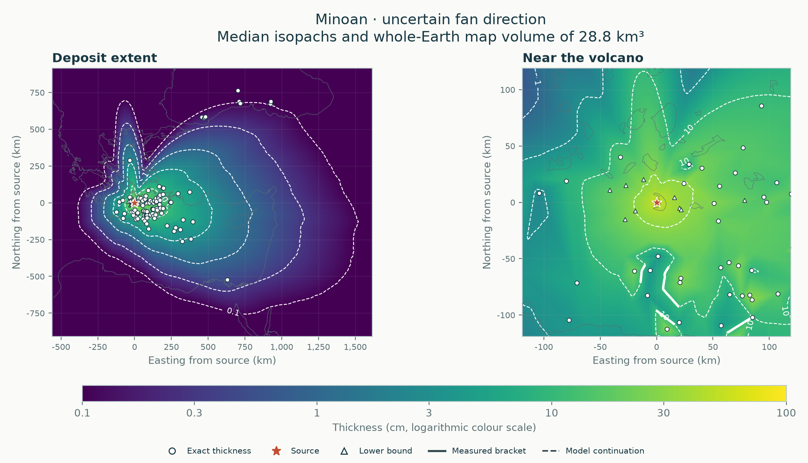

# Minoan directional fallout

**28.8 km³ of bulk fallout** is the whole-Earth integral of the principal median isopach map. The uncertain-fan-direction ensemble uses 101 quantitative observations and bounds. Integrating complete simulated deposits gives a median of **39.1 km³** and a conditional 95% interval of **21.3–138.5 km³**.

Measured triangles account for **8.5%** of the map volume. Solid contour fragments cross triangles where observations bracket the thickness. Dashes trace the continuation through gaps. A poorly sampled direction can still contain an unobserved fan.

## Predictive and numerical checks

| Held-out observations | Fixed-direction control | Uncertain fan direction | Exact-site 95% coverage |
|---|---:|---:|---:|
| Geographic regions | 1.668 | 1.782 | 87/92 (94.6%) |
| Source quadrants | 2.128 | 2.194 | 69/92 (75.0%) |

Lower scores indicate better predictions. The table includes every estimable fold. Passing-only scores, unscored folds and site-level intervals are available in the detailed report. Across the six benchmark eruptions, uncertain directions slightly improved geographic scores and worsened whole-quadrant scores.

[Sector areas, directional reach, support audit and alternative assumptions](azimuth/README.md) · [Principal numerical result](azimuth/report.json) · [Whole-Earth map](azimuth/world.png) · [Held-out site predictions](azimuth/heldout.csv)

## Directional sensitivities

Fixing fan directions under the same weights gives a median-map integral of 32.9 km³. The earlier fixed-direction ensemble has its own geographic calibration. [Earlier six-structure reconstruction](ensemble/README.md) · [Single-structure and proximal-cap study](single-structure.md)
