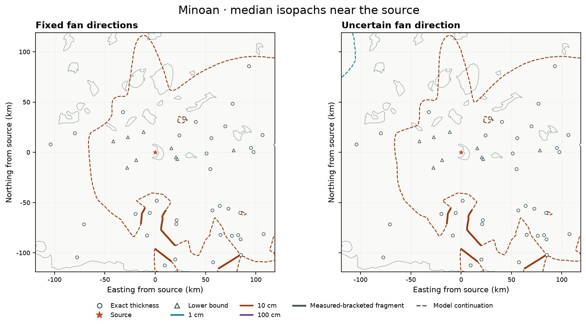
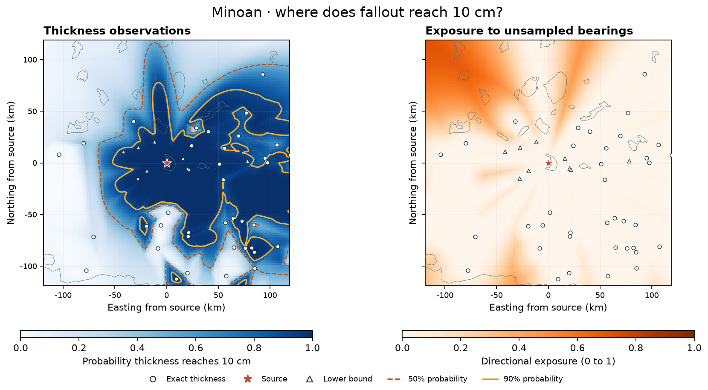

# Minoan · directional extent

The same 101 accepted observations give a **32.9 km³** median-map integral with fixed fan directions and **28.8 km³** when an unsampled fan can turn. These two fits use identical observations and structure weights. The primary six-structure estimate on the case home uses its original calibration.

Under uncertain azimuth, integrating each complete deposit gives a volume median of **39.1 km³** and a conditional 95% range of **21.3–138.5 km³**. Measured interpolation triangles contribute 8.5% of the median-map volume. The rest relies on continuation.

Solid marks require a triangle whose measured sites bracket the thickness and whose posterior crossing probability reaches 90%. Dashes show the remaining median contour. White circles are thickness observations. An empty sector can contain fallout.

## Reach from the volcano

Distances are great-circle kilometres to the first outward crossing on each compass ray. The area columns give the entire 10 cm footprint in the corresponding 45° sector, including detached areas. Together they distinguish a long point on a contour from an entire broad lobe.

| Bearing | Fixed 10 cm reach (km) | Uncertain 10 cm reach (km) | Fixed ≥10 cm area (km²) | Uncertain ≥10 cm area (km²) |
|---|---:|---:|---:|---:|
| N | 102.5 | 101.1 | 3,103 | 2,769 |
| NE | 134.8 | 134.9 | 7,496 | 7,378 |
| E | 244.8 | 244.8 | 18,103 | 17,839 |
| SE | 154.3 | 152.7 | 8,881 | 8,834 |
| S | 40.8 | 40.8 | 2,418 | 2,370 |
| SW | 73.7 | 73.7 | 2,115 | 2,104 |
| W | 66.0 | 65.9 | 1,722 | 1,714 |
| NW | 60.7 | 58.5 | 1,506 | 1,321 |

The 50% and 90% probability lines answer different questions. At a location on the 90% line, nine in ten model draws reach 10 cm. These are pointwise probabilities conditional on the model. Joint confidence over an entire region requires a different calculation.

## Withheld observations

Each row averages negative log predictive scores over equally weighted folds. Lower scores predict the withheld thicknesses and limits better. The passing-only columns exclude numerical failures. A dash means no fold passed.

| Deletion | All estimable folds | Fixed | Uncertain | Passing folds | Fixed, passing | Uncertain, passing |
|---|---:|---:|---:|---:|---:|---:|
| geographic | 4 | 1.668 | 1.782 | 4 | 1.668 | 1.782 |
| quadrants | 4 | 2.128 | 2.194 | 4 | 2.128 | 2.194 |

[Predictions for every estimable held-out site](heldout.csv). The numerical record includes all planned folds, row identities, unscorable directions, fit warnings and phase-integration checks.

## Checks and reproducibility

The shared contour audit found eligible bands under none of the screened support policies. Audit status is completed. [All contour decisions and deletion failures](complete-contour-audit.json)

The spatial integration check passed at 16,384 points per scramble. The map used up to 128 posterior draws per chain and structure. Resolved contour areas passed the split-packet check. The joint-volume quantiles passed the split check.

All six full fits passed their sampling diagnostics.

[Numerical report, all sector volumes and sensitivities](report.json) · [Complete fields and per-field volumes](fields.npz) · [Plotted grids](map-grid.npz) · [Fragment decisions](fragment-decisions.csv) · [Bracketed coordinates](bracketed-fragments.csv) · [File hashes](artifacts.json)
