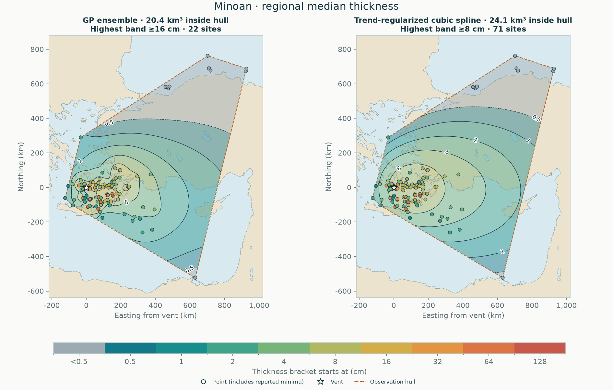
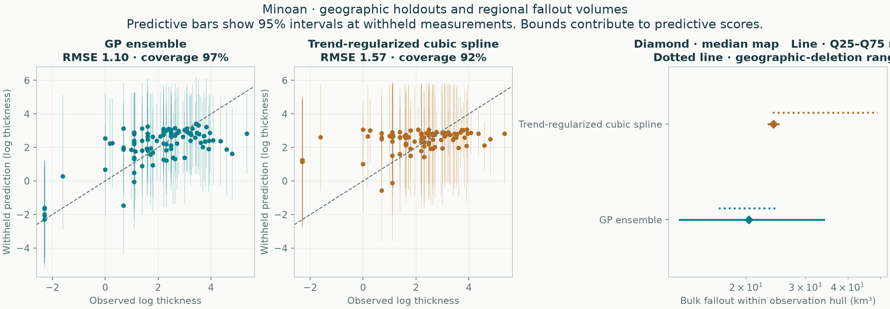

# Minoan: empirical methods on one regional footprint

All methods use the same accepted observations, geographic holdouts and integration area. No method is designated preferred.

**92 reported measurements and 9 reported minima fitted as points, 0 lower-censored fits, 0 upper limits.** The observation hull covers 760,879 km². The automatic validation buffer is 15.34 km.



The full observation hull and every accepted location are in view. The coloured field is clipped to the exact hull; fine coastlines are context only. [Map frame and rendering provenance](map-display.json).

| Quantity | GP ensemble | Trend-regularized cubic spline |
|---|---:|---:|
| Principal median-map volume inside hull (km³) | 20.38 | 24.09 |
| Integrated Q25–Q75 thickness (km³) | 12.63–34.28 | 23.12–25.10 |
| Outer equal-region negative log score ↓ | 1.542 | 1.928 |
| Outer log-thickness RMSE ↓ | 1.102 | 1.567 |
| Outer 95% observation-interval coverage | 97.0% | 92.1% |

Lower predictive score and RMSE are better. Coverage must be read with interval width and predictive score; wider intervals alone are not improvement.



## Scope

The footprint is the convex hull of measured/bounded locations, with no source point or invented observations added. It can contain large unsampled gaps and can exclude proximal deposits. These are **regional bulk fallout volumes, not total eruption volumes or dense-rock equivalents**. No global extrapolation enters this comparison.

Volume integrates pointwise median thickness over the observation hull. The endpoints integrate the pointwise 25th and 75th percentiles of latent thickness over that same area. [Band integrals and refinements](thickness-bands.json)

## Fitted methods

### GP ensemble

```json
{
  "candidate": {
    "tail": "stacked"
  },
  "components": [
    {
      "weight": 0.19385725977372334,
      "model": {
        "candidate": {
          "tail": "exponential",
          "length_factor": 0.75,
          "noise_ratio": 1.5
        },
        "beta": [
          3.0923268781880773,
          1.4806099770511183,
          1.048089967283284,
          -0.03218808427978109
        ],
        "radius_scale_km": 133.22889059013522,
        "length_km": 127.87199970946209,
        "amplitude_log": 0.9896802874453033,
        "noise_log": 1.484520431167955,
        "jitter": 9.794670713578183e-10,
        "trend_on_constraint_boundary": false,
        "uncertainty": "conditional Gaussian"
      }
    },
    {
      "weight": 0.41302646718775643,
      "model": {
        "candidate": {
          "tail": "power",
          "length_factor": 0.25,
          "noise_ratio": 0.25
        },
        "beta": [
          3.978901266553536,
          3.7684134553256534,
          1.7064047632278159,
          -0.4641825031040018
        ],
        "radius_scale_km": 133.22889059013522,
        "length_km": 42.62399990315403,
        "amplitude_log": 1.0681532730659606,
        "noise_log": 0.26703831826649016,
        "jitter": 1.1409514147615247e-09,
        "trend_on_constraint_boundary": true,
        "uncertainty": "conditional Gaussian"
      }
    },
    {
      "weight": 0.3931162730385202,
      "model": {
        "candidate": {
          "tail": "power",
          "length_factor": 0.75,
          "noise_ratio": 0.75
        },
        "beta": [
          3.978901266553536,
          3.7684134553256534,
          1.7064047632278159,
          -0.4641825031040018
        ],
        "radius_scale_km": 133.22889059013522,
        "length_km": 127.87199970946209,
        "amplitude_log": 1.0681532730659606,
        "noise_log": 0.8011149547994705,
        "jitter": 1.1409514147615247e-09,
        "trend_on_constraint_boundary": true,
        "uncertainty": "conditional Gaussian"
      }
    }
  ],
  "dominant_tail": "power",
  "observation_discrepancy_variance_log": 0.14839916772724002,
  "trend_on_constraint_boundary": true,
  "uncertainty": "Predictive mixture; includes disagreement among retained candidates, conditional on each fit and estimated weights. Fitted-parameter uncertainty is not integrated."
}
```

### Trend-regularized cubic spline

```json
{
  "method": "spline",
  "candidate": {
    "tail": "exponential",
    "knot_intervals": 6,
    "tension": 1.0,
    "smoothing": 1e-08,
    "trend_strength": 10000.0,
    "noise_ratio": 1.5
  },
  "bounds_km": [
    -174.67075905517459,
    -587.1161032420658,
    979.1548724951117,
    826.7692319953114
  ],
  "knot_intervals_xy": [
    5,
    6
  ],
  "n_coefficients": 72,
  "noise_log": 1.484520431167955,
  "amplitude_log": 0.9896802874453033,
  "trend_beta": [
    3.092326878179863,
    1.4806099770566719,
    1.048089967287868,
    -0.032188084272678934
  ],
  "trend_radius_scale_km": 133.22889059013522,
  "trend_on_constraint_boundary": false,
  "effective_df_exact": 0.18849455758943834,
  "newton_decrement": 3.6249842920242775e-26,
  "newton_iterations": 0,
  "quadrature_order": 6,
  "uncertainty": "Conditional Gaussian",
  "uncertainty_omits": [
    "fitted trend",
    "noise and smoothing estimation",
    "knot/trend selection",
    "sampling and preservation bias",
    "vent location error"
  ],
  "pseudo_observations": 0
}
```

Every explored candidate is retained in the selection tables. All response-dependent choices are retuned within training folds; no hand-placed pseudo-data enter the likelihood.

## Reliability checks

- All probability intervals condition on fitted parameters and selected settings; they omit parameter/selection and preservation/sampling uncertainty.
- Four geographic outer folds evaluate the entire tuning procedure; this is development evidence, not independent external validation.
- Geographic-deletion volume ranges show refitting sensitivity and are not confidence intervals.
- Spline selection reaches an explored search boundary: smoothing. This is a bounded-grid result, not proof of a continuous optimum.
- The selected spline strongly follows its estimated trend. Its conditional volume interval can be extremely narrow because trend-estimation uncertainty is omitted; inspect the geographic-deletion range rather than interpreting narrowness as established precision.

## Reproduce and inspect

```sh
tephra-isopachs compare Minoan --output results/new-regional-run
```

[Complete numerical report](report.json) · [Withheld predictions](heldout_predictions.csv) · [Accepted observation semantics](accepted_observations.csv) · [Selection tables](selection/README.md)

The JSON records input/source hashes, package versions, all fold memberships, regional integration refinements, conditional-volume sampling precision and geographic-deletion sensitivity. Historical GP global calculations remain separate.

## Which parts are actually supported?

Read the [local support and complete-contour audit](support/README.md) before extrapolating these hull volumes. It screens unsampled gaps, tests closure under geographic deletion, and separates interpolation from proximal/distal assumptions.

[Wrapped angular covariance on this input](wrapped-angular-covariance/README.md)
