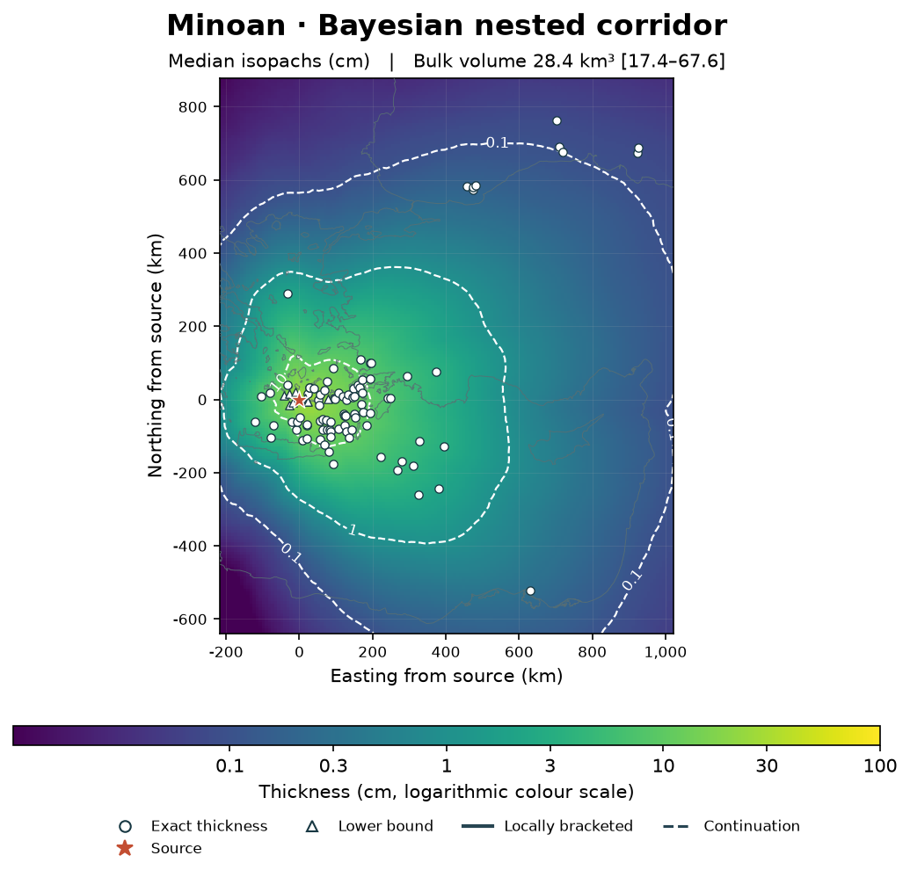
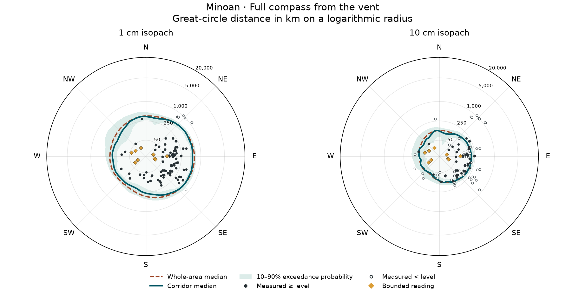

# Minoan · Bayesian nested isopachs

The principal corridor estimate of bulk fallout is **28.4 km³** (conditional 95% interval **17.4–67.6**). The median thickness map integrates to 24.9 km³. The whole-area sensitivity gives 37.6 km³ (25.1–91.8).

Solid portions cross a retained triangle with thicknesses on either side at distinct measured sites and at least 90% posterior crossing probability. Dashed portions depend on the continuation. The triangles diagnose spatial coverage. The shared contour screen also checks thickness bracketing and deletion stability. [Whole-Earth field](world.png) · [Every local bracket](local-brackets.csv.gz) · [Complete contour checks](support.json)

The buffered geographic score is 1.621 for the corridor and 1.536 for the whole-area sensitivity. Lower scores indicate better predictions at withheld sites. The corridor’s 95% predictive intervals cover 86 of 92 exact withheld readings. 4 of 4 geographic fits passed their sampling checks. The full-data proposal and importance check passed, the final volume populations passed, and the integration check passed. The shared screen accepted a complete contour band under 0 policies. [Prediction scores and row identities](report.json) · [Full fit diagnostics](full.json)

## Where the volume lies

The full-compass view includes all bearings through the antipode. Its logarithmic distance scale makes the proximal flanks visible. Areas in the table use the physical equal-area integral.

| Compass sector | Exact sites | Bounded sites | Corridor 1 cm area (km²) | Whole-area 1 cm area (km²) | Corridor volume (km³), median [95%] |
|---|---:|---:|---:|---:|---:|
| N | 1 | 0 | 43,914 | 51,137 | 2.7 [0.9–8.2] |
| NE | 18 | 0 | 89,960 | 95,816 | 5.2 [3.1–9.2] |
| E | 34 | 4 | 126,127 | 151,459 | 7.6 [4.6–14.9] |
| SE | 25 | 0 | 110,240 | 120,070 | 6.2 [3.8–13.7] |
| S | 8 | 0 | 31,113 | 49,690 | 2.0 [0.8–7.5] |
| SW | 3 | 1 | 16,681 | 24,560 | 1.0 [0.4–4.6] |
| W | 2 | 2 | 16,589 | 27,432 | 1.0 [0.3–6.8] |
| NW | 1 | 2 | 21,802 | 34,561 | 1.2 [0.3–9.0] |

At 1 cm, the corridor median map encloses 456,426 km² and the whole-area sensitivity encloses 554,726 km². Of these, 426,198 and 524,498 km² fall outside the retained exact-site triangles. An unsampled sector can contain ash. Its allocation depends on the assumed continuation.

The prior assigns 25% to continuation across all bearings. The remaining probability spans three fan widths and three down-range extensions. The fitted probability of whole-bearing continuation is 25.0%. The widths and extensions are shared structural assumptions. A bound supplies a likelihood event. Only positive evidence supplies a potential dispersal corridor.

[Volume and sector draws](volume-budget.npz) · [Complete field draws](full.npz) · [Areas, assumptions, bounds and diagnostics](report.json)

## Structural uncertainty

[Corridor and whole-area maps on a common scale](paired-isopachs.png)

| Prior probability of broad continuation | Median bulk volume, km³ [conditional 95%] |
|---:|---:|
| 10% | 26.8 [17.3–51.6] |
| 25% | 28.4 [17.4–67.6] |
| 50% | 31.0 [17.9–76.0] |
| 75% | 34.0 [19.1–83.5] |

The prior odds vary under the same observed likelihood. The numerical report also gives the volume by individual corridor law where the saved draws resolve it.

[Whole-area sensitivity report, posterior and diagnostics](../nested-whole-area/README.md)
