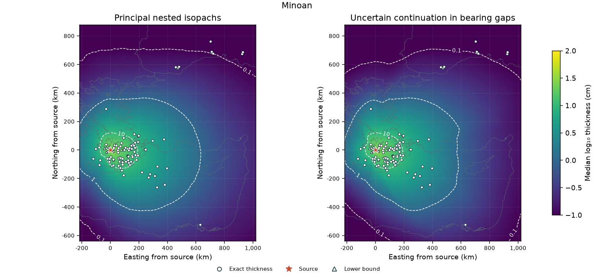

# Minoan · How much ash is assigned to bearings with limited evidence?

The uncertain-bearing median is **33.8 km³** with a conditional 95% interval of **22.9–71.4 km³**. Allowing a concentrated hidden fan to carry extra ash gives 37.1 km³ [24.4–87.8]. The principal nested median is 37.6 km³.

Every training location keeps its fitted thickness. The existing spherical bearing policy progressively allows an unseen fan to turn beyond the reach of measured bearings. The same policy includes broad continuation as a possibility. The extra-fallout experiment normalizes the rotating fan to unit mean over an unknown direction.

The paired geographic scores are 1.538 for the nested control and 1.549 for uncertain bearings. The finite-Earth integration and posterior-draw refinement passed. The scenario depends on its assigned angular widths and hidden-fan probabilities.

[Sector volume fractions, matched holdouts and integration checks](report.json)
