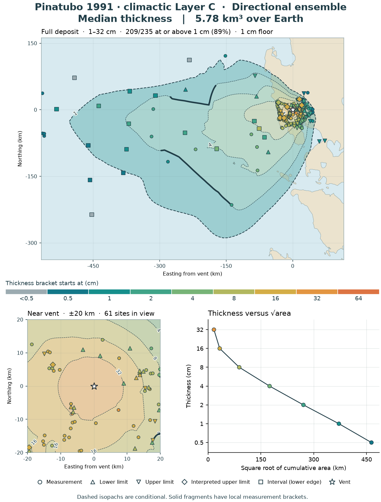
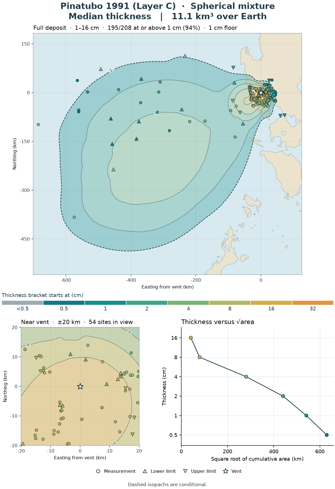
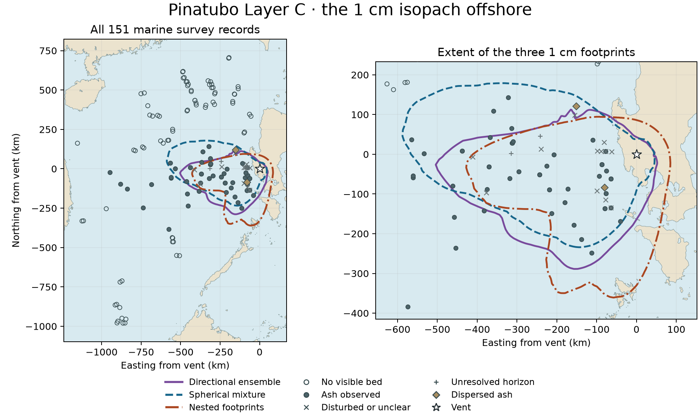

# Pinatubo 1991 · climactic Layer C fallout

Five methods reconstruct the C1 and C2 pumice and ash falls on Luzon and their marine equivalents, including co-ignimbrite ash. All five use the same **235 localities** from the 15 June 1991 deposit with 147 point thicknesses, 18 two-sided ranges, 31 lower limits and 39 upper limits. [Accepted observations](../../data/eruptions/Pinatubo_1991_layer_C_reviewed.csv) · [Land and marine source audit](../../data/audits/Pinatubo-1991/reaudit/README.md) · [Download all five estimates](results/principal-volumes.csv)

## Volumes and geographic prediction

Each estimate integrates the median thickness on its map. The conditional range integrates the pointwise 25th and 75th percentiles of thickness over the same area. The 50% probability refers to thickness at each location. A single probability for total volume does not follow from these endpoints.

| Method | Integration area | Median map (km³) | Q25–Q75 thickness maps (km³) | Held-out score ↓ | 95% predictive coverage |
|---|---|---:|---:|---:|---:|
| GP ensemble | observation hull | **4.21** | 3.22–5.57 | 0.955 | 97.3% |
| Cubic spline | observation hull | **6.1** | 4.17–10.9 | 1.421 | 90.5% |
| [Directional ensemble](results/directional/README.md) | whole Earth | **5.78** | 4.65–7.26 † | 1.072 † | 99.3% |
| [Spherical mixture](results/spherical-mixture/README.md) | whole Earth | **6.13** | 4.36–7.91 † | 0.895 † | 98.0% |
| [Bayesian nested footprints](results/nested-isopachs/README.md) | whole Earth | **7.37** | 4.83–13.7 | 1.234 † | 87.1% |

Lower scores indicate better geographic prediction. Coverage counts exact withheld measurements. A dagger marks a fit, integration or validation warning.

## Full deposits and near-vent detail

Each full map follows the thickest power-of-two contour enclosing at least 95% of the fitted locations, with a 1 cm minimum. The title gives the actual count, including when that minimum prevents 95% coverage. Global volumes include the thinner tail. The innermost line is the thickest doubling level enclosing an accepted location. The near-vent window expands from the proximal sites until eligible contours are visible. The curve sums all patches at each displayed thickness.

## Inside the observation hull

The GP and spline integrate over the dashed hull. Gaps inside it can still be poorly constrained. [Regional fits and numerical checks](results/README.md)

## What the field sites constrain

The regional models use the same 614,065 km² hull and predict all 235 sites in four buffered geographic holdouts. The GP covered 143 of 147 withheld point measurements at 95%, and the spline covered 133. In the southwestern deletion (fold 0), the spline's secondary expected volume exceeded the numerical range. Its median-map integral remained finite. The full-data median and quartile integrations passed for both regional models. Neither regional support screen qualified a complete contour band. [Regional fits and warnings](results/README.md) · [Regional contour support](results/support/README.md)

Five of the six directional structures passed on the full dataset. The narrow-fan structure retained a sampling warning and stayed in the ensemble. The directional, spherical and nested models passed their geographic-fit checks in **1/4, 3/4 and 3/4** regions, respectively. Scores use every withheld point thickness and bound. The spherical warning occurred with the northwestern group withheld (59 localities, six ranges). The nested warning occurred with the southwestern group withheld (58 localities, 12 ranges). [705 global predictions with evidence IDs and fit flags](results/geographic-site-validation.csv)

None of the three global maps qualified a complete contour band under the strict, standard or permissive screen. The whole-Earth estimates depend on the assumed continuation into unsampled areas. The nested map assigns about a quarter of its median volume to the southern sector, where sampling ends 42 km from the vent. [Directional support](results/directional/extent/support.json.gz) · [Spherical support](results/spherical-mixture/extent/support.json.gz) · [Nested footprints and sector checks](results/nested-isopachs/README.md)

## Spherical-mixture convergence

**The spherical map and volume are provisional.** The hosted run completed all eight full-data prior settings and four geographic refits. 4 of the eight full-data fits retained sampling warnings. The five-fan fit retained a sampling warning after its final retry (maximum R̂ 1.040, minimum bulk effective sample size 69.5, 0 divergences). [All prior settings](results/spherical-mixture/extent/prior-sensitivity.json) · [Draws, seeds and retry histories](results/sampling/README.md)

The three-fan baseline exhausted all three attempts. The final attempt retained 6,000 draws per chain. The median effective number of fans was **2.14, 2.13, 2.13 and 1.48** across the four chains. This quantity, $1/\sum_k w_k^2$, measures how evenly the fitted weights are distributed and is invariant to relabeling the fans. Its rank-normalized split R̂ was **1.524**. The parent log-volume parameter had R̂ **1.003**. Across all monitored quantities the maximum R̂ was **1.528** (target below 1.01) and the minimum bulk effective sample size was **7.1** (target at least 400). The saved chains allow these differences to be inspected without a refit. [Final baseline draws](diagnostics/spherical-mixture/baseline-attempt-3.npz)

The first local run stopped under memory pressure. Its diagnostic record preserves the 27 attempts completed up to that point and the source IDs in the affected holdout. [First-run diagnostics](diagnostics/spherical-mixture/attempts.json)

## Offshore survey

The directional 1 cm median isopach contains **56 of 151** marine survey positions. The spherical map contains **61** and nested footprints **51**. The audit gives an explicit quantitative role to 8 survey entries. Other entries retain their reported meaning, including inspected cores without a visible bed. [Station readings and mapped thicknesses](results/marine-stations.csv) · [Original pixels and land readings](../../data/audits/Pinatubo-1991/VISUAL-CHECK.md)

The earlier comparison used 208 localities. Its maps, source table and geographic folds remain together. [Earlier Layer C edition](../../archive/2026-11-24-case-editions/README.md#pinatubo)
