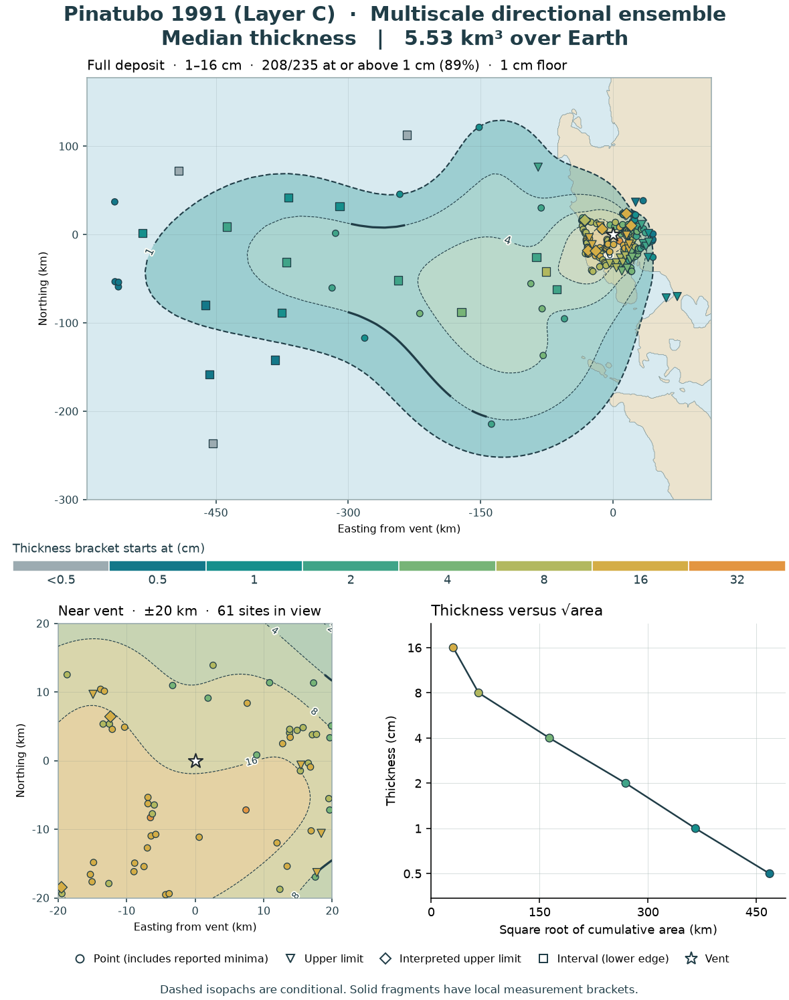
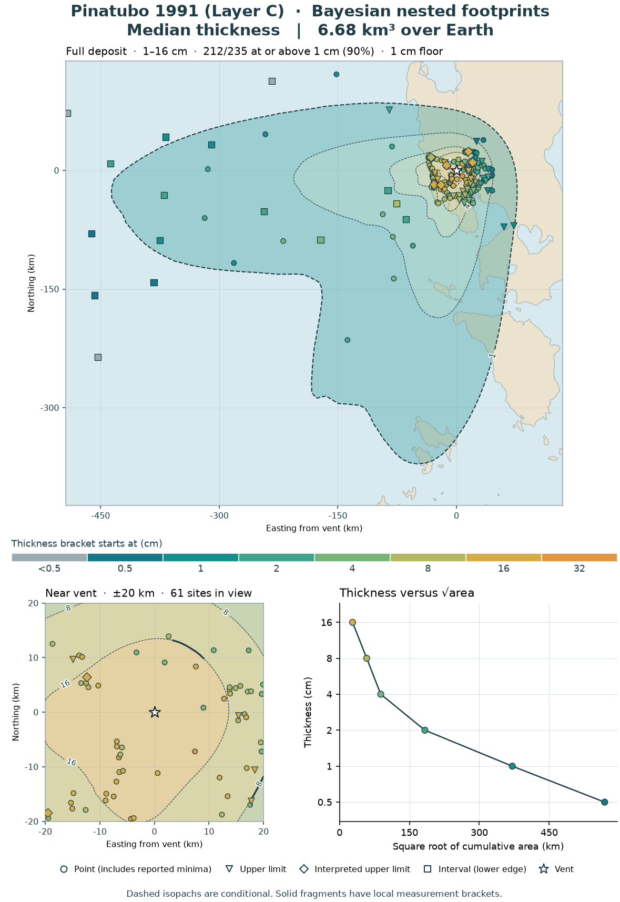
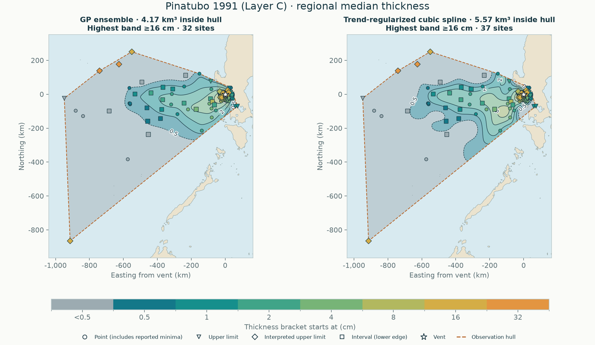

# Pinatubo 1991 (Layer C)

[Principal input maps and numbered detail plates](observations/README.md)

The five reconstructions use the same 235 accepted fallout localities. Field reports give 147 measured thicknesses, 31 lower limits, 39 upper limits and 18 two-sided ranges. Each lower limit enters the fit as a point at its reported value, including the 14 beyond 25 km. Upper limits and ranges retain their respective one-sided and two-sided probabilities. [Source audit](../../data/audits/Pinatubo-1991/reaudit/README.md) · [Reported table](../../data/eruptions/Pinatubo_1991_layer_C_reviewed.csv) · [Fitting table](../../data/eruptions/Pinatubo_1991_layer_C_reviewed_minimum_fit.csv)

The site table pairs each source classification with its fitting value, geographic fold, mapped thickness and held-out score. It includes the predictive median or cumulative probability at the site value where the method saves it. A fitted minimum can underestimate total fallout at an incomplete section. [Reported and fitted sites](results/minimum-fit-2026-11-25/reported-and-fitted-sites.csv) · [Changes by method and coverage by source type](results/minimum-fit-2026-11-25/minimum-fit-comparison.csv) · [Fitting convention](../../docs/methods/reported-minimum-fitting.md)

## Volumes and geographic prediction

Each estimate integrates the median thickness on its map. The conditional range integrates the pointwise 25th and 75th percentiles of thickness over the same area. The 50% probability refers to thickness at each location. A single probability for total volume does not follow from these endpoints.

| Method | Integration area | Median map (km³) | Q25–Q75 thickness maps (km³) | Held-out score ↓ | 95% predictive coverage |
|---|---|---:|---:|---:|---:|
| GP ensemble | observation hull | **4.17** | 3.2–5.54 | 1.037 | 98.9% |
| Cubic spline | observation hull | **5.57** | 3.81–10.2 | 0.929 | 95.5% |
| [Multiscale directional ensemble](results/minimum-fit-2026-11-25/directional/README.md) | whole Earth | **5.66** | 4.38–7.73 | 0.889 | 97.8% |
| [Spherical mixture](results/minimum-fit-2026-11-25/spherical-mixture/README.md) | whole Earth | **6.04** | 5.04–7.28 | 0.901 † | 96.6% |
| [Bayesian nested footprints](results/minimum-fit-2026-11-25/nested-isopachs/README.md) | whole Earth | **5.42** | 5.08–6.02 | 1.350 | 83.1% |

Lower scores indicate better geographic prediction. Coverage counts held-out measurements and reported minima fitted as points. A dagger marks a fit, integration or validation warning.

## Full deposits and near-vent detail

Each full map follows the thickest power-of-two contour enclosing at least 95% of the fitted locations, with a 1 cm minimum. The title gives the actual count, including when that minimum prevents 95% coverage. Global volumes include the thinner tail. The innermost line is the thickest doubling level enclosing an accepted location. The near-vent window expands from the proximal sites until eligible contours are visible. The curve sums all patches at each displayed thickness.

## Inside the observation hull

The GP and spline integrate over the dashed hull. Gaps inside it can still be poorly constrained. [Regional fits and numerical checks](results/minimum-fit-2026-11-25/README.md)

## Nested geometry and field agreement

The western and southern parts of the preceding field met at an abrupt shoulder, visible in both the 8–4 cm intermediate contours and the thin full-deposit outline. Positive area growth replaces that shoulder with a continuously turning field. The eastern 16 cm reach tightens and the long southern 1 cm extension contracts, while western marine reach grows. Boundary eccentricity increases from 0.38 to 0.72 at 16 cm and from 0.48 to 0.86 at 1 cm. The inner axis turns from about 50° to 77° across those levels. Successive contours remain connected and nested, with unequal but coherent spacing; the near-vent geometry belongs visibly to the westward full field rather than forming a separate round cap. The comparatively elliptical distal contours should not be read as a surveyed perimeter.

Eastern P7-062 (0.7 cm at 45 km) and the northeastern K-01 upper limit improve substantially, as do western WW-17955-1 and W04-SO-132-28. Northwestern W09-47 and southwestern W09-33 worsen. The W04-SO-140-25 and W04-SO-132-29 intervals receive higher event probabilities, while WW-17921-1, H01-25 and W04-SO-132-07 worsen. This remains a limitation in adapting to the marine thickness structure: all 18 interval medians lie outside their reported ranges, compared with 13 previously, even though the aggregate bounded-event score improves.

Measured log RMSE improves from 0.503 to 0.433, median absolute log error from 0.318 to 0.219, and bounded negative log probability from 1.317 to 1.103. Median upper-limit violations fall from 11 to 5. Geographic score improves from 1.419 to 1.350, with 83.1% coverage by nominal 95% observation intervals; the uncertainty remains undercalibrated. All four geographic fits pass. The full fit required 2,048 fixed-target moves and two successive passing checkpoints; the final mapped quartile check passes at 2,048 draws. Neither numerical agreement nor the improved average score resolves every conflicting marine record.

[Three-scale comparison, site identities and contour diagnostics](../../comparisons/nested-isopachs/adaptive-growth/visual-review.md#pinatubo-layer-c)

## Evidence and checks

[Matched predictions by locality](results/minimum-fit-2026-11-25/geographic-site-validation.csv) · [Numerical checks and file identities](results/minimum-fit-2026-11-25/release.json) · [Spherical fits and computing revisions](results/minimum-fit-2026-11-25/spherical-mixture/workflow-provenance.json) · [Regional support](results/minimum-fit-2026-11-25/support/README.md) · [Whole-area sensitivity](results/minimum-fit-2026-11-25/nested-whole-area/README.md)

[Previous maps and geological assessment](previous-minimum-treatment.md) · [Change at all distances across eruptions](../../comparisons/reported-minima/README.md)
