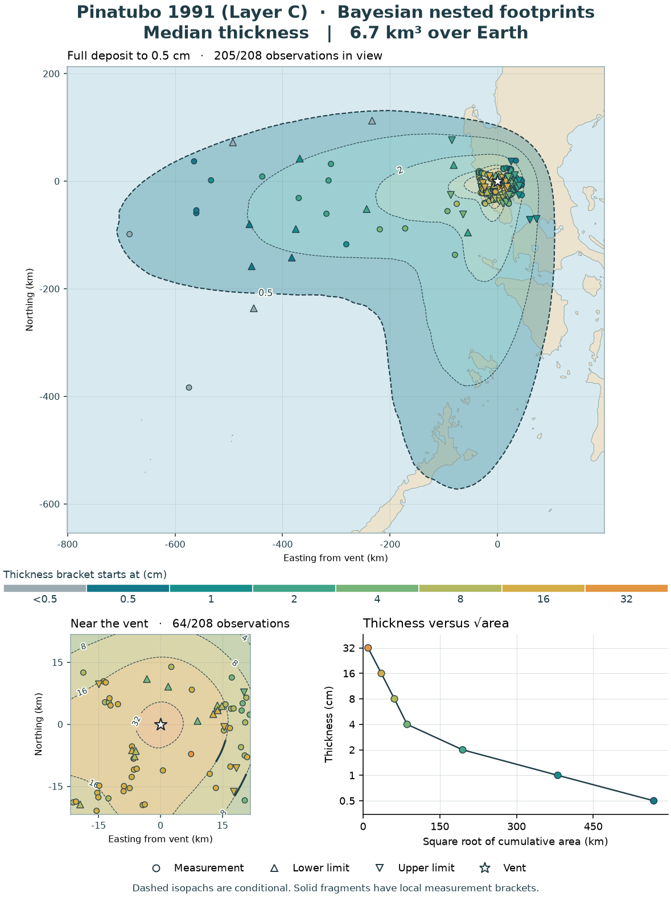

# Pinatubo 1991 · climactic Layer C

The 15 June 1991 climactic eruption deposited pumice and ash across Luzon and the South China Sea. This case combines the C1 and C2 fall layers on land with their marine equivalents, including co-ignimbrite fallout. Volumes refer to accumulated bulk deposit. The archive also identifies the separate layers A, B and D. [Field stratigraphy](https://pubs.usgs.gov/pinatubo/paladio/index.html) · [Offshore stratigraphy](https://doi.org/10.1007/s00445-003-0306-x)

**The reviewed Layer C input has 208 sites, comprising 150 measurements, 28 lower bounds and 30 upper bounds.** Two readers compared Koyaguchi C1 and C2 and checked 32 entries in Paladio-Melosantos Figure 7. The inventory contains 464 source records. The exact sites beyond 100 km leave a 294° gap in direction. [Accepted observations](../../data/eruptions/Pinatubo_1991_layer_C.csv) · [Koyaguchi review](../../data/audits/Pinatubo-1991/koyaguchi-c1-review.md) · [Figure 7 review and original crops](../../data/audits/Pinatubo-1991/paladio-figure-7-review.md)

**Model status.** The five-model rerun uses the combined 208-site input. The maps, volumes and geographic scores shown below are the 194-site baseline from before either figure review. [Archived fit input and reports](../../archive/2026-11-22-pinatubo-intake/pre-visual-review/README.md)

## Volumes and geographic prediction

Each volume integrates its method’s median-thickness map. The GP and spline cover the same observation hull. The other three methods cover Earth, including fallout below 0.5 cm. Conditional 95% intervals describe variation in whole-deposit volume across posterior draws.

| Method | Median-map volume (km³) | Conditional 95% interval (km³) | Held-out score ↓ | 95% coverage |
|---|---:|---:|---:|---:|
| GP ensemble | **3.5** | 3–5.05 | 4.300 | 86.4% |
| Cubic spline | **13.2** | 11.3–2.43e+11 (provisional) | 1.599 | 87.1% |
| [Directional ensemble](results/directional/README.md) | **6.57** | 5–11.8 (provisional) | 1.447 † | 89.3% |
| [Spherical mixture](results/spherical-mixture/README.md) | **13.7** | 8.79–25.4 (provisional) | 0.986 † | 97.1% |
| [Bayesian nested corridors](results/nested-isopachs/README.md) | **7.58** | 5.7–9.08 | 3.018 † | 60.7% |

Lower scores indicate better predictions in withheld geographic regions. Coverage counts exact withheld measurements. A dagger marks a numerical or geographic validation warning. Provisional intervals retain their fit or integration warnings.

## Full deposits and near-vent detail

The outer line is 0.5 cm. Contours and observation colours double from there. All three methods use the same near-vent window for this eruption. Each curve counts the combined area of all patches at or above a thickness.




## Inside the observation hull


The dashed boundary encloses all accepted sites. Gaps inside it can still be poorly constrained. [Regional fits and numerical checks](results/README.md)

## Check the measurements

- [Check a land reading by eye](../../data/audits/Pinatubo-1991/VISUAL-CHECK.md). Each evidence ID leads to the original pixels, the reading and the accepted CSV row or exclusion.
- [Compare both mapped positions of the same bed](results/source-checks/README.md#position-on-the-two-sublayer-maps). The alternative refits move the 51 combined sublayer observations to their positions on Koyaguchi’s C2 panel.
- [Check the twelve named sections](../../data/audits/Pinatubo-1991/field-check.md). The 22 grain-size sample entries resolve to twelve whole-section measurements.
- [Check a marine station](../../data/audits/Pinatubo-1991/marine-check.md). The measured bulk bed, stratigraphic subdivisions, cruise locator and repeat visits are kept together.
- [Inspect the other fall layers](../../data/audits/Pinatubo-1991/other-phases/README.md). The preclimactic A and B and postclimactic D measurements retain their original units, source pixels and location qualifications.
- [Check the distal reports](../../data/audits/Pinatubo-1991/distal-reports.md). The audit covers nineteen mapped localities and contemporary field reports, including the proximal 1–2 m areal average.

## Where the observations change the estimate

With all 34 offshore records withheld, the land-only nested fit covers 0 of 19 measured seabeds with its 95% predictive intervals. Its 0.70 km³ estimate also has a numerical warning. The full nested fit gives 7.58 km³. Including both endpoints of the nine marine replicate ranges gives 5.16 km³ with a conditional 95% interval of 4.44–7.06 km³. [Source tests and individual station predictions](results/source-checks/README.md)

The GP and spline use the same 279,806 km² observation hull. At the northern marine core SO-114-13 the source records 1–2 mm. With just its lower endpoint in the shared input, the spline predicts 24.1 m at that core. Giving the nine replicate stations their upper endpoints changes its regional volume from 13.17 to 5.30 km³. Its principal upper volume interval fails the integration check. [Regional sensitivity and field checks](results/source-checks/README.md#regional-sensitivity-to-the-upper-endpoints)

The uncertain-direction ensemble covered 125 of 140 scored exact thicknesses with its geographic 95% prediction intervals (140 exact sites in total). The spherical family placed a median 4.1% of its mass in the screened measurement footprint and 94.2% in intervening gaps and sectors, calculated across complete draws. [Directional holdouts](results/directional/azimuth/heldout.csv) · [Spherical mass by region](results/spherical-mixture/README.md)

The spherical baseline’s final sampling attempt recorded 1 divergent transition. Across eight fixed priors, 5 fits passed their numerical checks. Their full set of conditional intervals spans 6.29–431.02 km³. 2 of the four geographic training fits passed sampling checks. [Prior fits and diagnostics](results/spherical-mixture/report.json)

The nested corridor’s full fit passes its population and integration checks. 2 of its four geographic training fits pass. Across the four withheld regions, its predictive interval covers 85 of 140 measured thicknesses. No complete nested contour band passes the shared support screen. Beyond 100 km the exact sites leave a 294° unsampled arc. The whole-Earth volumes depend on assumptions about fallout outside the measured directions. [Observation map and directional coverage](../../data/audits/Pinatubo-1991/README.md#geographic-coverage) · [Nested support and extrapolation](results/nested-isopachs/README.md)

Wiesner and colleagues reported 5.5 km³ for the 15 June airfall deposit. Earlier thinning fits ranged from 1.7 to 4.4 km³ as distal extrapolation assumptions varied. These estimates share field evidence with this case. [Later land and marine estimate](https://doi.org/10.1007/s00445-003-0306-x) · [Earlier thinning scenarios](../../data/sources/pinatubo-1991/context/paladio-published-volume-comparisons.csv)

## Reproduce the case

These commands use the reviewed observations in this checkout. For the maps and numbers shown above, use the revision in the [pre-review archive](../../archive/2026-11-22-pinatubo-intake/pre-visual-review/README.md). The model command runs both regional families and all three whole-Earth families with their ordinary fit settings, prior sensitivities, support audits and buffered geographic holdouts.

```sh
python -m benchmarks.pinatubo
python -m src.empirical_isopach.cli compare pinatubo-1991-layer-c --output results/pinatubo-1991-replay
python -m benchmarks.pinatubo_sensitivity --output results/pinatubo-source-tests
```

The earlier 137-row intake retains its original five fits. The expanded audit adds 60 observations and removes three ambiguous map readings. The intervening 193-site regional and nested fields allow an independent test against the subsequently located SO-114-23 core. [Intake history and held-out replay](../../archive/2026-11-22-pinatubo-intake/README.md) · [Original sources and checksums](../../data/sources/pinatubo-1991/README.md)
