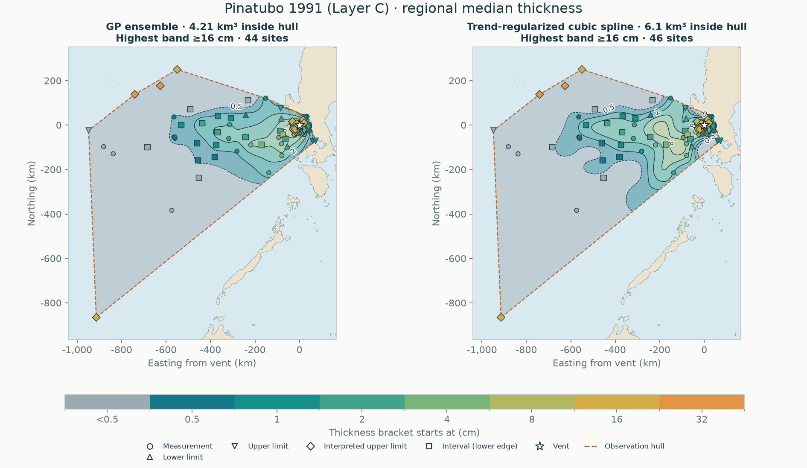

# Pinatubo 1991 · climactic Layer C fallout

The GP ensemble, trend-regularized cubic spline and nested footprints share **235 localities** across the C1 and C2 fall deposits on Luzon and their marine equivalents, including co-ignimbrite ash. The 15 June 1991 dataset contains 147 point measurements, 18 two-sided ranges, 31 lower limits and 39 upper limits. [Accepted observations](../../data/eruptions/Pinatubo_1991_layer_C_reviewed.csv) · [Land and marine source audit](../../data/audits/Pinatubo-1991/reaudit/README.md) · [Download the estimates](results/principal-volumes.csv)

## Volumes and geographic prediction

Each estimate integrates the median thickness on its map. The conditional range integrates the pointwise 25th and 75th percentiles of thickness over the same area. The 50% probability refers to thickness at each location. A single probability for total volume does not follow from these endpoints.

| Method | Integration area | Median map (km³) | Q25–Q75 thickness maps (km³) | Held-out score ↓ | 95% predictive coverage |
|---|---|---:|---:|---:|---:|
| GP ensemble | observation hull | **4.21** | 3.22–5.57 | 0.955 | 97.3% |
| Cubic spline | observation hull | **6.1** | 4.17–10.9 | 1.421 | 90.5% |
| [Bayesian nested footprints](results/nested-isopachs/README.md) | whole Earth | **7.37** | 4.83–13.7 | 1.234 † | 87.1% |

Lower scores indicate better geographic prediction. Coverage counts exact withheld measurements. A dagger marks a fit, integration or validation warning.

## Full deposits and near-vent detail

Each full map follows the thickest power-of-two contour enclosing at least 95% of the fitted locations, with a 1 cm minimum. The title gives the actual count, including when that minimum prevents 95% coverage. Global volumes include the thinner tail. The innermost line is the thickest doubling level enclosing an accepted location. The near-vent window expands from the proximal sites until eligible contours are visible. The curve sums all patches at each displayed thickness.

## Inside the observation hull

The GP and spline integrate over the dashed hull. Gaps inside it can still be poorly constrained. [Regional fits and numerical checks](results/README.md)

## What the field sites constrain

The regional models use the same 614,065 km² hull and predict all 235 sites in four buffered geographic holdouts. The GP covered 143 of 147 withheld point measurements at 95%, and the spline covered 133. In the southwestern deletion (fold 0), the spline's secondary expected volume exceeded the numerical range. Its median-map integral remained finite. The full-data median and quartile integrations passed for both regional models. Neither regional support screen qualified a complete contour band. [Regional fits and warnings](results/README.md) · [Regional contour support](results/support/README.md)

The full nested-footprint fit and its median and quartile map integrations passed. Three of four buffered geographic fits passed their numerical checks. The score includes all 235 held-out sites, and the 95% predictive intervals covered 87.1% of the point measurements. The shared support screen qualified no complete contour band. The southern sector has observations only to 42 km and accounts for about a quarter of the median-map volume. [Sampling, geographic support and offshore tests](results/nested-isopachs/README.md)

The offshore audit reconciles 151 survey entries, including revisits, mixed ash and inspected cores without a visible bed. The audit also preserves the reviewed Koyaguchi and Paladio-Melosantos land readings. [Marine station map](results/nested-isopachs/marine-survey.png) · [Original pixels and land readings](../../data/audits/Pinatubo-1991/VISUAL-CHECK.md) · [Earlier five-method comparison and input history](../../archive/2026-11-24-case-editions/README.md#pinatubo)

## Spherical-mixture convergence

**The first sampling run stopped on 24 November 2026 for method review.** The displaced spherical mixture reached the sampling stage on the audited 235 localities. The run ended before it produced a median-thickness map, integrated volume or geographic prediction score.

The three-fan baseline exhausted all three attempts. The final attempt retained 6,000 draws per chain. The median effective number of fans was **2.14, 2.13, 2.13 and 1.48** across the four chains. This quantity, $1/\sum_k w_k^2$, measures how evenly the fitted weights are distributed and is invariant to relabeling the fans. Its rank-normalized split R̂ was **1.524**. The parent log-volume parameter had R̂ **1.003**. Across all monitored quantities the maximum R̂ was **1.528** (target below 1.01) and the minimum bulk effective sample size was **7.1** (target at least 400). The saved chains allow these differences to be inspected without a refit. [Final baseline draws](diagnostics/spherical-mixture/baseline-attempt-3.npz)

| Check | Outcome on the audited input |
|---|---|
| Eight full-data prior settings | Four passed, including the one-fan fit. The baseline, diffuse-tail and wide-geography settings finished with warnings. The five-fan fit had seven divergences and maximum R̂ 1.277 on its first attempt (14.2 minutes). Its second attempt was interrupted. |
| Four buffered geographic refits | Folds 0, 1 and 3 passed. With the 59 sites in fold 2 withheld, the third attempt still had maximum R̂ 1.522 and one divergence. Six of those sites reported thickness ranges. |

Spherical and directional workers ran concurrently on a 16 GB machine that experienced memory pressure. Per-process peak memory was unmeasured, so attribution to an individual model remains open. The diagnostic record gives settings, seeds, timings and posterior hashes for all 27 completed attempts, along with the withheld site IDs. [Attempt diagnostics](diagnostics/spherical-mixture/attempts.json) · [Sampling and convergence rules](../../docs/methods/probabilistic-global.md#numerical-and-empirical-checks)
