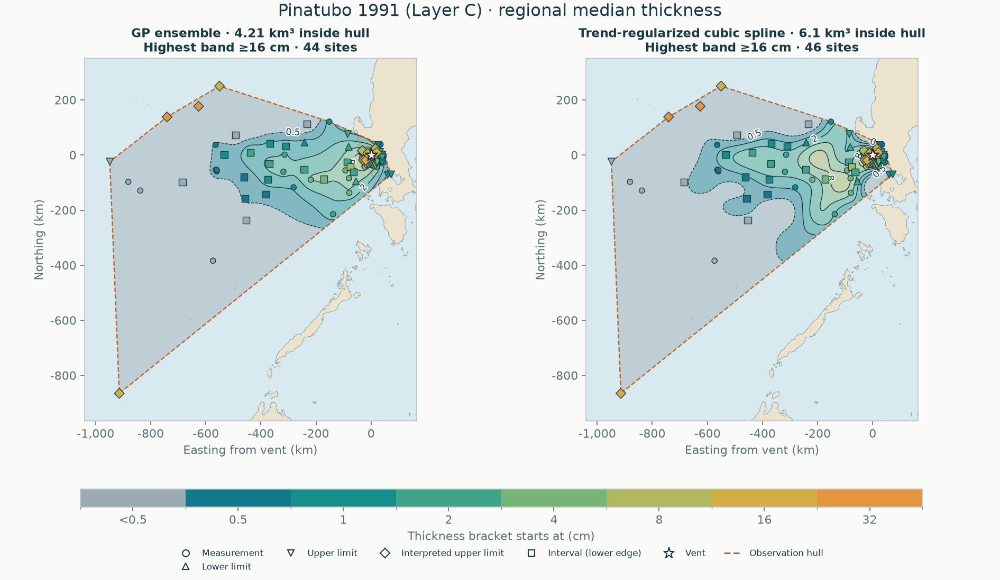
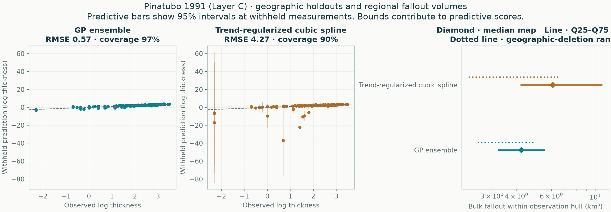

# Pinatubo 1991 (Layer C): empirical methods on one regional footprint

All methods use the same accepted observations, geographic holdouts and integration area. No method is designated preferred.

**147 exact measurements, 31 lower bounds, 39 upper limits, 18 two-sided intervals.** The observation hull covers 614,065 km². The automatic validation buffer is 1.76 km.



The full observation hull and every accepted location are in view. The coloured field is clipped to the exact hull; fine coastlines are context only. [Map frame and rendering provenance](map-display.json).

| Quantity | GP ensemble | Trend-regularized cubic spline |
|---|---:|---:|
| Principal median-map volume inside hull (km³) | 4.21 | 6.10 |
| Integrated Q25–Q75 thickness (km³) | 3.22–5.57 | 4.17–10.87 |
| Outer equal-region negative log score ↓ | 0.955 | 1.421 |
| Outer log-thickness RMSE ↓ | 0.568 | 4.271 |
| Outer 95% observation-interval coverage | 97.3% | 90.5% |

Lower predictive score and RMSE are better. Coverage must be read with interval width and predictive score; wider intervals alone are not improvement.



## Scope

The footprint is the convex hull of measured/bounded locations, with no source point or invented observations added. It can contain large unsampled gaps and can exclude proximal deposits. These are **regional bulk fallout volumes, not total eruption volumes or dense-rock equivalents**. No global extrapolation enters this comparison.

Volume integrates pointwise median thickness over the observation hull. The endpoints integrate the pointwise 25th and 75th percentiles of latent thickness over that same area. [Band integrals and refinements](thickness-bands.json)

## Fitted methods

### GP ensemble

```json
{
  "candidate": {
    "tail": "stacked"
  },
  "components": [
    {
      "weight": 0.07537852154560486,
      "model": {
        "candidate": {
          "tail": "exponential",
          "length_factor": 0.75,
          "noise_ratio": 1.5
        },
        "beta": [
          3.0879764641242793,
          1.0505890752073828,
          -0.8295251125001609,
          -0.2707928935621131
        ],
        "radius_scale_km": 31.19362515055033,
        "length_km": 32.188030810919884,
        "amplitude_log": 0.4959832051874641,
        "noise_log": 0.7439748077811961,
        "jitter": 2.459993398280301e-10,
        "trend_on_constraint_boundary": false,
        "uncertainty": "conditional Laplace"
      }
    },
    {
      "weight": 0.4917677113038557,
      "model": {
        "candidate": {
          "tail": "power",
          "length_factor": 0.75,
          "noise_ratio": 0.25
        },
        "beta": [
          4.37300660757869,
          3.3891235222256686,
          -1.2673926954709278,
          -0.5686625864452174
        ],
        "radius_scale_km": 31.19362515055033,
        "length_km": 32.188030810919884,
        "amplitude_log": 0.5801733470964213,
        "noise_log": 0.14504333677410533,
        "jitter": 3.366011126810646e-10,
        "trend_on_constraint_boundary": true,
        "uncertainty": "conditional Laplace"
      }
    },
    {
      "weight": 0.4328537671505395,
      "model": {
        "candidate": {
          "tail": "power",
          "length_factor": 1.5,
          "noise_ratio": 0.75
        },
        "beta": [
          4.37300660757869,
          3.3891235222256686,
          -1.2673926954709278,
          -0.5686625864452174
        ],
        "radius_scale_km": 31.19362515055033,
        "length_km": 64.37606162183977,
        "amplitude_log": 0.5801733470964213,
        "noise_log": 0.435130010322316,
        "jitter": 3.366011126810646e-10,
        "trend_on_constraint_boundary": true,
        "uncertainty": "conditional Laplace"
      }
    }
  ],
  "dominant_tail": "power",
  "observation_discrepancy_variance_log": 0.0,
  "trend_on_constraint_boundary": true,
  "uncertainty": "Predictive mixture; includes disagreement among retained candidates, conditional on each fit and estimated weights. Fitted-parameter uncertainty is not integrated."
}
```

### Trend-regularized cubic spline

```json
{
  "method": "spline",
  "candidate": {
    "tail": "power",
    "knot_intervals": 12,
    "tension": 1.0,
    "smoothing": 0.01,
    "trend_strength": 1.0,
    "noise_ratio": 0.75
  },
  "bounds_km": [
    -999.4560309065577,
    -920.8285318322295,
    123.76605171399694,
    306.5224189683878
  ],
  "knot_intervals_xy": [
    11,
    12
  ],
  "n_coefficients": 210,
  "noise_log": 0.3484076731436785,
  "amplitude_log": 0.4645435641915713,
  "trend_beta": [
    3.8120010368139408,
    2.734698401882434,
    -1.1016710825609686,
    -0.7821716345349167
  ],
  "trend_radius_scale_km": 31.19362515055033,
  "trend_on_constraint_boundary": false,
  "effective_df_exact": 15.419747236751608,
  "newton_decrement": 3.616483274961662e-22,
  "newton_iterations": 6,
  "quadrature_order": 6,
  "uncertainty": "Conditional Laplace",
  "uncertainty_omits": [
    "fitted trend",
    "noise and smoothing estimation",
    "knot/trend selection",
    "sampling and preservation bias",
    "vent location error"
  ],
  "pseudo_observations": 0
}
```

Every explored candidate is retained in the selection tables. All response-dependent choices are retuned within training folds; no hand-placed pseudo-data enter the likelihood.

## Reliability checks

- All probability intervals condition on fitted parameters and selected settings; they omit parameter/selection and preservation/sampling uncertainty.
- Four geographic outer folds evaluate the entire tuning procedure; this is development evidence, not independent external validation.
- Geographic-deletion volume ranges show refitting sensitivity and are not confidence intervals.
- Trend-regularized cubic spline geographic deletion folds 0 have an unrepresentable expected volume. Their median-map integrals, observed-site predictions and log expected volumes are retained.
- Spline selection reaches an explored search boundary: knot_intervals. This is a bounded-grid result, not proof of a continuous optimum.

## Reproduce and inspect

```sh
tephra-isopachs compare 'Pinatubo 1991 (Layer C)' --output results/new-regional-run
```

[Complete numerical report](report.json) · [Withheld predictions](heldout_predictions.csv) · [Accepted observation semantics](accepted_observations.csv) · [Selection tables](selection/README.md)

The JSON records input/source hashes, package versions, all fold memberships, regional integration refinements, conditional-volume sampling precision and geographic-deletion sensitivity. Historical GP global calculations remain separate.

## Which parts are actually supported?

Read the [local support and complete-contour audit](support/README.md) before extrapolating these hull volumes. It screens unsampled gaps, tests closure under geographic deletion, and separates interpolation from proximal/distal assumptions.
