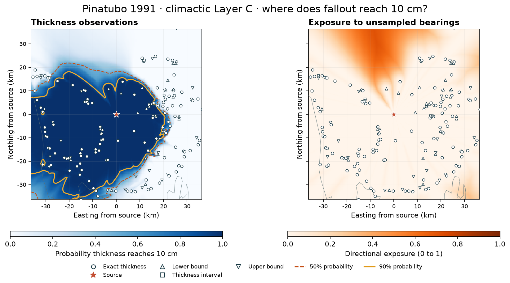

# Pinatubo 1991 (Layer C) · Directional ensemble

The principal bulk volume is **6.38 km³**, the whole-Earth integral of the median-thickness map. The conditional thickness-band range is **5.19–8.11 km³**. Its endpoints integrate the pointwise 25th and 75th percentiles of latent thickness over Earth. **Numerical warning on the fitted deposit distribution.**

Each circle shows a measurement. Bounded sites take the colour of their stated limit. The curve counts every patch at or above each thickness. The 1 cm footprint includes 188 of 208 modeled locations. The full volume also includes fallout thinner than the displayed footprint. [Thickness and cumulative area](thickness-area.csv) · [Map integral, resolution and source hashes](deposit.json)

The principal map uses the geographic continuation evaluated on all registered eruptions. [Geographic holdouts, structural alternatives and numerical checks](extent/report.json) · [Complete contour decisions](extent/support.json.gz) · [Predictions at withheld observations](extent/heldout.csv.gz)

## Earlier continuation and its diagnostics

The following figures and statistics describe the fitted parent and its broader continuation. The principal estimate and its interval appear above.

## Reach from the volcano

Distances are great-circle kilometres to the first outward crossing on each compass ray. The area columns give the entire 10 cm footprint in the corresponding 45° sector, including detached areas. Together they distinguish a long point on a contour from an entire broad lobe.

| Bearing | Fixed 10 cm reach (km) | Uncertain 10 cm reach (km) | Fixed ≥10 cm area (km²) | Uncertain ≥10 cm area (km²) |
|---|---:|---:|---:|---:|
| N | 17.6 | 17.3 | 125 | 118 |
| NE | 17.6 | 17.6 | 119 | 119 |
| E | 21.8 | 21.8 | 175 | 175 |
| SE | 22.5 | 22.5 | 209 | 209 |
| S | 30.3 | 30.3 | 446 | 439 |
| SW | 53.5 | 49.0 | 1,339 | 1,294 |
| W | 79.3 | 79.3 | 2,035 | 2,031 |
| NW | 20.3 | 20.4 | 222 | 216 |

The 50% and 90% probability lines answer different questions. At a location on the 90% line, nine in ten model draws reach 10 cm. These are pointwise probabilities conditional on the model. Joint confidence over an entire region requires a different calculation.

## Withheld observations

Each row averages negative log predictive scores over equally weighted folds. Lower scores predict the withheld thicknesses and limits better. The passing-only columns exclude numerical failures. Coverage counts exact withheld thicknesses inside the uncertain-direction 95% predictive interval. A dash marks an unavailable score or coverage.

| Deletion | All estimable folds | Fixed | Uncertain | Passing folds | Fixed, passing | Uncertain, passing | Exact-site 95% coverage |
|---|---:|---:|---:|---:|---:|---:|---:|
| Geographic regions | 4 | 1.454 | 1.549 | 2 | 2.335 | 2.383 | 134/150 (89.3%) |
| Source quadrants | 4 | 1.378 | 1.254 | 1 | 2.298 | 1.538 | 136/150 (90.7%) |

[Predictions for every estimable held-out site](azimuth/heldout.csv). The numerical record includes all planned folds, row identities, unscorable directions, fit warnings and phase-integration checks.

## Independent archive predictions

These locations have reported ash occurrences or tentative correlations. The fitted thickness data supply the predictions. The intervals describe latent bulk thickness at each location.

| Archive | Identification | Median thickness (cm) | Conditional 95% interval (cm) |
|---|---|---:|---:|
| WW-open-01 | secure | 1.19e-18 | 2.22e-44–3.41e-06 |
| WW-open-02 | secure | 8.56e-15 | 7.41e-47–0.00267 |
| WW-open-03 | secure | 3.88e-14 | 1.57e-43–0.00654 |
| WW-open-04 | secure | 1.56e-13 | 3.98e-38–0.000252 |
| WW-open-05 | secure | 1.1e-13 | 1.76e-41–0.00932 |
| WW-open-06 | secure | 3.58e-13 | 1.2e-36–0.000459 |
| WW-open-07 | secure | 3.77e-13 | 8.89e-38–0.0152 |
| WW-open-08 | secure | 9.19e-13 | 2.76e-35–0.000577 |
| WW-open-09 | secure | 2.16e-14 | 3.59e-32–0.000158 |
| WW-open-10 | secure | 1.12e-12 | 2.69e-35–0.0228 |
| WW-open-11 | secure | 3.73e-12 | 4.04e-33–0.00144 |
| WW-open-12 | secure | 1.49e-11 | 1.31e-30–5.92e-05 |
| WW-open-13 | secure | 3.76e-09 | 6.08e-20–0.00919 |
| WW-open-14 | secure | 2.72e-11 | 3.07e-24–0.06 |
| WW-open-15 | secure | 5.29e-10 | 2.49e-27–0.000105 |
| WW-open-16 | secure | 5.25e-11 | 3.92e-30–0.0201 |
| WW-open-17 | secure | 3.22e-10 | 8.76e-21–0.0803 |
| WW-open-18 | secure | 1.62e-10 | 1.18e-26–0.0991 |
| WW-open-19 | secure | 1.07e-07 | 1.13e-20–0.0799 |
| WW-open-20 | secure | 8.35e-12 | 8.54e-21–0.00695 |
| WW-open-21 | secure | 0.000616 | 1.91e-07–0.0467 |
| WW-open-22 | secure | 0.000159 | 7.12e-08–0.0544 |
| WW-open-23 | secure | 0.0293 | 0.000153–0.204 |
| WW-open-24 | secure | 2.58e-06 | 2.59e-15–0.0211 |
| WW-open-25 | secure | 0.132 | 0.0082–0.504 |
| WW-open-26 | secure | 0.165 | 0.0148–0.595 |
| WW-open-27 | secure | 0.142 | 0.00477–0.636 |
| WW-open-28 | secure | 0.127 | 0.00505–0.536 |
| WW-open-29 | secure | 0.0815 | 0.0127–0.192 |
| WW-open-30 | secure | 0.0709 | 0.00188–0.189 |
| WW-open-31 | secure | 0.0432 | 8.27e-05–0.32 |
| WW-open-32 | secure | 0.00336 | 5.49e-05–0.0185 |
| WW-open-33 | secure | 0.0011 | 6.37e-11–0.0124 |
| WW-open-34 | secure | 0.00104 | 1.36e-10–0.015 |
| WW-open-35 | secure | 0.00076 | 1.9e-08–0.0191 |
| WW-open-36 | secure | 0.000841 | 1.36e-07–0.0272 |
| WW-open-37 | secure | 0.000612 | 7.51e-09–0.0156 |
| SO132_10 | secure | 0.475 | 0.288–0.713 |
| SO132_11 | secure | 1.24 | 0.87–1.65 |
| SO132_12 | secure | 1.66 | 1.33–2.15 |
| SO132_12A | secure | 1.73 | 1.4–2.21 |
| SO132_13 | secure | 2.83 | 1.96–4.19 |
| SO132_14 | secure | 2.58 | 1.76–3.85 |
| SO132_15 | secure | 2.09 | 1.41–3.13 |
| SO132_16 | secure | 1.74 | 1.29–2.63 |
| SO132_17 | secure | 0.852 | 0.241–2.02 |
| SO132_19 | secure | 0.299 | 0.00649–1.48 |
| SO132_2 | secure | 0.021 | 0.00641–0.0546 |
| SO132_20 | secure | 1.93 | 1.32–3.1 |
| SO132_21 | secure | 2.27 | 1.52–3.26 |
| SO132_22 | tentative | 2.4 | 1.63–3.53 |
| SO132_23 | secure | 3.97 | 3.28–4.98 |
| SO132_24 | tentative | 3.23 | 2.43–4.74 |
| SO132_25 | secure | 4.93 | 4.22–5.82 |
| SO132_26 | secure | 4.43 | 3.86–5.13 |
| SO132_27 | secure | 3.82 | 3.25–4.58 |
| SO132_28 | secure | 3.98 | 2.66–5.86 |
| SO132_29 | secure | 4.61 | 3.21–6.88 |
| SO132_3 | secure | 0.055 | 0.0254–0.113 |
| SO132_30 | secure | 3.24 | 2.54–4.04 |
| SO132_31 | secure | 2.35 | 1.74–3.02 |
| SO132_32 | secure | 2.22 | 0.0737–7.55 |
| SO132_33 | secure | 1.86 | 0.0054–9.53 |
| SO132_34 | secure | 1.26 | 0.00152–8.15 |
| SO132_35 | secure | 1.7 | 0.0283–8.11 |
| SO132_36 | secure | 4.57 | 2.66–8.79 |
| SO132_37 | secure | 4.36 | 2.73–7.17 |
| SO132_37A | secure | 4.63 | 3.12–7.52 |
| SO132_38 | secure | 5.21 | 2.77–8.76 |
| SO132_39 | secure | 5.39 | 4.09–7.02 |
| SO132_4 | secure | 0.15 | 0.0315–0.375 |
| SO132_40 | secure | 7.58 | 2.05–9.14 |
| SO132_41 | secure | 6.65 | 4.57–9.79 |
| SO132_42 | secure | 9.16 | 7.83–10.7 |
| SO132_43 | secure | 9.88 | 8.4–11.9 |
| SO132_44 | secure | 8.78 | 7.43–10.5 |
| SO132_44A | secure | 9.28 | 7.86–11.1 |
| SO132_47 | secure | 0.0167 | 5.62e-07–2.97 |
| SO132_48 | secure | 0.0954 | 0.00132–3.21 |
| SO132_49 | secure | 5.97 | 2.32–11.2 |
| SO132_5 | secure | 0.381 | 0.247–0.556 |
| SO132_50 | secure | 7.07 | 4.86–8.52 |
| SO132_7 | secure | 1.12 | 0.727–1.69 |
| SO132_8 | secure | 1.17 | 0.947–1.48 |
| SO132_9 | secure | 0.834 | 0.575–1.15 |
| GIK18429 | secure | 0.0159 | 0.000704–0.0894 |
| GIK18430 | secure | 0.0201 | 0.00623–0.053 |
| SO140B_10 | secure | 3.82 | 3.25–4.58 |
| SO140B_11 | secure | 3.96 | 2.67–5.79 |
| SO140B_12 | secure | 4.37 | 2.75–7.17 |
| SO140B_13 | secure | 5.06 | 2.93–8.34 |
| SO140B_14 | secure | 7.58 | 2.05–9.13 |
| SO140B_23 | secure | 10.8 | 9.16–12.9 |
| SO140B_24 | secure | 9.16 | 7.82–10.7 |
| SO140B_25 | secure | 8.54 | 5.87–12.8 |
| SO140B_3 | secure | 0.662 | 0.438–1.01 |
| SO140B_4 | secure | 2.12 | 1.41–3.19 |
| SO140B_5 | secure | 2.26 | 1.72–3.02 |
| SO140B_6 | secure | 2.58 | 1.76–3.85 |
| SO140B_7 | secure | 2.98 | 2.56–3.51 |
| SO140B_8 | secure | 2.27 | 1.53–3.25 |
| SO140B_9 | tentative | 3.23 | 2.43–4.74 |

## Checks and reproducibility

The shared contour audit found eligible bands under none of the screened support policies. Audit status is completed. [All contour decisions and deletion failures](azimuth/complete-contour-audit.json)

The spatial integration check passed at 32,768 points per scramble. The map used up to 64 posterior draws per chain and structure. Resolved contour areas passed the split-packet check. The joint-volume quantiles passed the split check.

Full-fit sampling warnings occurred for reference, possible_missing_fan.

[Numerical report, all sector volumes and sensitivities](azimuth/report.json) · [Complete fields and per-field volumes](azimuth/fields.npz) · [Principal map grids](azimuth/median-grids.npz) · [Near-source comparison grids](azimuth/map-grid.npz) · [Fragment decisions](azimuth/fragment-decisions.csv) · [Bracketed coordinates](azimuth/bracketed-fragments.csv) · [File hashes](azimuth/artifacts.json)

## Related directional studies

- [Earlier fixed-direction ensemble and its separate calibration](ensemble/README.md)
- [Single-structure and proximal-cap sensitivities](single-structure/README.md)
- [Measured-fan continuation and inspected-site evidence](bearing/README.md)
