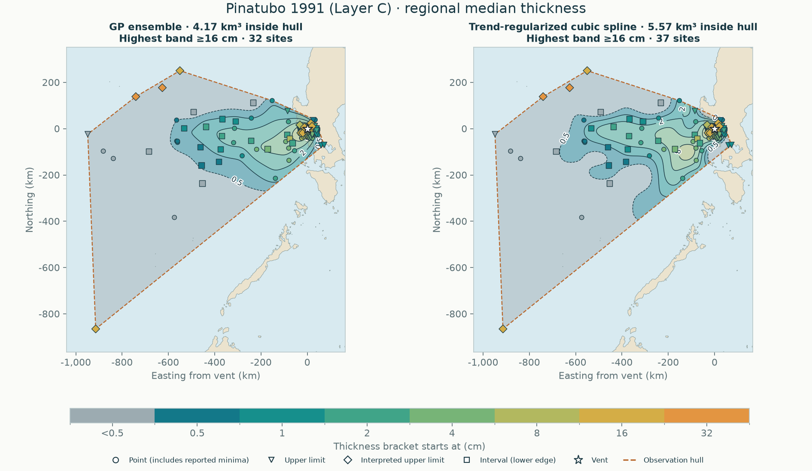
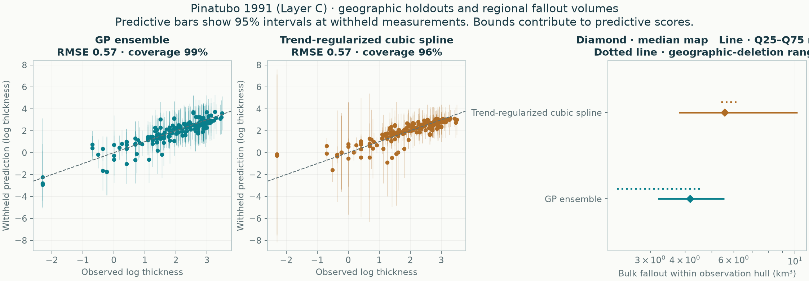

# Pinatubo 1991 (Layer C): empirical methods on one regional footprint

All methods use the same accepted observations, geographic holdouts and integration area. No method is designated preferred.

**147 reported measurements and 31 reported minima fitted as points, 0 lower-censored fits, 39 upper limits, 18 two-sided intervals.** The observation hull covers 614,065 km². The automatic validation buffer is 1.76 km.



The full observation hull and every accepted location are in view. The coloured field is clipped to the exact hull; fine coastlines are context only. [Map frame and rendering provenance](map-display.json).

| Quantity | GP ensemble | Trend-regularized cubic spline |
|---|---:|---:|
| Principal median-map volume inside hull (km³) | 4.17 | 5.57 |
| Integrated Q25–Q75 thickness (km³) | 3.20–5.54 | 3.81–10.20 |
| Outer equal-region negative log score ↓ | 1.037 | 0.929 |
| Outer log-thickness RMSE ↓ | 0.568 | 0.575 |
| Outer 95% observation-interval coverage | 98.9% | 95.5% |

Lower predictive score and RMSE are better. Coverage must be read with interval width and predictive score; wider intervals alone are not improvement.



## Scope

The footprint is the convex hull of measured/bounded locations, with no source point or invented observations added. It can contain large unsampled gaps and can exclude proximal deposits. These are **regional bulk fallout volumes, not total eruption volumes or dense-rock equivalents**. No global extrapolation enters this comparison.

Volume integrates pointwise median thickness over the observation hull. The endpoints integrate the pointwise 25th and 75th percentiles of latent thickness over that same area. [Band integrals and refinements](thickness-bands.json)

## Fitted methods

### GP ensemble

```json
{
  "candidate": {
    "tail": "stacked"
  },
  "components": [
    {
      "weight": 0.19682769949806153,
      "model": {
        "candidate": {
          "tail": "exponential",
          "length_factor": 1.5,
          "noise_ratio": 1.5
        },
        "beta": [
          3.0247736038352757,
          0.9820352901283227,
          -0.7697912572148919,
          -0.2709571164326697
        ],
        "radius_scale_km": 29.649802849160537,
        "length_km": 61.338989041951166,
        "amplitude_log": 0.5003194177694147,
        "noise_log": 0.750479126654122,
        "jitter": 2.503195197971261e-10,
        "trend_on_constraint_boundary": false,
        "uncertainty": "conditional Laplace"
      }
    },
    {
      "weight": 0.8031723005019386,
      "model": {
        "candidate": {
          "tail": "power",
          "length_factor": 1.5,
          "noise_ratio": 0.75
        },
        "beta": [
          4.328924187515774,
          3.2966774020591836,
          -1.18018163998804,
          -0.5371601142158337
        ],
        "radius_scale_km": 29.649802849160537,
        "length_km": 61.338989041951166,
        "amplitude_log": 0.6014958271264743,
        "noise_log": 0.45112187034485574,
        "jitter": 3.617972300505615e-10,
        "trend_on_constraint_boundary": true,
        "uncertainty": "conditional Laplace"
      }
    }
  ],
  "dominant_tail": "power",
  "observation_discrepancy_variance_log": 0.0,
  "trend_on_constraint_boundary": true,
  "uncertainty": "Predictive mixture; includes disagreement among retained candidates, conditional on each fit and estimated weights. Fitted-parameter uncertainty is not integrated."
}
```

### Trend-regularized cubic spline

```json
{
  "method": "spline",
  "candidate": {
    "tail": "power",
    "knot_intervals": 12,
    "tension": 1.0,
    "smoothing": 0.01,
    "trend_strength": 1.0,
    "noise_ratio": 0.75
  },
  "bounds_km": [
    -999.4560309065577,
    -920.8285318322297,
    123.76605171399694,
    306.5224189683878
  ],
  "knot_intervals_xy": [
    11,
    12
  ],
  "n_coefficients": 210,
  "noise_log": 0.3530654754906226,
  "amplitude_log": 0.4707539673208302,
  "trend_beta": [
    3.716801978812784,
    2.5691085365713198,
    -1.0015377340912723,
    -0.7540020630597273
  ],
  "trend_radius_scale_km": 29.649802849160537,
  "trend_on_constraint_boundary": false,
  "effective_df_exact": 17.195724982612138,
  "newton_decrement": 3.5625126378638e-22,
  "newton_iterations": 6,
  "quadrature_order": 6,
  "uncertainty": "Conditional Laplace",
  "uncertainty_omits": [
    "fitted trend",
    "noise and smoothing estimation",
    "knot/trend selection",
    "sampling and preservation bias",
    "vent location error"
  ],
  "pseudo_observations": 0
}
```

Every explored candidate is retained in the selection tables. All response-dependent choices are retuned within training folds; no hand-placed pseudo-data enter the likelihood.

## Reliability checks

- All probability intervals condition on fitted parameters and selected settings; they omit parameter/selection and preservation/sampling uncertainty.
- Four geographic outer folds evaluate the entire tuning procedure; this is development evidence, not independent external validation.
- Geographic-deletion volume ranges show refitting sensitivity and are not confidence intervals.
- Spline selection reaches an explored search boundary: knot_intervals. This is a bounded-grid result, not proof of a continuous optimum.

## Reproduce and inspect

```sh
tephra-isopachs compare 'Pinatubo 1991 (Layer C)' --output results/new-regional-run
```

[Complete numerical report](report.json) · [Withheld predictions](heldout_predictions.csv) · [Accepted observation semantics](accepted_observations.csv) · [Selection tables](selection/README.md)

The JSON records input/source hashes, package versions, all fold memberships, regional integration refinements, conditional-volume sampling precision and geographic-deletion sensitivity. Historical GP global calculations remain separate.

## Which parts are actually supported?

Read the [local support and complete-contour audit](support/README.md) before extrapolating these hull volumes. It screens unsampled gaps, tests closure under geographic deletion, and separates interpolation from proximal/distal assumptions.

[Wrapped angular covariance on this input](wrapped-angular-covariance/README.md)
