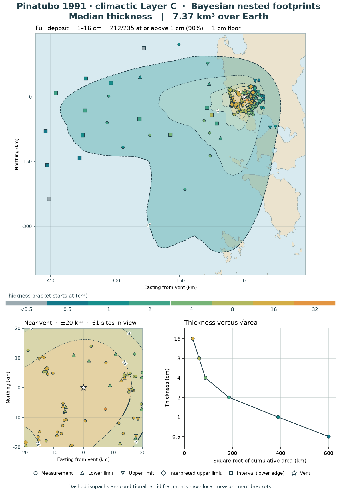
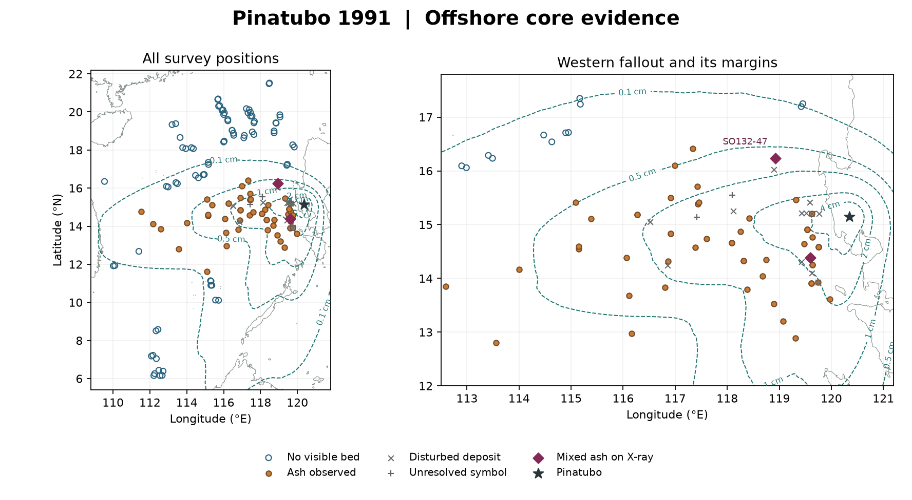

# Pinatubo 1991 · climactic Layer C · Bayesian nested footprints

The principal bulk volume is **7.37 km³**, the whole-Earth integral of the median-thickness map. The conditional thickness-band range is **4.83–13.7 km³**. Its endpoints integrate the pointwise 25th and 75th percentiles of latent thickness over Earth.



Circles show point values. Triangles and diamonds show one-sided limits. Squares show two-sided intervals, colored by their lower edge. Both endpoints enter the fit. The curve counts every patch at or above each thickness. The 1 cm footprint includes 212 of 235 modeled locations. The thickest displayed line is 16 cm and encloses 42 fitted locations. The volume includes fallout beyond the displayed contours. [Median thickness grid](median-grid.npz) · [Thickness and cumulative area](thickness-area.csv) · [Map integral, resolution and source hashes](deposit.json)

The fitted model predicts the four buffered geographic groups with an equal-group negative log score of 1.234. 3 of four independent deletion fits passed their numerical checks.

Each deposit draw expands one or more dispersal footprints. Stations enter through their thickness evidence. The direction and extent of each phase are inferred jointly with the area–thickness curve.

[Joint fit, structural sensitivities and numerical checks](footprints/report.json) · [Held-out predictions](footprints/heldout.csv.gz) · [Contour support and all rejection reasons](footprints/support.json.gz) · [Archive-site predictions](footprints/archive-probes.json) · [Volume and observations by compass sector](footprints/sector-volumes.csv)

## Geographic support and extrapolation

Across draws, the median volume share inside the first measured area rank is 0.7%. The median share outside the last positive rank is 15.3%, with a conditional 95% range of 3.1%–65.7%. A measured site can constrain one part of a perimeter while its opposite side remains unsampled.

The shared geographic screen accepts a complete contour band under 0 of 3 policies.

[Sector-by-sector evidence and volume](footprints/sector-volumes.csv) · [Volume sensitivity to the priors](footprints/report.json) · [Complete contour decisions](footprints/support.json.gz)

## What the field evidence tests

Across complete posterior deposits, the conditional 95% interval for bulk volume is **5.03–28.42 km³**, with a median of 9.39 km³. The full posterior passed. Median and quartile map integrations passed. The buffered geographic holdouts scored all 235 sites. Exact-site 95% predictive coverage was **87.1%**. The reported scores for geographic holdout 0 remain provisional. The earlier 208-site fit gave a 6.70 km³ median-map integral. Both the station inventory and the observation types changed. The difference combines their effects. [Fit attempts, sensitivities and validation](footprints/report.json) · [Initial packets preceding refinement](attempts/initial) · [Earlier estimate](../README.md)

All 18 ranges enter as two-sided interval events. Withholding a station yields a predicted probability for its complete interval. For instance, SO-114-13 spans 0.1–0.2 cm. The nearshore 8.5–9.0 cm observation has a held-out probability of 0.084% in its narrow band. Interval scores depend on both the width of the band and geographic predictive skill. [Scores for all 18 intervals](interval-validation.csv)



The dashed lines on the survey map show the conditional median field down to 0.1 cm (1 mm). Each survey entry retains its field classification. Named casts and nearby imprecisely located symbols can overlap. Among 78 entries classified as inspected without a visible bed, 17 have median predicted deposition above 1 mm and 0 above 5 mm. These counts include possible repeat localities. Two additional radiographed sections contain completely mixed ash. For SO132-47 the local median is **0.68 cm**, with a 95% latent thickness interval of **0.30–1.24 cm**. Wetzel reconstructed approximately **1.5 cm** at this site. It enters once as a qualified point, and the posterior reflects neighboring observations and model geometry. [All 151 station predictions and threshold probabilities](marine-predictions.csv) · [Field evidence](../../../../../data/audits/Pinatubo-1991/reaudit/source-notes.md)

Omitting the four SO95 sediment-package ceilings gives a median joint-draw volume of 9.39 km³. Omitting the seven farmer recollections gives 9.43 km³. At SO132-47, replacing the 1.5 cm reconstructed thickness with the weaker province-specific 2 cm ceiling gives 5.79 km³. The diagnostics reweight complete posterior deposits by the likelihood ratio of the modified evidence. Effective sample sizes and conditional 95% endpoints are tabulated for every group. Southern extrapolation remains important. That sector has observations only to 42 km and contributes 25% of the median-map volume. [Omission and weaker-transfer diagnostics](conditional-omissions.csv) · [Sector distances and volumes](footprints/sector-volumes.csv)

## Reproduce the principal fit

From the repository root, use a fresh destination for the principal fit and its four buffered geographic holdouts.

```sh
python -m benchmarks.nested_footprints --case pinatubo-1991-layer-c --output results/pinatubo-fits
python -m benchmarks.footprint_release --case pinatubo-1991-layer-c --fits results/pinatubo-fits --output results/pinatubo-release
python -m benchmarks.pinatubo_nested_review --folder results/pinatubo-release/pinatubo-1991-layer-c
python -m benchmarks.pinatubo_marine_map --folder results/pinatubo-release/pinatubo-1991-layer-c
```

Run `python -m benchmarks.pinatubo_nested_review --verify` to replay the published map, interval scores, station predictions and omission estimates. [Principal source audit](../../../../../data/audits/Pinatubo-1991/reaudit/README.md)
