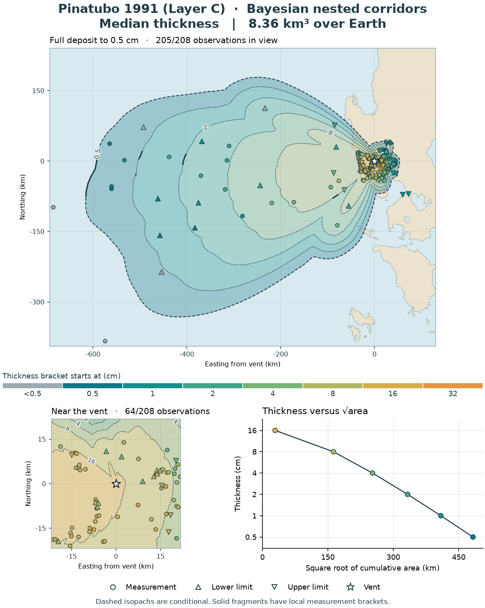
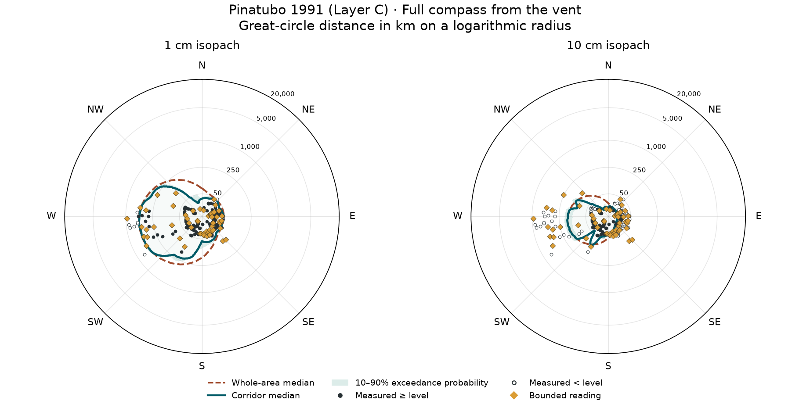

# Pinatubo 1991 (Layer C) · Bayesian nested corridors

The principal bulk volume is **8.36 km³**, the whole-Earth integral of the median-thickness map. The conditional 95% interval for total fallout volume is **7.42–9.6 km³** across complete posterior draws.

Each circle shows a measurement. Bounded sites take the colour of their stated limit. The curve counts every patch at or above each thickness. The volume also includes thinner fallout beyond the 0.5 cm line. [Thickness and cumulative area](thickness-area.csv) · [Map integral, resolution and source hashes](deposit.json)

Solid segments cross locally bracketed triangles with at least 90% posterior crossing probability. [Whole-Earth context](world.png) · [Local brackets](local-brackets.csv.gz) · [Complete contour checks](support.json)

The buffered geographic score is 3.142 for the corridor and 2.157 for the whole-area sensitivity. Lower scores indicate better predictions at withheld sites. The corridor’s 95% predictive intervals cover 93 of 150 exact withheld readings. 3 of 4 geographic fits passed their sampling checks. The full-data proposal and importance check passed, the final volume populations passed, and the integration check passed. The shared screen accepted a complete contour band under 0 policies. [Prediction scores and row identities](report.json) · [Full fit diagnostics](full.json)

## Where the volume lies

The full-compass view includes all bearings through the antipode. Its logarithmic distance scale makes the proximal flanks visible. Areas in the table use the physical equal-area integral.

| Compass sector | Exact sites | Bounded sites | Corridor 1 cm area (km²) | Whole-area 1 cm area (km²) | Corridor conditional 95% volume interval (km³) |
|---|---:|---:|---:|---:|---:|
| N | 1 | 2 | 429 | 2,823 | 0.022–0.05 |
| NE | 12 | 2 | 739 | 915 | 0.034–0.045 |
| E | 32 | 14 | 795 | 882 | 0.035–0.045 |
| SE | 22 | 9 | 1,037 | 1,332 | 0.048–0.069 |
| S | 11 | 8 | 4,905 | 12,599 | 0.2–0.3 |
| SW | 35 | 8 | 53,632 | 68,495 | 2.4–3.2 |
| W | 24 | 12 | 88,879 | 94,317 | 3.7–5.2 |
| NW | 13 | 3 | 16,001 | 29,681 | 0.5–1.0 |

At 1 cm, the corridor median map encloses 166,417 km² and the whole-area sensitivity encloses 211,044 km². Of these, 152,870 and 197,497 km² fall outside the retained exact-site triangles. An unsampled sector can contain ash. Its allocation depends on the assumed continuation.

The prior assigns 25% to continuation across all bearings. The remaining probability spans three fan widths and three down-range extensions. The fitted probability of whole-bearing continuation is 0.2%. The widths and extensions are shared structural assumptions. A bound supplies a likelihood event. Only positive evidence supplies a potential dispersal corridor.

[Volume and sector draws](volume-budget.npz) · [Complete field draws](full.npz) · [Areas, assumptions, bounds and diagnostics](report.json)

## Structural uncertainty

[Corridor and whole-area maps on a common scale](paired-isopachs.png)

| Prior probability of broad continuation | Conditional 95% volume interval (km³) |
|---:|---:|
| 10% | 7.4–9.6 |
| 25% | 7.4–9.6 |
| 50% | 7.4–9.6 |
| 75% | 7.4–10.0 |

The prior odds vary under the same observed likelihood. The numerical report also gives the volume by individual corridor law where the saved draws resolve it.

[Whole-area sensitivity report, posterior and diagnostics](../nested-whole-area/README.md)
