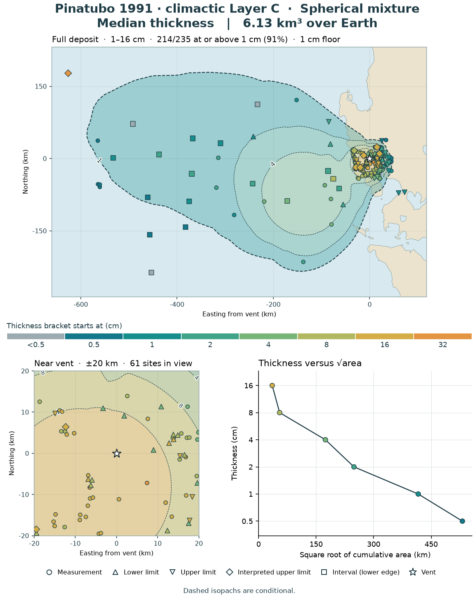

# Pinatubo 1991 · climactic Layer C · Spherical mixture

The principal bulk volume is **6.13 km³**, the whole-Earth integral of the median-thickness map. The conditional thickness-band range is **4.36–7.91 km³**. Its endpoints integrate the pointwise 25th and 75th percentiles of latent thickness over Earth. **Numerical warning on the fitted deposit distribution.**

Each circle shows a measurement. Bounded sites take the colour of their stated limit. The curve counts every patch at or above each thickness. The 1 cm footprint includes 214 of 235 modeled locations. The thickest displayed line is 16 cm and encloses 42 fitted locations. The volume includes fallout beyond the displayed contours. [Median thickness grid](median-grid.npz) · [Thickness and cumulative area](thickness-area.csv) · [Map integral, resolution and source hashes](deposit.json)

The principal map uses the geographic continuation evaluated on all registered eruptions. [Geographic holdouts, structural alternatives and numerical checks](extent/report.json) · [Complete contour decisions](extent/support.json.gz) · [Predictions at withheld observations](extent/heldout.csv.gz)

[Conditional intervals under all eight fixed prior fits](extent/prior-sensitivity.json)

## Earlier continuation and its diagnostics

The following figures and statistics describe the fitted parent and its broader continuation. The principal estimate and its interval appear above.

## What the unobserved directions contribute

| Continuation assumption | Conditional 95% volume interval (km³) |
|---|---:|
| Broad parent continuation | 6.3–10.8 |
| Unknown fan, 90° half-thickness angle | 5.7–9.5 |
| Unknown fan, 47° half-thickness angle | 5.4–8.9 |
| Enhanced narrow hidden fan, separate sensitivity | 5.8–13.6 |

The three principal assumptions allow local thickness up to the parent prediction in the same draw. The enhanced-fan sensitivity allows extra ash along a hidden axis. Changing the angular spread of measured reach also changes the inferred mass.

| Angle at which measured reach halves | Conditional 95% volume interval (km³) | Numerical checks |
|---|---:|---|
| 11.25° | 4.7–10.1 | Passed |
| 45° | 6.2–10.4 | Passed |

The median fraction inside the screened measurement footprint is **14.7%**. The median fraction beyond the farthest exact site is **1.2%**. Other mass lies in the intervening gaps and the unmeasured proximal cap. These are sampling classes.

## Prediction and uncertainty

The equal-region held-out log score is **0.970**, compared with 1.008 for the original geometry. Lower scores indicate better predictions. The 95% predictive interval covered **97.3%** of exact held-out thicknesses. Every buffered training fold builds its own bearing support. Censored sites contribute their reported limit events to the score.

Across 76 held-out readings with gap exposure of at least 0.5, mean negative log score was 0.861 for the principal field and 0.973 for its parent. This subset weights individual sites equally.

The shared contour audit identified no qualifying standard-policy band. [Complete decisions and geographic deletions](complete-contour-audit.json)

| Spherical prior | Conditional 95% volume interval (km³) | Numerical checks |
|---|---:|---|
| baseline | 5.6–10.1 | parent sampler warning |
| diffuse tail | 5.7–54.5 | parent sampler warning |
| wide geography | 5.4–10.1 | parent sampler warning |
| volume prior shift | 6.0–10.2 | Passed |
| one fan | 11.8–27.5 | Passed |
| five fans | 6.0–47.6 | parent sampler, volume draw split warning |
| gaussian errors | 5.4–7.6 | Passed |
| diffuse mixture weights | 5.8–10.1 | Passed |

The resolved 1, 10 and 100 cm contour areas passed the split-draw test at 96 parent draws per chain. Sparsely represented or empty contour unions remain unresolved.

Geographic folds with sampling warnings (numbered from one) include 3.
The tail and overall scale can remain weakly identified even when numerical checks pass. The reference-amplitude prior induces a prior on retained volume. Reworking, incomplete sampling and source attribution can add uncertainty beyond these conditional intervals.

[Prior sensitivity and mass partition](volume.png) · [Derived-volume chains](sampling.png) · [Numerical report](report.json) · [Held-out sites](heldout_predictions.csv) · [Whole-deposit draws](volume_draws.csv.gz) · [Joint sector and support-class volumes](bearing/baseline.npz) · [Original spherical fit and all attempts](bearing/parent-report.json)

[Thickness and predictive intervals at inspected archives](archive-evidence/README.md)
