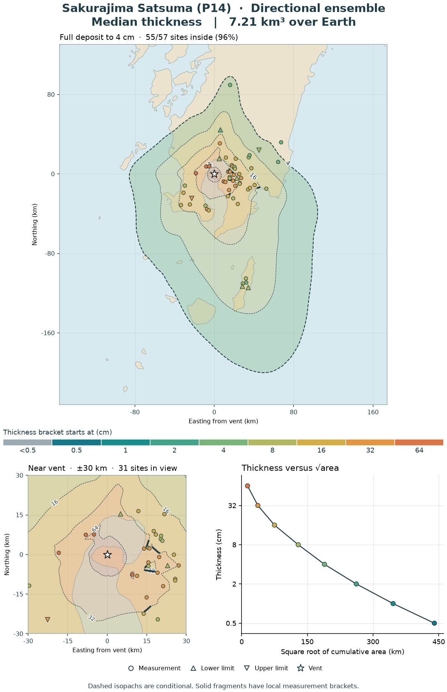
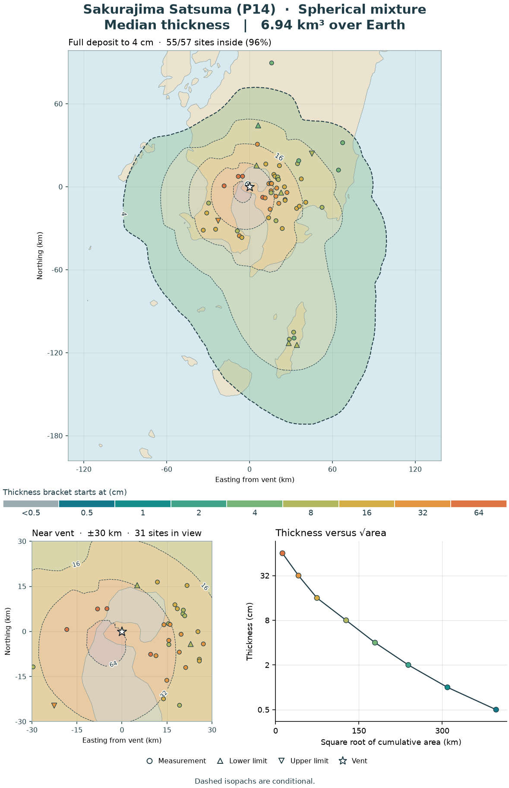
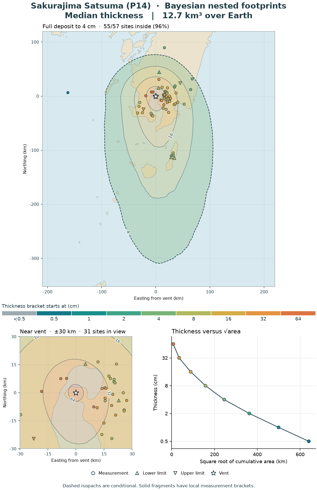

# Sakurajima Satsuma fallout, southern Japan

The 12.8 ka Satsuma eruption (P14, Sz-S) deposited ash and pumice east and west of Sakurajima. The reconstruction combines primary fallout from its eruptive phases. **50 measured thicknesses, five lower bounds and two upper bounds** come from field sections, written excavation records, an island outcrop and a seafloor core. Each location and thickness comes from a numeric source record. [Accepted data](../../data/eruptions/Sakurajima_Satsuma.csv) · [Published sources](../../data/sources/sakurajima-satsuma/README.md) · [202-row selection audit](../../data/audits/Sakurajima-Satsuma/README.md)

## Volumes and geographic prediction

Each estimate integrates the median thickness on its map. The conditional range integrates the pointwise 25th and 75th percentiles of thickness over the same area. The 50% probability refers to thickness at each location. A single probability for total volume does not follow from these endpoints.

| Method | Median map (km³) | Q25–Q75 thickness maps (km³) | Held-out score ↓ | 95% predictive coverage |
|---|---:|---:|---:|---:|
| GP ensemble | **3.08** | 2.4–3.96 | 1.264 | 94.0% |
| Cubic spline | **9.12** | 5.81–15.2 | 1.371 | 90.0% |
| [Directional ensemble](results/directional/README.md) | **7.21** | 3.58–15.7 | 1.156 † | 96.0% |
| [Spherical mixture](results/spherical-mixture/README.md) | **6.94** | 4.22–14.5 | 1.351 | 88.0% |
| [Bayesian nested footprints](results/nested-isopachs/README.md) | **12.7** | 6.85–26.4 | 1.063 † | 94.0% |

Lower scores indicate better geographic prediction. Coverage counts exact withheld measurements. A dagger marks a fit, integration or validation warning.

## Full deposits and near-vent detail

Each full map follows the thickest power-of-two contour enclosing at least 95% of the fitted locations, with a 1 cm minimum. The title gives the actual count, including when that minimum prevents 95% coverage. Global volumes include the thinner tail. The near-vent window depends on the eruption’s proximal sites. The curve sums all patches at each thickness.

## Inside the observation hull

The GP and spline integrate over the dashed hull. Gaps inside it can still be poorly constrained. [Regional fits and numerical checks](results/README.md)

The current global fits use the same audited rows. [What changed in the maps, volumes and validation](../../comparisons/global-extent/README.md) · [Continuation rules](../../docs/methods/finite-spread.md)

## Where the thicknesses constrain the deposit

At least two measured beds fall in each 45° compass sector around the Kitadake summit reference. Measured thicknesses range from 0.8 to 95 cm at 9–163 km. Both northwest readings are within 12 km. The largest gap between measured bearings increases from 44° across all sites to 107° beyond 50 km and 251° beyond 100 km. Three western measurements cover 18, 32 and 163 km. Their reported thicknesses are 70, 15 and 0.8 cm. The excavation report describes the 70 cm bed as a persistent primary deposit. [Counts and distances by sector](../../data/audits/Sakurajima-Satsuma/coverage.csv) · [Original excavation report, printed p. 11](https://www.jomon-no-mori.jp/old/pdf_data/H46001-2-0110-1.pdf)

Glass chemistry also correlates HGY1026 in Lake Huguangyan, southern China, with Satsuma, about 2,330 km from the summit reference. This records much farther ash transport. The reported shard counts and sediment sampling intervals supply no measured primary bed thickness at that distance. [Lake-core study](https://agupubs.onlinelibrary.wiley.com/doi/full/10.1029/2020GL090582)

The GP and cubic spline integrate a common 24,004 km² hull. Within the 635 km² of well-connected measurement triangles both regional median-thickness maps integrate to 0.18 km³. These triangles contain 2.6% of the directional median-map volume. The common standard support screen accepts no complete isopach band for any family. Values outside that footprint depend on extrapolation across the proximal gap, between sampled directions and beyond measured distances. [Support geometry and partial volumes](results/support/README.md)

The largest cubic-spline median on the in-hull prediction grid is 447 cm, about 42 km west and 44 km north of the source. The nearest measured site is 49 km away. The GP predicts 5.5 cm at the same point, and the peak lies outside the standard interpolation triangles. The spline peak helps explain why the two regional hull volumes diverge even though their estimates agree inside the well-sampled footprint. The accepted beds reach 95 cm. [Grid values and nearest measurement](results/source-audit/regional-map-peak.csv)

## Global estimates and sensitivity

In the [preceding reconstruction](../../archive/2026-11-22-global-extent/README.md), the uncertain-direction median map integrates to **7.1 km³**. The conditional 95% volume interval is **3.8–70.6 km³**. All six full-data model fits passed their sampler checks. All four geographic folds were scored, with one fold retaining a sampling warning. All four quadrant folds passed. For the geographic holdouts, uncertain directions gave a mean negative log score of 1.164 compared with 1.028 for fixed directions. Lower is better. [Directional estimates, withheld-site results and maps](results/directional/README.md)

In the [preceding reconstruction](../../archive/2026-11-22-global-extent/README.md), the spherical baseline passed its sampler, integration and draw-split checks. The shifted-volume prior retained a draw-split warning. With the western lenticular marine bed removed, the directional median-map integral rises to **9.6 km³**. The full refits and predictions for the withheld core quantify how strongly that one observation constrains distal fallout. [Marine-core sensitivity](results/source-audit/README.md) · [Spherical estimates and validation](results/spherical-mixture/README.md)

In the [preceding reconstruction](../../archive/2026-11-22-global-extent/README.md), at Kuwanoki, the directional median is 12.6 cm and the spherical median is about 11 cm. The excavation report identifies minerals and glass in terrace sediment and gives no preserved Satsuma bed thickness. This discrepancy is a reason to look for nearby undisturbed sections. Kuwanoki and four other occurrence records carry zero additional likelihood weight. [Archive site checks](results/spherical-mixture/archive-evidence/README.md) · [Original Kuwanoki report](https://doi.org/10.24484/sitereports.3454)

Nishihara et al. report 11.1 km³ of bulk P14 fallout. Their isopachs use overlapping thickness observations. The published volume provides context and played no part in selecting priors or fitting these estimates. [Published volumes, Table 4](https://doi.org/10.3389/feart.2022.988373)

## Reproduce the case

The source replay verifies the two original workbooks, site identifiers, source-row decisions and coverage. The intake workflow reproduces the five registered fits, their matched geographic tests and the conditional global volume estimates. [Source replay](../../data/audits/Sakurajima-Satsuma/README.md) · [Run instructions](../../docs/NEW_ERUPTION.md) · [Directional verification receipt](results/source-audit/release.json)

In the [earlier fitted comparison](../../archive/2026-11-22-global-extent/README.md), both sets of held-out thicknesses favor the broader continuation. The full-data proposal retained a numerical warning. [Whole-area continuation sensitivity](results/nested-whole-area/README.md)
