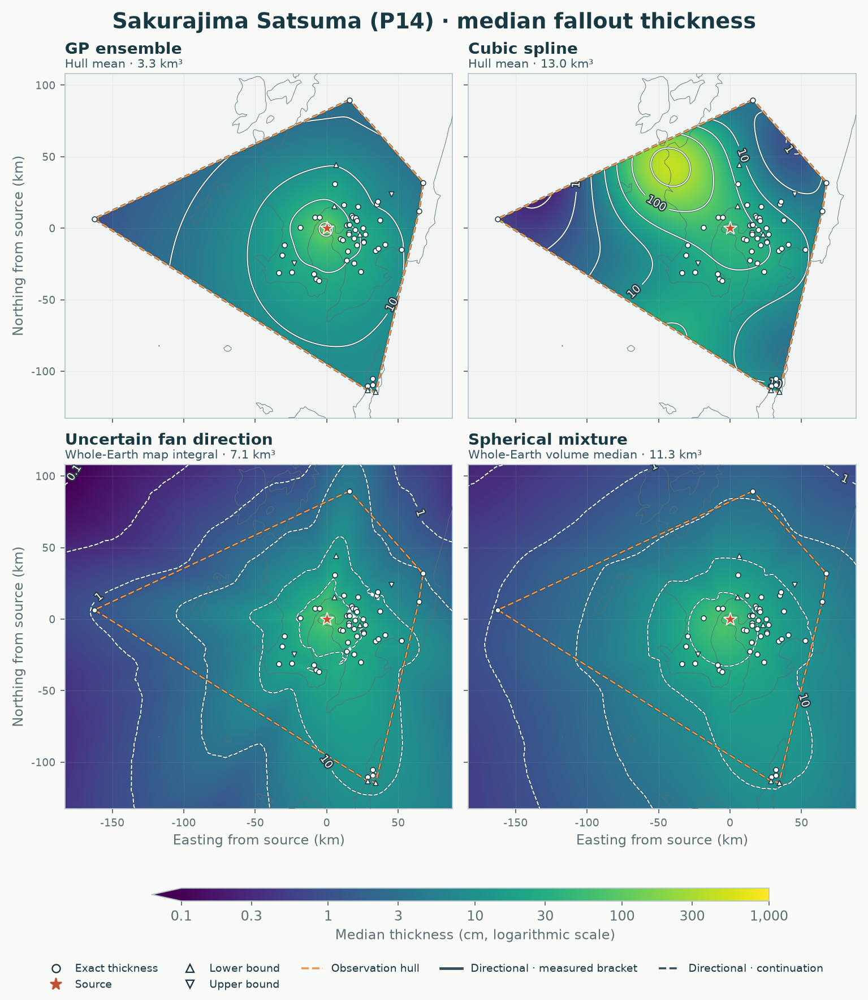
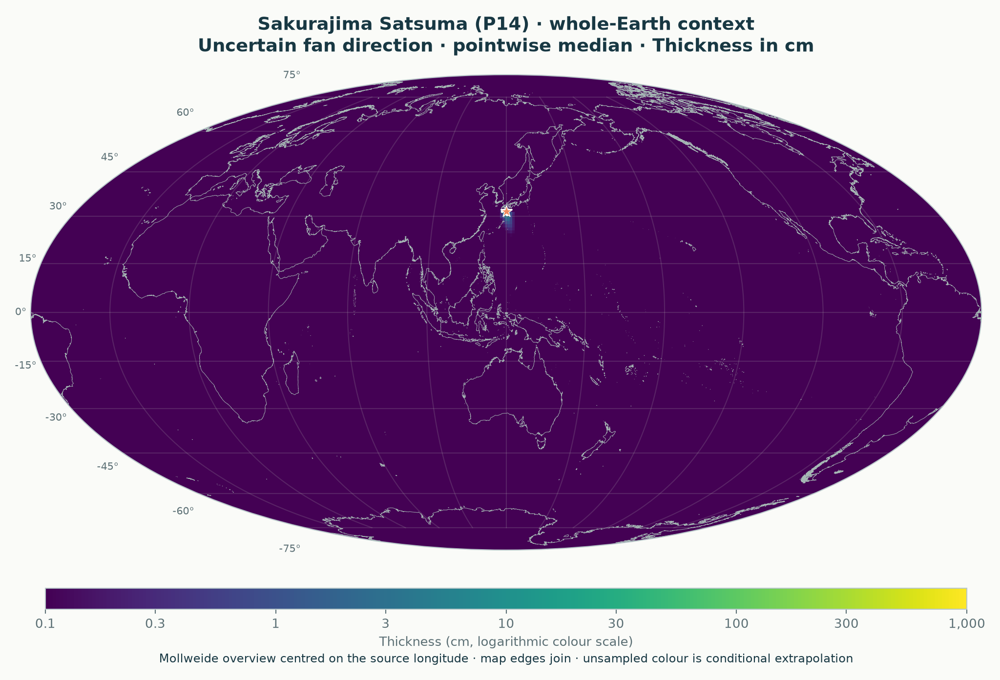
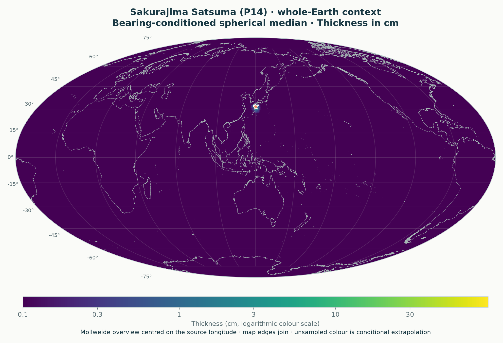
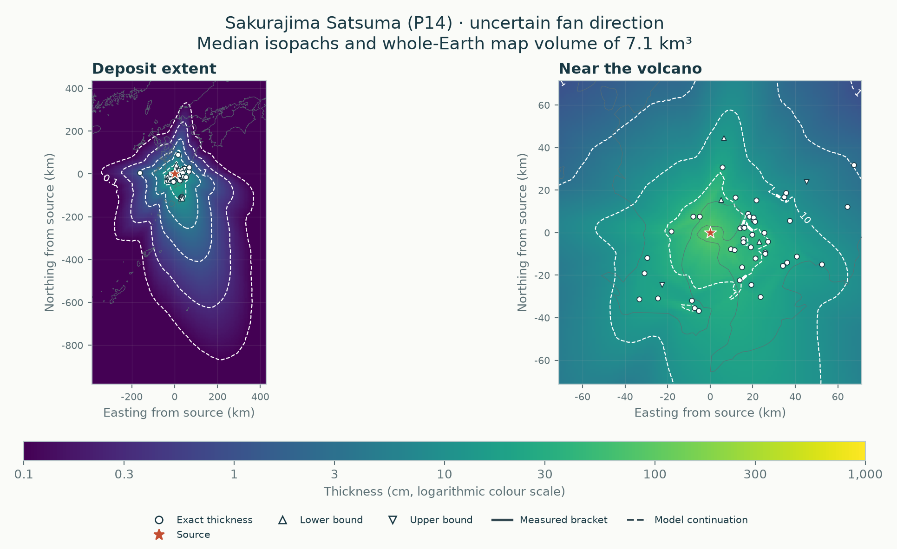
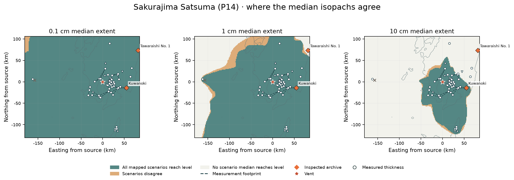
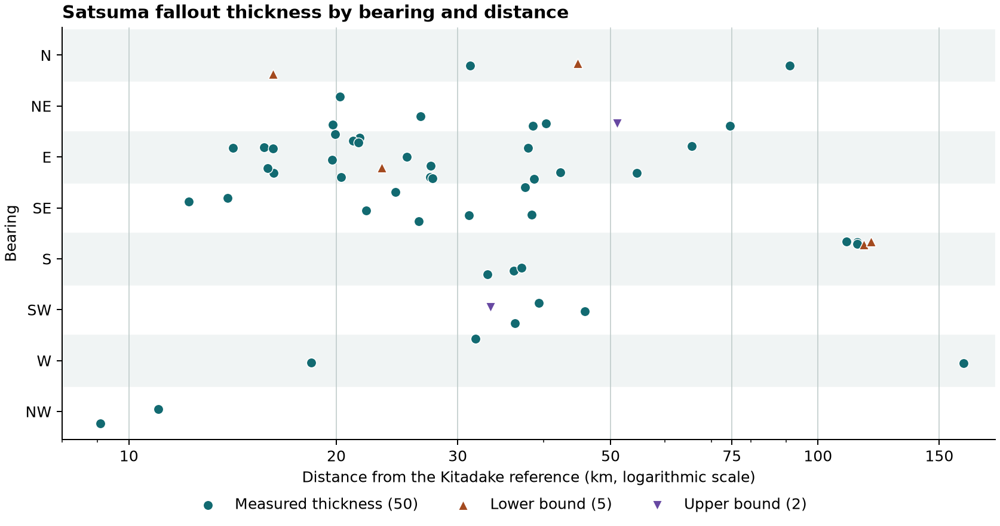

# Sakurajima Satsuma fallout, southern Japan

**Geographic reach of nested isopachs.** Limiting the lateral and down-range reach of each positive site gives 6.7 km³ of bulk fallout (conditional 95% interval 3.1–30.7), compared with 12.5 km³ under the whole-area continuation. Both sets of held-out thicknesses favor the broader continuation. The full-data proposal retained a numerical warning. [Paired maps, volumes and checks](results/nested-reach/README.md) · [Full-compass isopachs](results/nested-reach/compass.png)

The 12.8 ka Satsuma eruption (P14, Sz-S) deposited ash and pumice east and west of Sakurajima. The reconstruction combines primary fallout from its eruptive phases. **50 measured thicknesses, five lower bounds and two upper bounds** come from field sections, written excavation records, an island outcrop and a seafloor core. Each location and thickness comes from a numeric source record. [Accepted data](../../data/eruptions/Sakurajima_Satsuma.csv) · [Published sources](../../data/sources/sakurajima-satsuma/README.md) · [202-row selection audit](../../data/audits/Sakurajima-Satsuma/README.md)

## Five matched thickness-only fits

All four maps use the same frame, contour levels and thickness scale. Thickness below the first colour-bar tick shares the lowest shade. The dashed line encloses the observation hull. The regional fits stop there. The global fits also show how thickness continues into unsampled ground. On the directional map, solid white segments connect thicknesses bracketed by measured sites in a supported triangle. White dashes on the global maps show conditional isopachs. Gaps inside the hull can still be poorly constrained.

## Volume and predictive performance

| Method | Bulk volume (km³) | Conditional 95% interval (km³) | Held-out score ↓ | 95% coverage |
|---|---|---:|---:|---:|
| GP ensemble | Hull mean **3.33** | 2.64–4.02 | 1.264 | 94.0% |
| Cubic spline | Hull mean **13.04** | 4.18–41.49 | 1.371 | 90.0% |
| [Directional ensemble · uncertain fan direction](results/directional/README.md) | Whole-Earth median map **7.1** · volume median 10.0 | 3.8–70.6 | 1.164 † | 96.0% |
| [Spherical mixture](results/spherical-mixture/README.md) | Whole-Earth volume median **11.3** | 5.1–666.5 | 1.376 | 88.0% |
| [Bayesian nested isopachs](results/nested-isopachs/README.md) | Whole-Earth volume median **12.5** | 7.0–60.2 **(provisional)** | 0.742 † | 98.0% |

[Nested median isopachs and the area–thickness curve](results/nested-isopachs/isopachs.png) · [Nested whole-Earth map](results/nested-isopachs/world.png) · [Nested sensitivity in poorly sampled bearings](results/nested-isopachs/bearing-study/README.md) · [Uncertain gap amount](results/directional/sensitivity-study/README.md) · [Soft source displacement](results/spherical-mixture/sensitivity-study/README.md)

The nested estimate puts a median 1.4% of the fallout volume inside the retained exact-site triangles and 45.9% beyond the farthest exact measurement. 1/4 geographic refits passed the independent-population check.

A lower negative log predictive score means better prediction across withheld regions. Each region gets equal weight. Coverage is the share of exact held-out observations inside the 95% predictive interval. † A geographic fit had a numerical warning or incomplete scoring.

The directional map integrates pointwise median thickness. Measured interpolation triangles account for **2.6%** of its volume. The directional volume interval comes from complete simulated deposits. The spherical mixture reports the median integrated volume across broad and uncertain fan continuations. The regional intervals condition on fitted settings. [Regional maps, fits and diagnostics](results/README.md)

Compare the two whole-Earth maps

| Uncertain fan direction | Spherical mixture |
|---|---|
|  |  |

Both maps use the vent longitude as their central meridian. Read the thickness key under each map.

With the same observations and structure weights, fixing the fan directions gives a median-map volume of **9.1 km³**.

View the directional deposit extent and source area

## Directional assumptions

The principal fit above uses quantitative thicknesses and bounds. The measured-fan model extends fallout along sampled bearings.

| Fan direction | Evidence assumption | Median-map volume (km³) | Complete-deposit median (km³) | Conditional 95% interval (km³) |
|---|---|---:|---:|---:|
| Measured fan directions | Thicknesses and bounds | 8.2 | 9.9 | 4.3–73.4 |

View agreement between the directional sensitivities

[Measured-fan maps, held-out tests and site evidence](results/directional/bearing/README.md)

## Where the thicknesses constrain the deposit

At least two measured beds fall in each 45° compass sector around the Kitadake summit reference. Measured thicknesses range from 0.8 to 95 cm at 9–163 km. Both northwest readings are within 12 km. The largest gap between measured bearings increases from 44° across all sites to 107° beyond 50 km and 251° beyond 100 km. Three western measurements cover 18, 32 and 163 km. Their reported thicknesses are 70, 15 and 0.8 cm. The excavation report describes the 70 cm bed as a persistent primary deposit. [Counts and distances by sector](../../data/audits/Sakurajima-Satsuma/coverage.csv) · [Original excavation report, printed p. 11](https://www.jomon-no-mori.jp/old/pdf_data/H46001-2-0110-1.pdf)

Glass chemistry also correlates HGY1026 in Lake Huguangyan, southern China, with Satsuma, about 2,330 km from the summit reference. This records much farther ash transport. The reported shard counts and sediment sampling intervals supply no measured primary bed thickness at that distance. [Lake-core study](https://agupubs.onlinelibrary.wiley.com/doi/full/10.1029/2020GL090582)

The GP and cubic spline integrate a common 24,004 km² hull. Within the 635 km² of well-connected measurement triangles both regional models give an expected partial volume of 0.19 km³. These triangles contain 2.6% of the directional median-map volume. The common standard support screen accepts no complete isopach band for any family. Values outside that footprint depend on extrapolation across the proximal gap, between sampled directions and beyond measured distances. [Support geometry and partial volumes](results/support/README.md)

The largest cubic-spline median on the in-hull prediction grid is 447 cm, about 42 km west and 44 km north of the source. The nearest measured site is 49 km away. The GP predicts 5.5 cm at the same point, and the peak lies outside the standard interpolation triangles. The spline peak helps explain why the two regional hull volumes diverge even though their estimates agree inside the well-sampled footprint. The accepted beds reach 95 cm. [Grid values and nearest measurement](results/source-audit/regional-map-peak.csv)

## Global estimates and sensitivity

The uncertain-direction median map integrates to **7.1 km³**. Complete draws give **10.0 [3.8–70.6] km³** (median and conditional 95% interval). All six full-data model fits passed their sampler checks. All four geographic folds were scored, with one fold retaining a sampling warning. All four quadrant folds passed. For the geographic holdouts, uncertain directions gave a mean negative log score of 1.164 compared with 1.028 for fixed directions. Lower is better. [Directional estimates, withheld-site results and maps](results/directional/README.md)

The spherical mixture gives **11.3 [5.1–666.5] km³**. The baseline passed its sampler, integration and draw-split checks. Medians across eight fixed prior fits range from 6.5 to 15.4 km³. The shifted-volume prior retained a draw-split warning. With the western lenticular marine bed removed, the spherical median rises to **54.7 km³** and the directional map integral rises to **9.6 km³**. The full refits and predictions for the withheld core quantify how strongly that one observation constrains distal fallout. [Marine-core sensitivity](results/source-audit/README.md) · [Spherical estimates and validation](results/spherical-mixture/README.md)

At Kuwanoki, the directional median is 12.6 cm and the spherical median is about 11 cm. The excavation report identifies minerals and glass in terrace sediment and gives no preserved Satsuma bed thickness. This discrepancy is a reason to look for nearby undisturbed sections. Kuwanoki and four other occurrence records carry zero additional likelihood weight. [Archive site checks](results/spherical-mixture/archive-evidence/README.md) · [Original Kuwanoki report](https://doi.org/10.24484/sitereports.3454)

Nishihara et al. report 11.1 km³ of bulk P14 fallout. Their isopachs use overlapping thickness observations. The published volume provides context and played no part in selecting priors or fitting these estimates. [Published volumes, Table 4](https://doi.org/10.3389/feart.2022.988373)

## Reproduce the case

The source replay verifies the two original workbooks, site identifiers, source-row decisions and coverage. The intake workflow reproduces the four registered fits, their matched geographic tests and the conditional global volume estimates. [Source replay](../../data/audits/Sakurajima-Satsuma/README.md) · [Run instructions](../../docs/NEW_ERUPTION.md) · [Directional verification receipt](results/source-audit/release.json)
