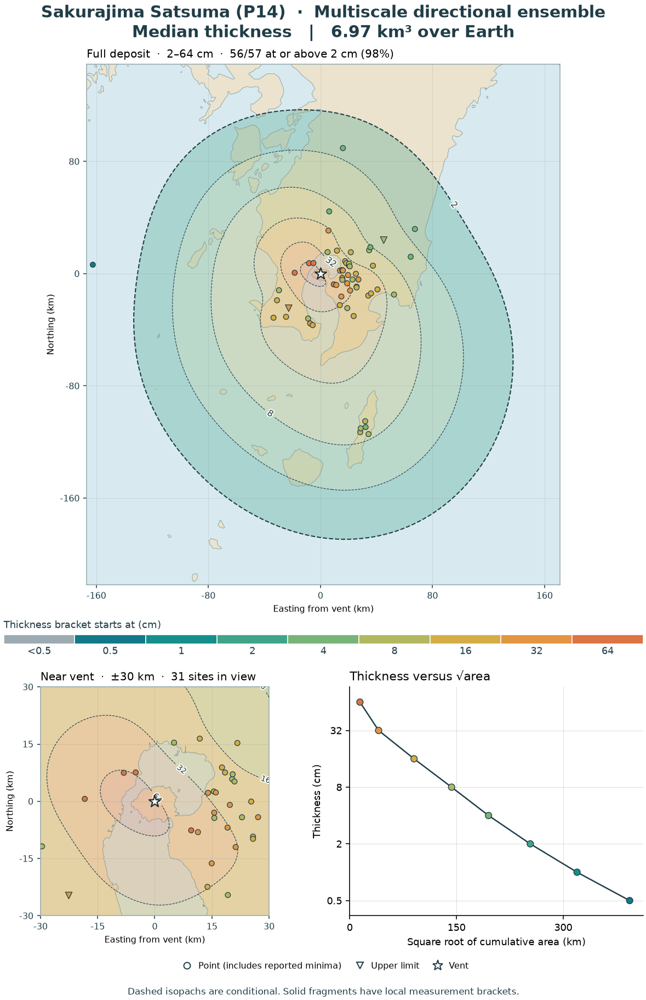
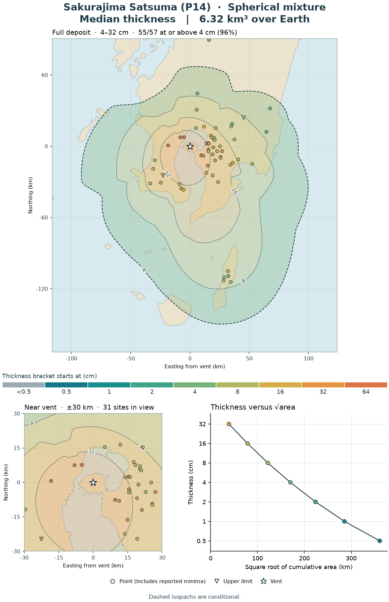
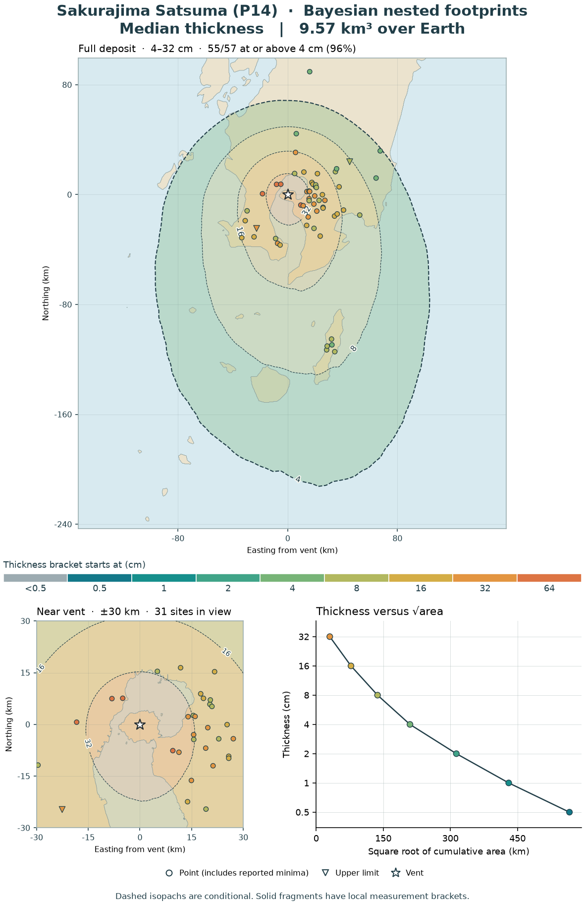
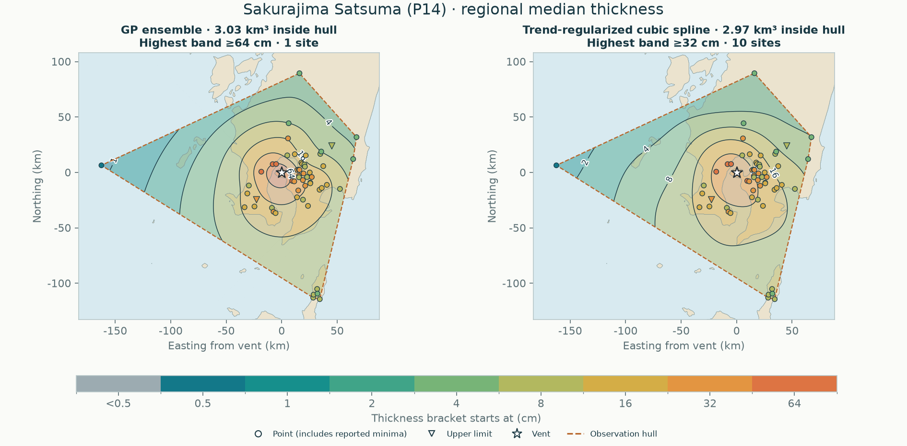

# Sakurajima Satsuma (P14)

[Principal input maps and numbered detail plates](observations/README.md)

The five reconstructions use the same 57 accepted fallout localities. Field reports give 50 measured thicknesses, 5 lower limits, 2 upper limits and 0 two-sided ranges. Each lower limit enters the fit as a point at its reported value, including the 3 beyond 25 km. Upper limits and ranges retain their respective one-sided and two-sided probabilities. [Source audit](../../data/audits/Sakurajima-Satsuma/README.md) · [Reported table](../../data/eruptions/Sakurajima_Satsuma.csv) · [Fitting table](../../data/eruptions/Sakurajima_Satsuma_minimum_fit.csv)

The site table pairs each source classification with its fitting value, geographic fold, mapped thickness and held-out score. It includes the predictive median or cumulative probability at the site value where the method saves it. A fitted minimum can underestimate total fallout at an incomplete section. [Reported and fitted sites](results/minimum-fit-2026-11-25/reported-and-fitted-sites.csv) · [Changes by method and coverage by source type](results/minimum-fit-2026-11-25/minimum-fit-comparison.csv) · [Fitting convention](../../docs/methods/reported-minimum-fitting.md)

## Volumes and geographic prediction

Each estimate integrates the median thickness on its map. The conditional range integrates the pointwise 25th and 75th percentiles of thickness over the same area. The 50% probability refers to thickness at each location. A single probability for total volume does not follow from these endpoints.

| Method | Integration area | Median map (km³) | Q25–Q75 thickness maps (km³) | Held-out score ↓ | 95% predictive coverage |
|---|---|---:|---:|---:|---:|
| GP ensemble | observation hull | **3.03** | 2.43–3.81 | 1.097 | 96.4% |
| Cubic spline | observation hull | **2.97** | 2.5–3.52 | 1.103 | 94.5% |
| [Multiscale directional ensemble](results/minimum-fit-2026-11-25/directional/README.md) | whole Earth | **8.19** | 4.76–17.1 | 0.993 | 100.0% |
| [Spherical mixture](results/minimum-fit-2026-11-25/spherical-mixture/README.md) | whole Earth | **6.32** | 3.95–11.7 † | 1.358 | 89.1% |
| [Bayesian nested footprints](results/minimum-fit-2026-11-25/nested-isopachs/README.md) | whole Earth | **7.41** | 4.99–13.5 | 0.963 | 100.0% |

Lower scores indicate better geographic prediction. Coverage counts held-out measurements and reported minima fitted as points. A dagger marks a fit, integration or validation warning.

## Full deposits and near-vent detail

Each full map follows the thickest power-of-two contour enclosing at least 95% of the fitted locations, with a 1 cm minimum. The title gives the actual count, including when that minimum prevents 95% coverage. Global volumes include the thinner tail. The innermost line is the thickest doubling level enclosing an accepted location. The near-vent window expands from the proximal sites until eligible contours are visible. The curve sums all patches at each displayed thickness.

## Inside the observation hull

The GP and spline integrate over the dashed hull. Gaps inside it can still be poorly constrained. [Regional fits and numerical checks](results/minimum-fit-2026-11-25/README.md)

## Nested geometry and field agreement

The small 64 cm proximal contour becomes eccentric and aligns gradually with the larger northwestern–southeastern envelope. The 32, 16 and 8 cm contours have smooth, unequal spacing rather than one rigidly expanding oval. In the full picture the southern 1 cm reach contracts from roughly 500 to 350 km, while the northwestern reach expands. The near contours remain geometrically coherent within that full field; the method does not reproduce every east–west local thickness contrast.

Northern GSJ-1F-02 and southeastern S2-T41 improve; northern GSJ-1B-03 and southwestern GSJ-1B-33 worsen. Both upper limits, GSJ-1B-31 and GSJ-1D-26, receive higher event probabilities. Measured log RMSE improves from 0.497 to 0.483, bounded negative log probability from 0.258 to 0.220, and geographic score from 1.092 to 0.963. Median absolute log error increases from 0.330 to 0.374. The final map check uses 4,096 draws.

[Three-scale comparison, site identities and contour diagnostics](../../comparisons/nested-isopachs/adaptive-growth/visual-review.md#sakurajima-satsuma)

## Evidence and checks

[Matched predictions by locality](results/minimum-fit-2026-11-25/geographic-site-validation.csv) · [Sampling attempts and diagnostics](results/minimum-fit-2026-11-25/sampling/attempts.csv) · [Numerical checks and file identities](results/minimum-fit-2026-11-25/release.json) · [Spherical fits and computing revisions](results/minimum-fit-2026-11-25/spherical-mixture/workflow-provenance.json) · [Regional support](results/minimum-fit-2026-11-25/support/README.md) · [Whole-area sensitivity](results/minimum-fit-2026-11-25/nested-whole-area/README.md)

[Previous maps and geological assessment](previous-minimum-treatment.md) · [Change at all distances across eruptions](../../comparisons/reported-minima/README.md)
