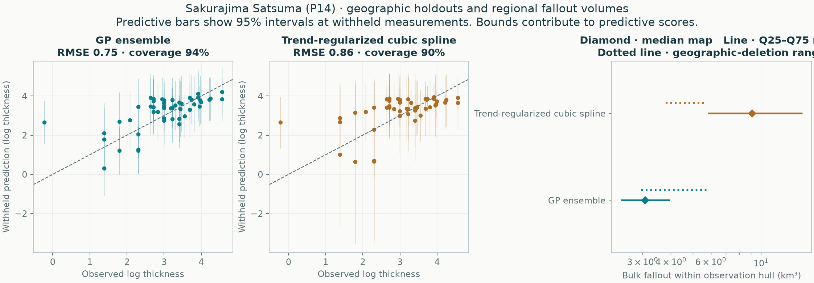

# Sakurajima Satsuma (P14) · regional fits inside the observation hull

[All available methods on the eruption page](../README.md)

The GP and cubic spline use the same accepted observations, geographic holdouts and observation hull.

**50 exact measurements, 5 lower bounds, 2 upper limits.** The observation hull covers 24,004 km². The automatic validation buffer is 4.23 km.


The full observation hull and every accepted location are in view. The coloured field is clipped to the exact hull; fine coastlines are context only. [Map frame and rendering provenance](map-display.json).

| Quantity | GP ensemble | Trend-regularized cubic spline |
|---|---:|---:|
| Principal median-map volume inside hull (km³) | 3.08 | 9.12 |
| Integrated Q25–Q75 thickness (km³) | 2.40–3.96 | 5.81–15.21 |
| Outer equal-region negative log score ↓ | 1.264 | 1.371 |
| Outer log-thickness RMSE ↓ | 0.751 | 0.862 |
| Outer 95% observation-interval coverage | 94.0% | 90.0% |

Lower predictive score and RMSE are better. Coverage must be read with interval width and predictive score; wider intervals alone are not improvement.



## Scope

The footprint is the convex hull of measured/bounded locations, with no source point or invented observations added. It can contain large unsampled gaps and can exclude proximal deposits. These are **regional bulk fallout volumes, not total eruption volumes or dense-rock equivalents**. No global extrapolation enters this comparison.

Volume integrates pointwise median thickness over the observation hull. The endpoints integrate the pointwise 25th and 75th percentiles of latent thickness on the same hull. [Band integrals and refinements](thickness-bands.json)

## Fitted methods

### GP ensemble

```json
{
  "candidate": {
    "tail": "stacked"
  },
  "components": [
    {
      "weight": 0.6147998235985108,
      "model": {
        "candidate": {
          "tail": "power",
          "length_factor": 0.25,
          "noise_ratio": 0.75
        },
        "beta": [
          4.913903889579061,
          2.4929627122310642,
          -0.04887611276342879,
          -0.49053274643879546
        ],
        "radius_scale_km": 27.50932370357925,
        "length_km": 9.620184733127548,
        "amplitude_log": 0.4955227376669493,
        "noise_log": 0.371642053250212,
        "jitter": 2.4554278354494826e-10,
        "trend_on_constraint_boundary": true,
        "uncertainty": "conditional Laplace"
      }
    },
    {
      "weight": 0.3852001764014893,
      "model": {
        "candidate": {
          "tail": "power",
          "length_factor": 1.5,
          "noise_ratio": 1.5
        },
        "beta": [
          4.913903889579061,
          2.4929627122310642,
          -0.04887611276342879,
          -0.49053274643879546
        ],
        "radius_scale_km": 27.50932370357925,
        "length_km": 57.72110839876529,
        "amplitude_log": 0.4955227376669493,
        "noise_log": 0.743284106500424,
        "jitter": 2.4554278354494826e-10,
        "trend_on_constraint_boundary": true,
        "uncertainty": "conditional Laplace"
      }
    }
  ],
  "dominant_tail": "power",
  "observation_discrepancy_variance_log": 0.0,
  "trend_on_constraint_boundary": true,
  "uncertainty": "Predictive mixture; includes disagreement among retained candidates, conditional on each fit and estimated weights. Fitted-parameter uncertainty is not integrated."
}
```

### Trend-regularized cubic spline

```json
{
  "method": "spline",
  "candidate": {
    "tail": "power",
    "knot_intervals": 2,
    "tension": 1.0,
    "smoothing": 1e-08,
    "trend_strength": 1.0,
    "noise_ratio": 0.75
  },
  "bounds_km": [
    -173.9670011064267,
    -124.55440141491619,
    78.93715529573417,
    99.72450519289441
  ],
  "knot_intervals_xy": [
    2,
    2
  ],
  "n_coefficients": 25,
  "noise_log": 0.35976441617200416,
  "amplitude_log": 0.4796858882293389,
  "trend_beta": [
    4.666294956564778,
    2.2056825259284674,
    -0.026380607266458116,
    -0.5730113776915264
  ],
  "trend_radius_scale_km": 27.50932370357925,
  "trend_on_constraint_boundary": false,
  "effective_df_exact": 10.506584201121612,
  "newton_decrement": 6.633535376591675e-13,
  "newton_iterations": 3,
  "quadrature_order": 6,
  "uncertainty": "Conditional Laplace",
  "uncertainty_omits": [
    "fitted trend",
    "noise and smoothing estimation",
    "knot/trend selection",
    "sampling and preservation bias",
    "vent location error"
  ],
  "pseudo_observations": 0
}
```

Every explored candidate is retained in the selection tables. All response-dependent choices are retuned within training folds; no hand-placed pseudo-data enter the likelihood.

## Reliability checks

- All probability intervals condition on fitted parameters and selected settings; they omit parameter/selection and preservation/sampling uncertainty.
- Four geographic outer folds evaluate the entire tuning procedure; this is development evidence, not independent external validation.
- Geographic-deletion volume ranges show refitting sensitivity and are not confidence intervals.
- Spline selection reaches an explored search boundary: smoothing. This is a bounded-grid result, not proof of a continuous optimum.

## Reproduce and inspect

```sh
tephra-isopachs compare 'Sakurajima Satsuma (P14)' --output results/new-regional-run
```

[Complete numerical report](report.json) · [Withheld predictions](heldout_predictions.csv) · [Accepted observation semantics](accepted_observations.csv) · [Selection tables](selection/README.md)

The JSON records input/source hashes, package versions, all fold memberships, regional integration refinements, conditional-volume sampling precision and geographic-deletion sensitivity. Historical GP global calculations remain separate.

## Which parts are actually supported?

Read the [local support and complete-contour audit](support/README.md) before extrapolating these hull volumes. It screens unsampled gaps, tests closure under geographic deletion, and separates interpolation from proximal/distal assumptions.
