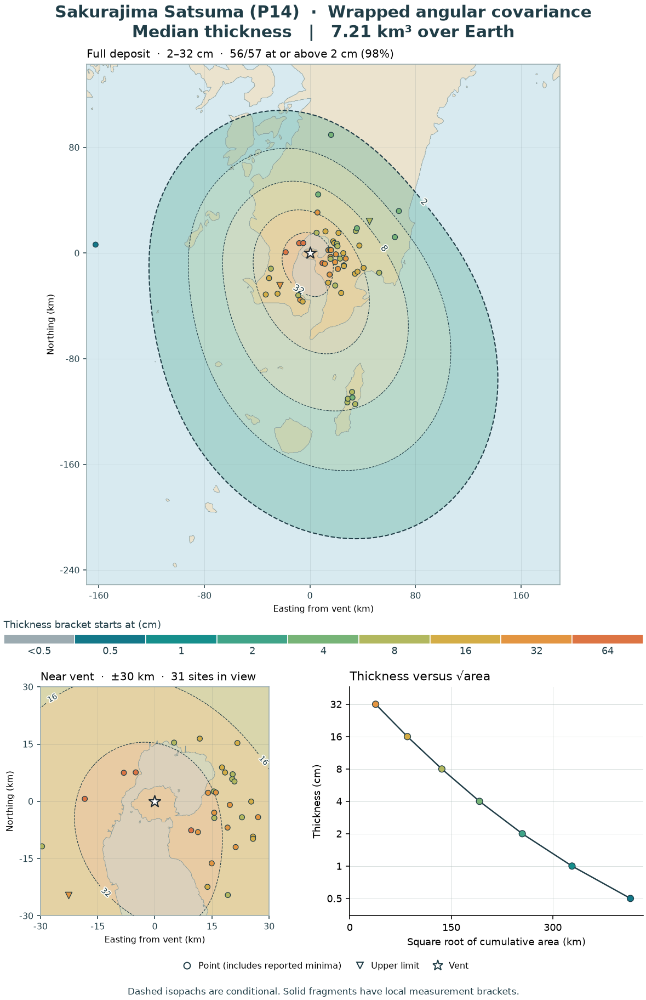

# Sakurajima Satsuma (P14) · Wrapped angular covariance

The principal bulk volume is **7.21 km³**, the whole-Earth integral of the median-thickness map. The conditional thickness-band range is **5.05–11.1 km³**. Its endpoints integrate the pointwise 25th and 75th percentiles of latent thickness over Earth.

Circles show point thicknesses, including reported lower limits fitted at their stated values. Bounded sites take the colour of their stated limit. The curve counts every patch at or above each thickness. The 2 cm footprint includes 56 of 57 modeled locations. The thickest displayed line is 32 cm and encloses 10 fitted locations. The volume includes fallout beyond the displayed contours. [Median thickness grid](median-grid.npz) · [Thickness and cumulative area](thickness-area.csv) · [Map integral, resolution and source hashes](deposit.json)

[Proximal, intermediate and full-deposit map](three-scales.png)

The equal-block geographic negative log score is 0.962. The central 95% preserved-bed interval contains 100.0% of held-out point records.

[Regional and source fit, fixed sensitivities and numerical checks](report.json) · [Held-out sites](heldout.csv.gz) · [Site fits](measured-sites.csv.gz) · [Contour support and deletion decisions](support.json.gz) · [Archive predictions](archive-probes.json)
