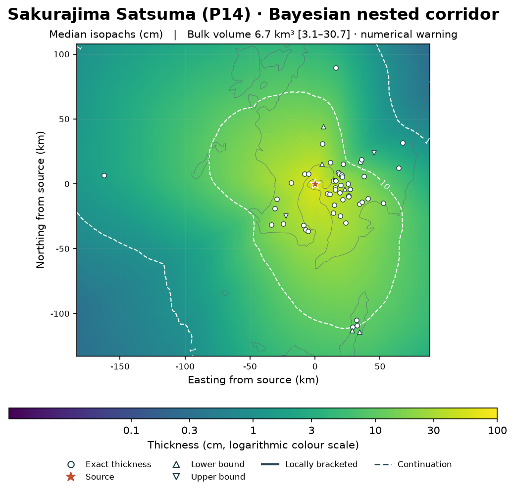
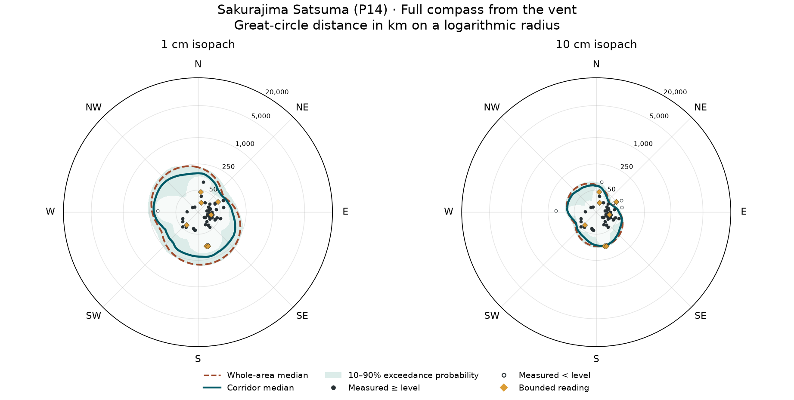

# Sakurajima Satsuma (P14) · Bayesian nested isopachs

The principal corridor estimate of bulk fallout is **6.7 km³** (conditional 95% interval **3.1–30.7**). The median thickness map integrates to 6.3 km³. The whole-area sensitivity gives 12.5 km³ (7.0–60.2).

Solid portions cross a retained triangle with thicknesses on either side at distinct measured sites and at least 90% posterior crossing probability. Dashed portions depend on the continuation. The triangles diagnose spatial coverage. The shared contour screen also checks thickness bracketing and deletion stability. [Whole-Earth field](world.png) · [Every local bracket](local-brackets.csv.gz) · [Complete contour checks](support.json)

The buffered geographic score is 1.016 for the corridor and 0.742 for the whole-area sensitivity. Lower scores indicate better predictions at withheld sites. The corridor’s 95% predictive intervals cover 49 of 50 exact withheld readings. 1 of 4 geographic fits passed their sampling checks. The full-data proposal and importance check retained a warning, the final volume populations passed, and the integration check passed. The shared screen accepted a complete contour band under 0 policies. [Prediction scores and row identities](report.json) · [Full fit diagnostics](full.json)

## Where the volume lies

The full-compass view includes all bearings through the antipode. Its logarithmic distance scale makes the proximal flanks visible. Areas in the table use the physical equal-area integral.

| Compass sector | Exact sites | Bounded sites | Corridor 1 cm area (km²) | Whole-area 1 cm area (km²) | Corridor volume (km³), median [95%] |
|---|---:|---:|---:|---:|---:|
| N | 2 | 2 | 8,378 | 15,452 | 0.7 [0.3–3.2] |
| NE | 6 | 1 | 3,562 | 4,458 | 0.2 [0.1–1.0] |
| E | 20 | 1 | 5,309 | 9,266 | 0.4 [0.3–2.0] |
| SE | 8 | 0 | 13,720 | 28,682 | 1.2 [0.5–5.8] |
| S | 6 | 2 | 15,942 | 35,244 | 1.4 [0.8–6.7] |
| SW | 3 | 1 | 9,452 | 17,479 | 0.7 [0.3–3.7] |
| W | 3 | 0 | 13,992 | 17,554 | 0.9 [0.6–3.7] |
| NW | 2 | 0 | 15,021 | 25,815 | 1.1 [0.1–5.0] |

At 1 cm, the corridor median map encloses 85,376 km² and the whole-area sensitivity encloses 153,951 km². Of these, 84,739 and 153,314 km² fall outside the retained exact-site triangles. An unsampled sector can contain ash. Its allocation depends on the assumed continuation.

The prior assigns 25% to continuation across all bearings. The remaining probability spans three fan widths and three down-range extensions. The fitted probability of whole-bearing continuation is 24.9%. The widths and extensions are shared structural assumptions. A bound supplies a likelihood event. Only positive evidence supplies a potential dispersal corridor.

[Volume and sector draws](volume-budget.npz) · [Complete field draws](full.npz) · [Areas, assumptions, bounds and diagnostics](report.json)

## Structural uncertainty

[Corridor and whole-area maps on a common scale](paired-isopachs.png)

| Prior probability of broad continuation | Median bulk volume, km³ [conditional 95%] |
|---:|---:|
| 10% | 6.1 [3.1–18.9] |
| 25% | 6.7 [3.1–30.7] |
| 50% | 8.3 [3.2–43.9] |
| 75% | 10.7 [3.4–50.5] |

The prior odds vary under the same observed likelihood. The numerical report also gives the volume by individual corridor law where the saved draws resolve it.

[Whole-area sensitivity report, posterior and diagnostics](../nested-whole-area/README.md)
