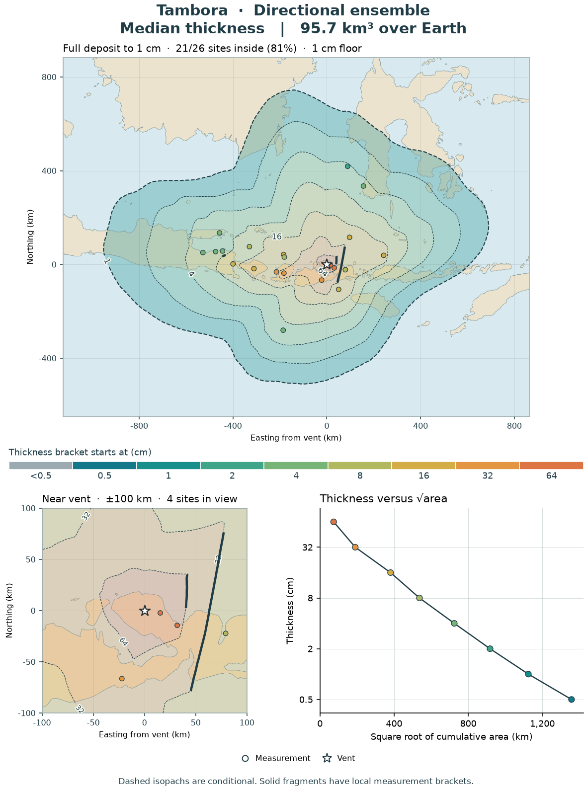
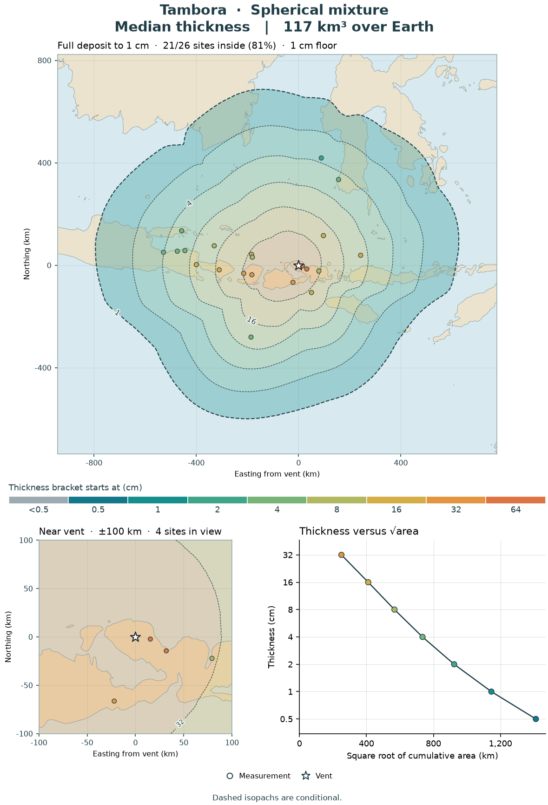
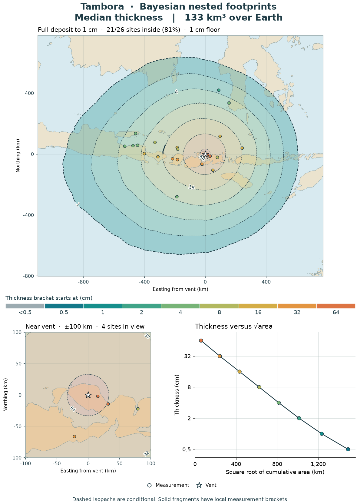
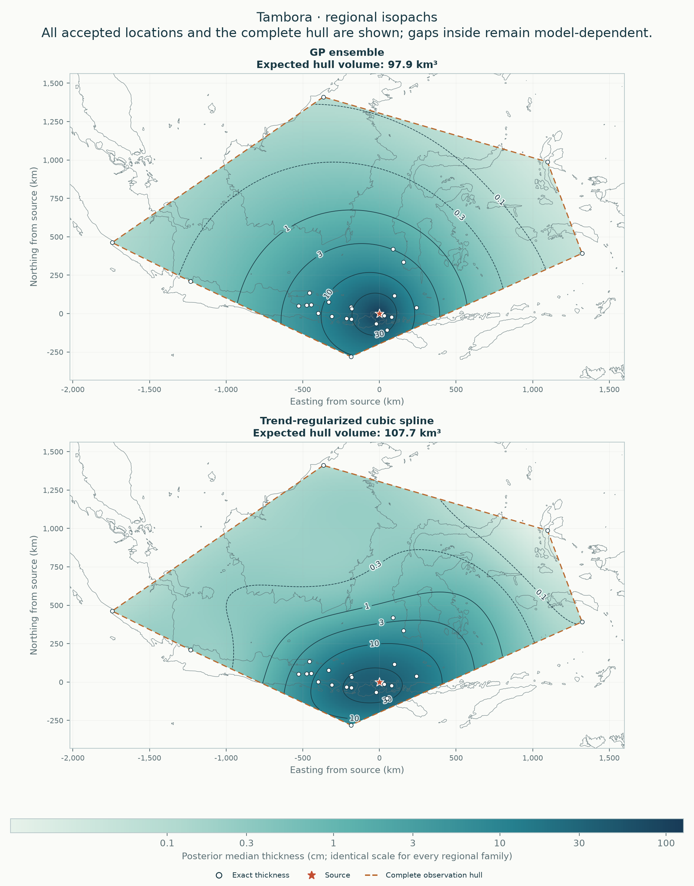

# Tambora fallout reconstruction

The accepted dataset contains 26 exact measurements. The regional fits share an observation hull of 2,980,287 km². [Accepted thickness CSV](../../data/eruptions/Tambora_tephra.csv) · [Input provenance](../../data/eruptions/README.md)

## Volumes and geographic prediction

Each estimate integrates the median thickness on its map. The conditional range integrates the pointwise 25th and 75th percentiles of thickness over the same area. The 50% probability refers to thickness at each location. A single probability for total volume does not follow from these endpoints.

| Method | Median map (km³) | Q25–Q75 thickness maps (km³) | Held-out score ↓ | 95% predictive coverage |
|---|---:|---:|---:|---:|
| GP ensemble | **91.1** | 71.4–117 | 1.620 | 96.2% |
| Cubic spline | **93.5** | 73.5–123 | 1.548 | 96.2% |
| [Directional ensemble](results/directional/README.md) | **95.7** | 62–146 † | 2.029 † | 84.6% |
| [Spherical mixture](results/spherical-mixture/README.md) | **117** | 82.3–176 | 1.590 | 100.0% |
| [Bayesian nested footprints](results/nested-isopachs/README.md) | **133** | 94.3–204 | 1.382 † | 100.0% |

Lower scores indicate better geographic prediction. Coverage counts exact withheld measurements. A dagger marks a fit, integration or validation warning.

## Full deposits and near-vent detail

Each full map follows the thickest power-of-two contour enclosing at least 95% of the fitted locations, with a 1 cm minimum. The title gives the actual count, including when that minimum prevents 95% coverage. Global volumes include the thinner tail. The near-vent window depends on the eruption’s proximal sites. The curve sums all patches at each thickness.

## Inside the observation hull

The GP and spline integrate over the dashed hull. Gaps inside it can still be poorly constrained. [Regional fits and numerical checks](results/README.md)

The current global fits use the same audited rows. [What changed in the maps, volumes and validation](../../comparisons/global-extent/README.md) · [Continuation rules](../../docs/methods/finite-spread.md)

## Evidence and limitations

The calculation uses the supplied acceptance flags. An independent row-by-row source review is still outstanding. The median-map integration checks passed, but several held-out fits also carry warnings.

The standard local-support footprint covers 49,323 km². No complete isopach band passed the support and deletion checks. [Support map, partial volumes and rejected contours](results/support/README.md)

In the [earlier fitted comparison](../../archive/2026-11-22-global-extent/README.md), both geographic and whole-quadrant holdouts predict the real observations better under the broader continuation. [Whole-area continuation sensitivity](results/nested-whole-area/README.md)
