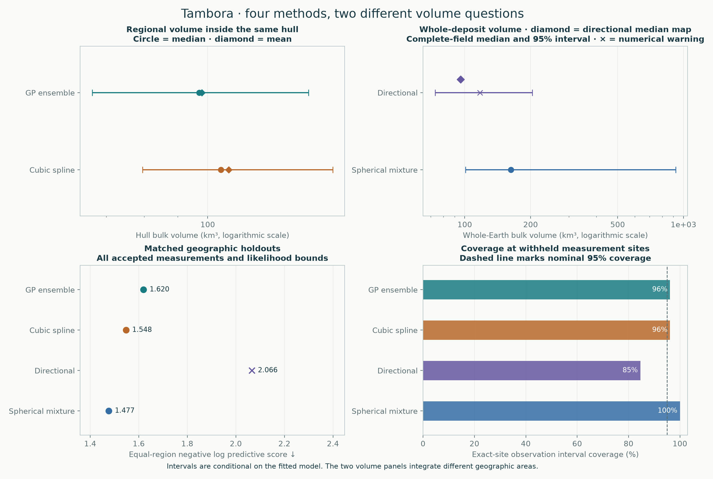

# Tambora fallout reconstruction

The accepted dataset contains 26 exact measurements. The regional fits share an observation hull of 2,980,287 km². [Accepted thickness CSV](../../data/eruptions/Tambora_tephra.csv) · [Input provenance](../../data/eruptions/README.md)

## Bulk fallout volume

| Model | Area | Volume summary (km³) | Conditional 95% volume interval (km³) |
|---|---|---:|---:|
| [Directional ensemble](results/directional/README.md) | Whole Earth | Median-map integral **105.8** · complete-field median 119.6 | 78.6–184.0 |
| [Spherical mixture](results/spherical-mixture/README.md) | Whole Earth | Posterior median **179.1** | 112.9–1,284.2 |
| GP ensemble | Observation hull | Expected **97.91** | 66.61–142.60 |
| Cubic spline | Observation hull | Expected **107.69** | 79.51–155.23 |

The directional interval summarizes complete simulated deposits. Measured interpolation triangles hold **10.1%** of the central directional map’s volume. The regional intervals condition on the fitted settings. [Paired regional maps and held-out tests](results/README.md)

## Evidence and limitations

The calculation uses the supplied acceptance flags. An independent row-by-row source review is still outstanding. Four of the six full-data directional fits carry numerical warnings. The median-map integration checks passed, but several held-out fits also carry warnings.

The standard local-support footprint covers 49,323 km². No complete isopach band passed the support and deletion checks. [Support map, partial volumes and rejected contours](results/support/README.md)
