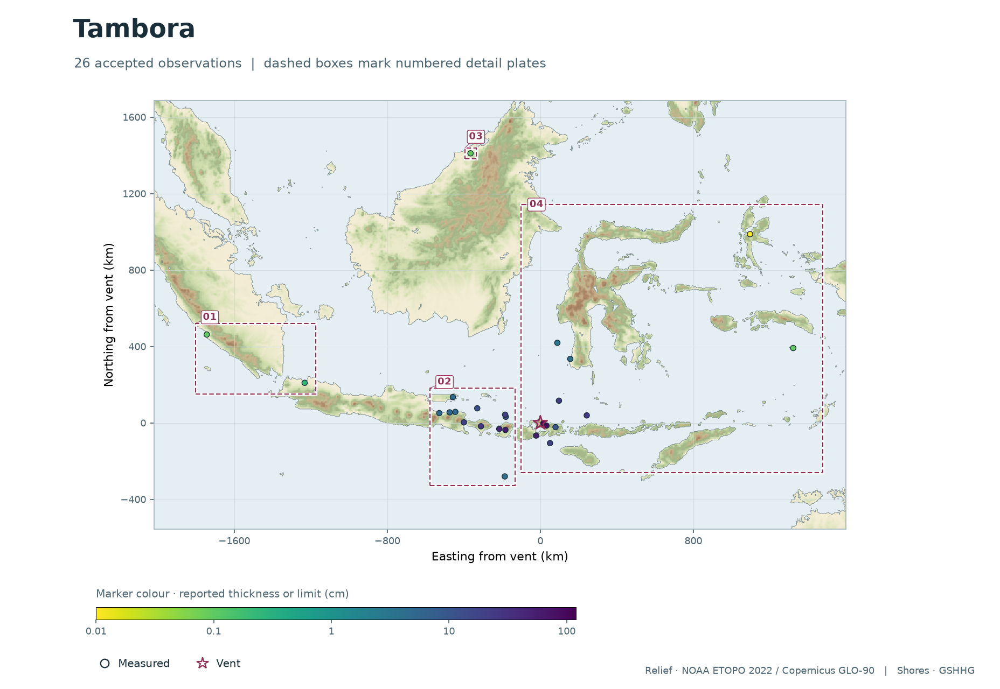

# Tambora · principal input observations

All 26 accepted rows have a symbol at their registered coordinates on the overview and a labelled reading on one numbered detail plate. The dashed boxes show the detail extents. A star marks the vent. Positions use a vent-centred equal-area grid in kilometres. Land shading shows elevation and slope. GSHHG supplies the coastline and inland water at the map’s scale. [NOAA ETOPO](https://doi.org/10.25921/fd45-gt74) · [Copernicus GLO-90](https://registry.opendata.aws/copernicus-dem/) · [GSHHG](https://doi.org/10.5281/zenodo.7007502)

[Accepted input CSV](../../../data/eruptions/Tambora_tephra.csv) · [Site index with coordinates and full input precision](sites.csv) · [Input hashes and panel bounds](manifest.json)

The table shows the evidence ID and source citation alongside the reported or interpreted reading. A dash marks an unavailable evidence ID. Complete citations and unrounded values are in the site index. A reported lower limit appears as ≥ on these evidence figures and as a point at that value in the fit. Upper limits and ranges retain their respective events. Marker colour represents the displayed thickness or limit, using the lower endpoint for ranges. Where rows share coordinates, a single diamond uses the first CSV row as its map key and the adjacent table lists each row.

| Detail plate | Input rows | Easting × northing span |
|---|---:|---:|
| [01](detail-01.png) | 2 | 630 × 370 km |
| [02](detail-02.png) | 12 | 443 × 511 km |
| [03](detail-03.png) | 1 | 57.9 × 57.9 km |
| [04](detail-04.png) | 11 | 1.58e+03 × 1.4e+03 km |
