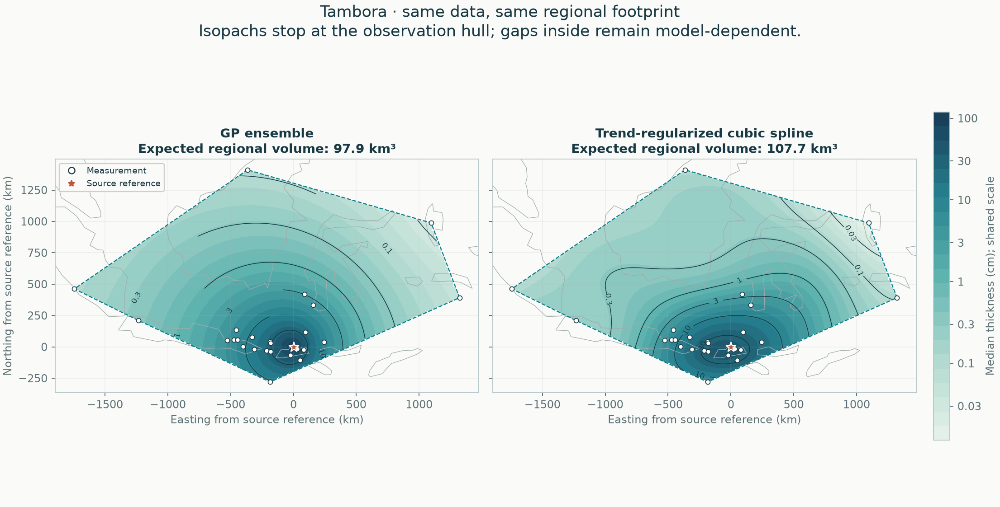
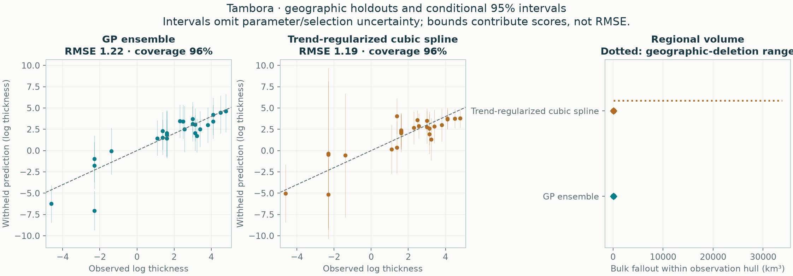

# Tambora: empirical methods on one regional footprint

All methods use the same accepted observations, geographic holdouts and integration area. No method is designated preferred.

**26 exact measurements, 0 lower bounds, 0 upper limits.** The observation hull covers 2,980,287 km². The automatic validation buffer is 80.59 km.



| Quantity | GP ensemble | Trend-regularized cubic spline |
|---|---:|---:|
| Expected regional bulk fallout (km³) | 97.91 | 107.69 |
| Integral of median thickness surface (km³) | 91.14 | 93.46 |
| Conditional 95% volume interval (km³) | 66.61–142.60 | 79.51–155.23 |
| Outer equal-region negative log score ↓ | 1.620 | 1.548 |
| Outer log-thickness RMSE ↓ | 1.216 | 1.186 |
| Outer 95% observation-interval coverage | 96.2% | 96.2% |

Lower predictive score and RMSE are better. Coverage must be read with interval width and predictive score; wider intervals alone are not improvement.



## Scope

The footprint is the convex hull of measured/bounded locations, with no source point or invented observations added. It can contain large unsampled gaps and can exclude proximal deposits. These are **regional bulk fallout volumes, not total eruption volumes or dense-rock equivalents**. No global extrapolation enters this comparison.

The mean volume integrates expected thickness. The median-surface integral is a separate quantity; it is not the median volume. Volume intervals come from complete correlated surface draws, not sums of pointwise interval endpoints.

## Fitted methods

### GP ensemble

```json
{
  "candidate": {
    "tail": "stacked"
  },
  "components": [
    {
      "weight": 0.5042249718762707,
      "model": {
        "candidate": {
          "tail": "power",
          "length_factor": 0.75,
          "noise_ratio": 1.5
        },
        "beta": [
          4.919343599926689,
          4.329884819595936,
          -0.6511549234382746,
          -0.2675376968048928
        ],
        "radius_scale_km": 337.4763181106144,
        "length_km": 373.37859987704354,
        "amplitude_log": 0.6582756775213083,
        "noise_log": 0.9874135162819625,
        "jitter": 4.3332686761613755e-10,
        "trend_on_constraint_boundary": false,
        "uncertainty": "conditional Gaussian"
      }
    },
    {
      "weight": 0.49577502812372926,
      "model": {
        "candidate": {
          "tail": "power",
          "length_factor": 1.5,
          "noise_ratio": 1.5
        },
        "beta": [
          4.919343599926689,
          4.329884819595936,
          -0.6511549234382746,
          -0.2675376968048928
        ],
        "radius_scale_km": 337.4763181106144,
        "length_km": 746.7571997540871,
        "amplitude_log": 0.6582756775213083,
        "noise_log": 0.9874135162819625,
        "jitter": 4.3332686761613755e-10,
        "trend_on_constraint_boundary": false,
        "uncertainty": "conditional Gaussian"
      }
    }
  ],
  "dominant_tail": "power",
  "observation_discrepancy_variance_log": 0.34988895306784606,
  "trend_on_constraint_boundary": false,
  "uncertainty": "Predictive mixture; includes disagreement among retained candidates, conditional on each fit and estimated weights. Fitted-parameter uncertainty is not integrated."
}
```

### Trend-regularized cubic spline

```json
{
  "method": "spline",
  "candidate": {
    "tail": "exponential",
    "knot_intervals": 4,
    "tension": 1.0,
    "smoothing": 0.01,
    "trend_strength": 1.0,
    "noise_ratio": 0.75
  },
  "bounds_km": [
    -1897.2399941087745,
    -364.76628403861207,
    1475.3673376660838,
    1495.060335109635
  ],
  "knot_intervals_xy": [
    4,
    2
  ],
  "n_coefficients": 35,
  "noise_log": 0.5194357723512364,
  "amplitude_log": 0.6925810298016486,
  "trend_beta": [
    3.8418513376129138,
    1.4567598624616778,
    -0.23535508970803493,
    -0.1424323934755244
  ],
  "trend_radius_scale_km": 337.4763181106144,
  "trend_on_constraint_boundary": false,
  "effective_df_exact": 9.715989471449298,
  "newton_decrement": 2.1054228182815445e-26,
  "newton_iterations": 0,
  "quadrature_order": 6,
  "uncertainty": "Conditional Gaussian",
  "uncertainty_omits": [
    "fitted trend",
    "noise and smoothing estimation",
    "knot/trend selection",
    "sampling and preservation bias",
    "vent location error"
  ],
  "pseudo_observations": 0
}
```

Every explored candidate is retained in the selection tables. All response-dependent choices are retuned within training folds; no hand-placed pseudo-data enter the likelihood.

## Reliability checks

- All probability intervals condition on fitted parameters and selected settings; they omit parameter/selection and preservation/sampling uncertainty.
- Four geographic outer folds evaluate the entire tuning procedure; this is development evidence, not independent external validation.
- Geographic-deletion volume ranges show refitting sensitivity and are not confidence intervals.

## Reproduce and inspect

```sh
tephra-isopachs compare Tambora --output results/new-regional-run
```

[Complete numerical report](report.json) · [Withheld predictions](heldout_predictions.csv) · [Accepted observation semantics](accepted_observations.csv) · [Selection tables](selection/README.md)

The JSON records input/source hashes, package versions, all fold memberships, regional integration refinements, conditional-volume sampling precision and geographic-deletion sensitivity. Historical GP global calculations remain separate.

## Which parts are actually supported?

Read the [local support and complete-contour audit](support/README.md) before extrapolating these hull volumes. It screens unsampled gaps, tests closure under geographic deletion, and separates interpolation from proximal/distal assumptions.
