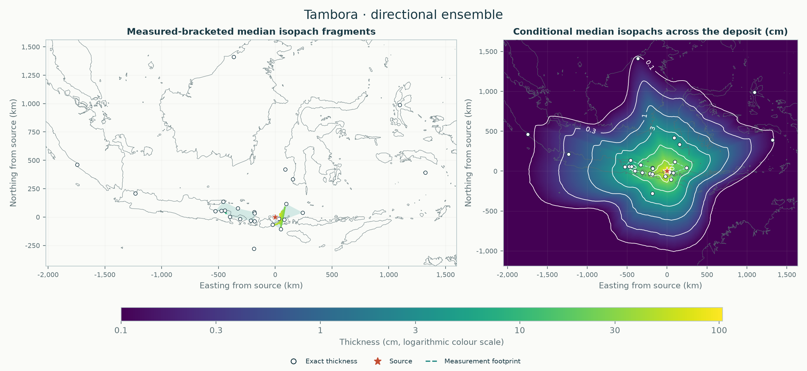

# Directional ensemble for Tambora

The central median-isopach map integrates to **105.8 km³ of bulk fallout**. Complete simulated deposits have a median of **119.6 km³** and a conditional 95% interval of **78.6–184.0 km³**.

[Read the ensemble estimate, compass budgets, predictive tests and numerical qualifications](ensemble/README.md)

[Single-structure reference, 13 prior sensitivities and unobserved proximal-cap experiment](single-structure.md)
