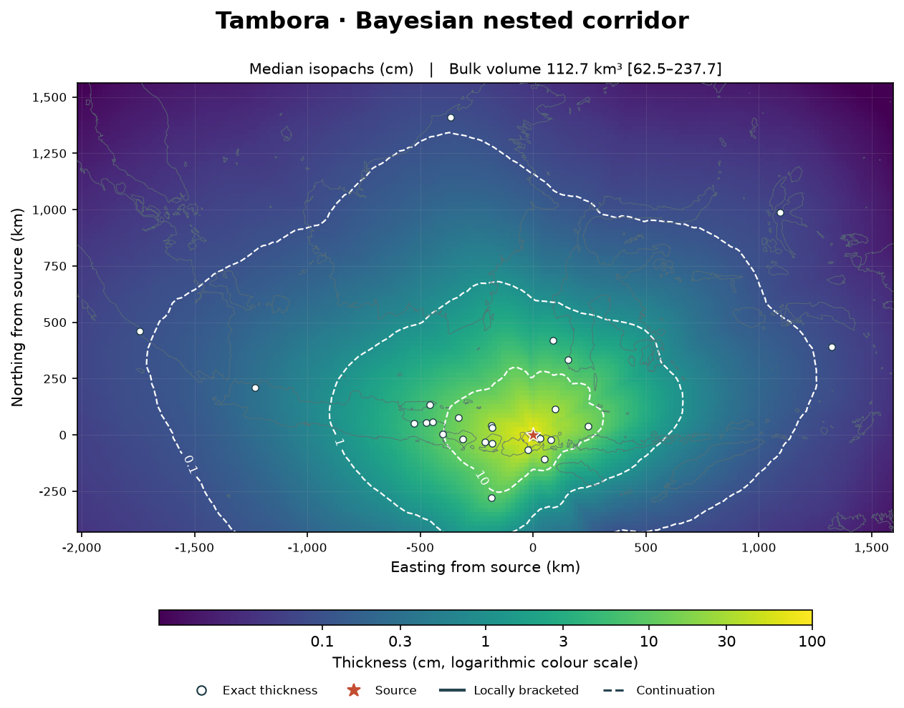
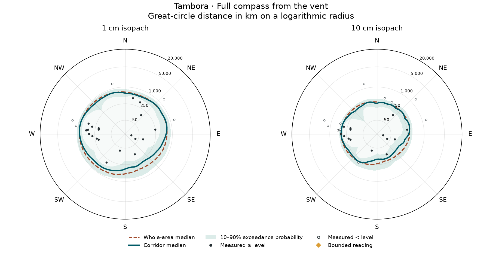

# Tambora · Bayesian nested isopachs

The principal corridor estimate of bulk fallout is **112.7 km³** (conditional 95% interval **62.5–237.7**). The median thickness map integrates to 94.9 km³. The whole-area sensitivity gives 146.9 km³ (96.1–290.7).

Solid portions cross a retained triangle with thicknesses on either side at distinct measured sites and at least 90% posterior crossing probability. Dashed portions depend on the continuation. The triangles diagnose spatial coverage. The shared contour screen also checks thickness bracketing and deletion stability. [Whole-Earth field](world.png) · [Every local bracket](local-brackets.csv.gz) · [Complete contour checks](support.json)

The buffered geographic score is 1.646 for the corridor and 1.368 for the whole-area sensitivity. Lower scores indicate better predictions at withheld sites. The corridor’s 95% predictive intervals cover 26 of 26 exact withheld readings. 4 of 4 geographic fits passed their sampling checks. The full-data proposal and importance check passed, the final volume populations passed, and the integration check passed. The shared screen accepted a complete contour band under 0 policies. [Prediction scores and row identities](report.json) · [Full fit diagnostics](full.json)

## Where the volume lies

The full-compass view includes all bearings through the antipode. Its logarithmic distance scale makes the proximal flanks visible. Areas in the table use the physical equal-area integral.

| Compass sector | Exact sites | Bounded sites | Corridor 1 cm area (km²) | Whole-area 1 cm area (km²) | Corridor volume (km³), median [95%] |
|---|---:|---:|---:|---:|---:|
| N | 2 | 0 | 159,305 | 174,441 | 13.4 [6.0–29.0] |
| NE | 3 | 0 | 157,692 | 169,893 | 14.6 [5.1–33.9] |
| E | 4 | 0 | 132,324 | 173,887 | 11.7 [3.4–29.6] |
| SE | 2 | 0 | 46,306 | 121,441 | 4.3 [1.2–35.7] |
| S | 1 | 0 | 66,038 | 131,175 | 5.8 [1.6–49.7] |
| SW | 1 | 0 | 146,949 | 225,471 | 13.6 [4.7–55.3] |
| W | 13 | 0 | 279,086 | 305,697 | 24.0 [14.8–40.5] |
| NW | 0 | 0 | 210,411 | 262,780 | 16.3 [4.8–36.6] |

At 1 cm, the corridor median map encloses 1,198,110 km² and the whole-area sensitivity encloses 1,564,785 km². Of these, 1,148,900 and 1,515,575 km² fall outside the retained exact-site triangles. An unsampled sector can contain ash. Its allocation depends on the assumed continuation.

The prior assigns 25% to continuation across all bearings. The remaining probability spans three fan widths and three down-range extensions. The fitted probability of whole-bearing continuation is 25.0%. The widths and extensions are shared structural assumptions. A bound supplies a likelihood event. Only positive evidence supplies a potential dispersal corridor.

[Volume and sector draws](volume-budget.npz) · [Complete field draws](full.npz) · [Areas, assumptions, bounds and diagnostics](report.json)

## Structural uncertainty

[Corridor and whole-area maps on a common scale](paired-isopachs.png)

| Prior probability of broad continuation | Median bulk volume, km³ [conditional 95%] |
|---:|---:|
| 10% | 107.8 [61.8–211.6] |
| 25% | 112.7 [62.5–237.7] |
| 50% | 123.4 [64.2–276.0] |
| 75% | 135.3 [68.1–299.7] |

The prior odds vary under the same observed likelihood. The numerical report also gives the volume by individual corridor law where the saved draws resolve it.

[Whole-area sensitivity report, posterior and diagnostics](../nested-whole-area/README.md)
