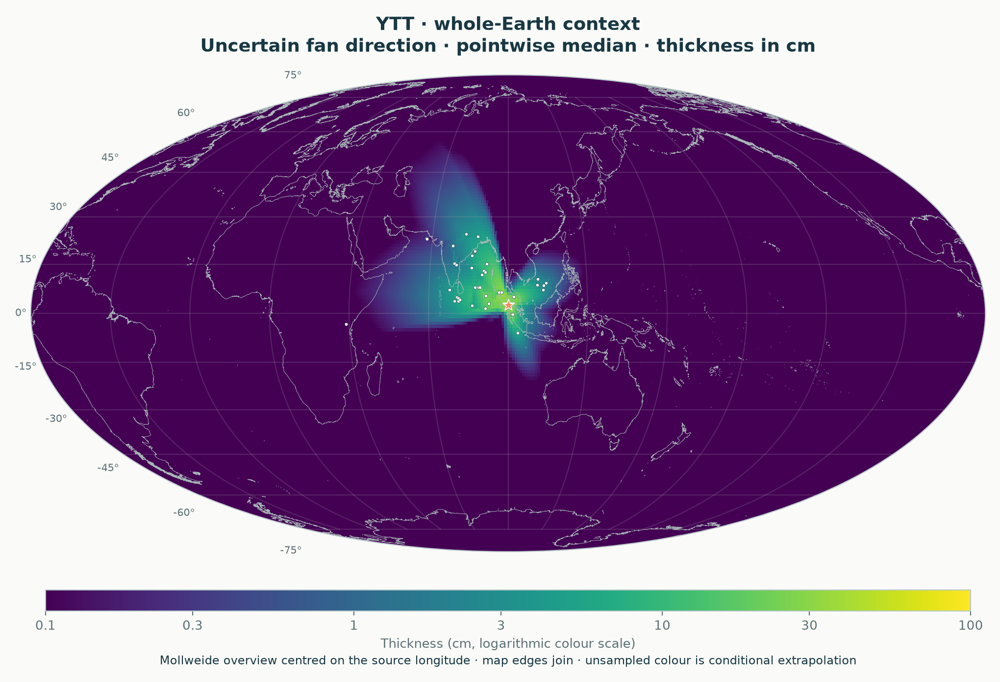
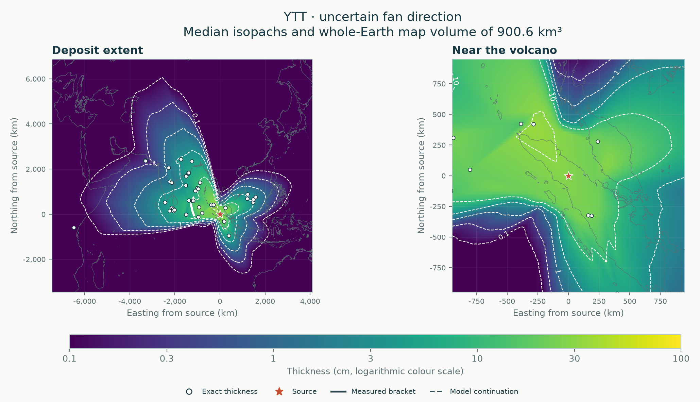

# Younger Toba Tuff (YTT) fallout reconstruction

**Geographic reach of nested isopachs.** Limiting the lateral and down-range reach of each positive site gives 1,322.2 km³ of bulk fallout (conditional 95% interval 771.0–3,000.8), compared with 1,543.0 km³ under the whole-area continuation. The corridor fit improves buffered predictions and fares worse on withheld quadrants. The full-data fit and volume population checks retained numerical warnings. [Paired maps, volumes and checks](results/nested-reach/README.md) · [Full-compass isopachs](results/nested-reach/compass.png)

The accepted dataset contains 46 exact measurements. The regional fits share an observation hull of 17,719,965 km². [Accepted thickness CSV](../../data/eruptions/YTT_tephra.csv) · [Row-level source audit](../../data/audits/YTT/README.md)

## Isopach fits

All four maps use the same frame, contour levels and thickness scale. Thickness below the first colour-bar tick shares the lowest shade. The dashed line encloses the observation hull. The regional fits stop there. The global fits also show how thickness continues into unsampled ground. On the directional map, solid white segments connect thicknesses bracketed by measured sites in a supported triangle. White dashes on the global maps show conditional isopachs. Gaps inside the hull can still be poorly constrained.

## Volume and predictive performance

| Method | Bulk volume (km³) | Conditional 95% interval (km³) | Held-out score ↓ | 95% coverage |
|---|---|---:|---:|---:|
| GP ensemble | Hull mean **1,196.14** | 759.73–1,861.41 | 1.934 | 91.3% |
| Cubic spline | Hull mean **1,203.01** | 797.96–1,998.78 | 2.153 | 82.6% |
| [Directional ensemble · uncertain fan direction](results/directional/README.md) | Whole-Earth median map **900.6** · volume median 1,272.1 | 736.5–3,660.9 | 1.531 † | 100.0% |
| [Spherical mixture](results/spherical-mixture/README.md) | Whole-Earth volume median **1,510.5** | 1,054.3–48,708.5 | 1.756 | 84.8% |
| [Bayesian nested isopachs](results/nested-isopachs/README.md) | Whole-Earth volume median **1,543.0** | 1,048.5–3,339.5 **(provisional)** | 1.507 † | 93.5% |

[Nested median isopachs and the area–thickness curve](results/nested-isopachs/isopachs.png) · [Nested whole-Earth map](results/nested-isopachs/world.png) · [Nested sensitivity in poorly sampled bearings](results/nested-isopachs/bearing-study/README.md) · [Uncertain gap amount](results/directional/sensitivity-study/README.md) · [Soft source displacement](results/spherical-mixture/sensitivity-study/README.md)

The nested estimate puts a median 13.2% of the fallout volume inside the retained exact-site triangles and 0.9% beyond the farthest exact measurement. 3/4 geographic refits passed the independent-population check.

A lower negative log predictive score means better prediction across withheld regions. Each region gets equal weight. Coverage is the share of exact held-out observations inside the 95% predictive interval. † A geographic fit had a numerical warning or incomplete scoring.

The directional map integrates pointwise median thickness. Measured interpolation triangles account for **21.7%** of its volume. The directional volume interval comes from complete simulated deposits. The spherical mixture reports the median integrated volume across broad and uncertain fan continuations. The regional intervals condition on fitted settings. [Regional maps, fits and diagnostics](results/README.md)

Compare the two whole-Earth maps

| Uncertain fan direction | Spherical mixture |
|---|---|
|  |  |

Both maps use the vent longitude as their central meridian. Read the thickness key under each map.

With the same observations and structure weights, fixing the fan directions gives a median-map volume of **1,005.6 km³**.

View the directional deposit extent and source area

## Evidence and limitations

The principal selection includes the two qualified Maninjau beds and core U1445B at 8 cm. The audit records source qualifications and alternative selections. All six full-data directional fits passed their checks. Two buffered geographic folds carry sampling warnings.

The standard local-support footprint covers 1,196,058 km². No complete isopach band passed the support and deletion checks. [Support map, partial volumes and rejected contours](results/support/README.md)
