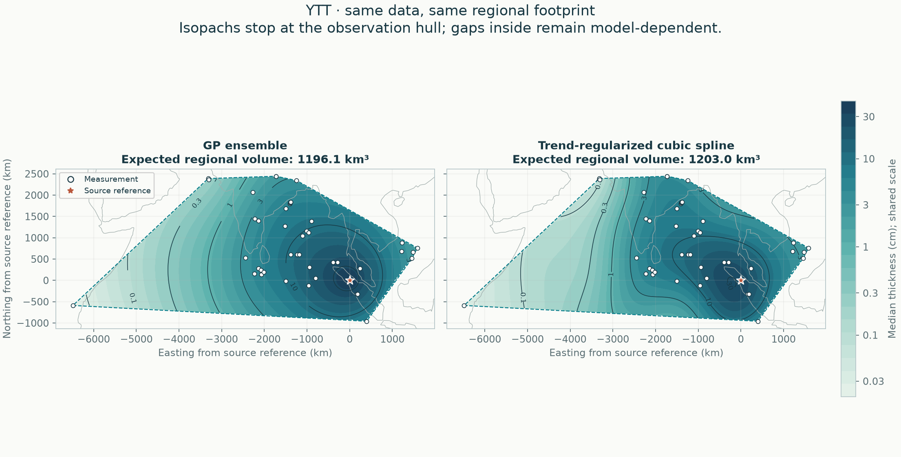

# YTT: data, global and regional results

[Regional fit](results/README.md) · [Local support](results/support/README.md) · [Conditional global estimate](results/global/README.md)

[All eruptions](../README.md) · [Active methods](../../methods/README.md) · [Add or revise data](../../docs/NEW_ERUPTION.md)

## Global fallout

The joint global posterior has median **1,674 km³** and a **1,204–54,907 km³ conditional 95% credible interval** for bulk fallout. All accepted fans are fitted together. This whole-Earth estimate uses no closing pseudo-data or arbitrary calculation region. [Read the global report, assumptions and sensitivity refits](results/global/README.md). The wide upper tail reflects deposits that remain poorly constrained by observations.

**Local support audit:** no complete isopach band passes the support and deletion checks. The standard local footprint covers 1,196,058 km². Read the [local partial volumes and rejected-contour checks](results/support/README.md) before interpreting the broader hull results below. The separate [conditional global analysis](results/global/README.md) now estimates the whole deposit under explicit assumptions; this contour-screen decision is unchanged.

## Regional reconstruction

**GP ensemble and automatic cubic spline are reported as peers.** Both use the same accepted data, geographic holdouts and observation hull.

[Read the full comparison](results/README.md) · [Compare all six eruptions](../../comparisons/regional/README.md) · [Method definitions](../../docs/METHODS.md)

46 exact measurements and 0 lower bounds; regional area 17,719,965 km².

| Quantity | GP ensemble | Cubic spline |
|---|---:|---:|
| Expected regional bulk fallout (km³) | 1196.14 | 1203.01 |
| Outer equal-region negative log score ↓ | 1.934 | 2.153 |

These volumes cover only the observation hull. It can include unsampled gaps and exclude proximal deposits; it is not total eruption volume or dense-rock equivalent. Conditional intervals omit fitted-parameter and selection uncertainty. Read withheld coverage and geographic-deletion sensitivity in the full report.

The [audited principal selection](../../data/audits/YTT/README.md) still contains 46 observations. No source decisions or input values changed.

## Evidence and calculation

| Follow the calculation | File |
|---|---|
| Accepted input | [Thickness observations](../../data/eruptions/YTT_tephra.csv) |
| Source decisions | [Audit or supplied-flag status](../../data/audits/YTT/README.md) |
| Whole-deposit mass and uncertainty | [Global posterior report](results/global/README.md) |
| Local maps and partial volumes | [Regional report](results/README.md) |
| Fits, validation and provenance | [Complete numerical record](results/report.json) |
| Row-by-row outer predictions | [Held-out predictions](results/heldout_predictions.csv) |
| Automatic tuning | [Candidate tables](results/selection/README.md) |

The 2026-11-04 regional rerun reproduced accepted inputs, fitted settings, held-out predictions and matched-hull volumes exactly. The new global companion is published separately. [Rerun verification](../../comparisons/global/verification.json).

## Related evidence and history

[Validation and targeted studies](../../comparisons/README.md) · [Earlier calculations in Git history](../../docs/HISTORY.md)
