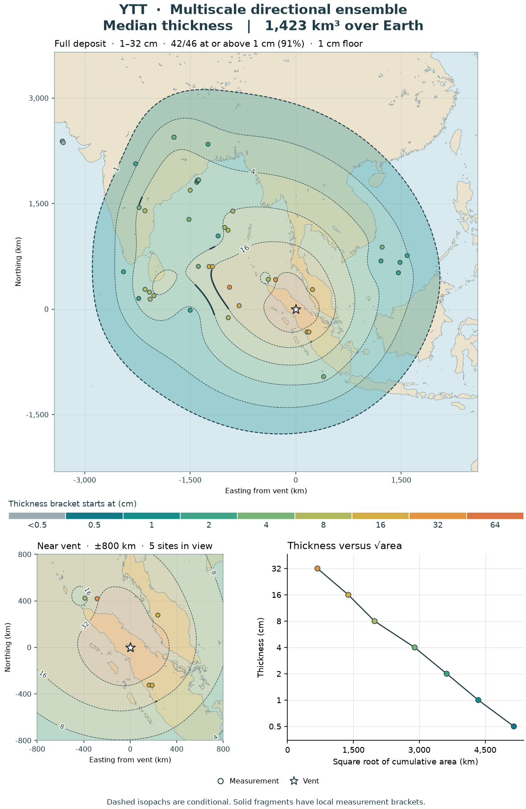
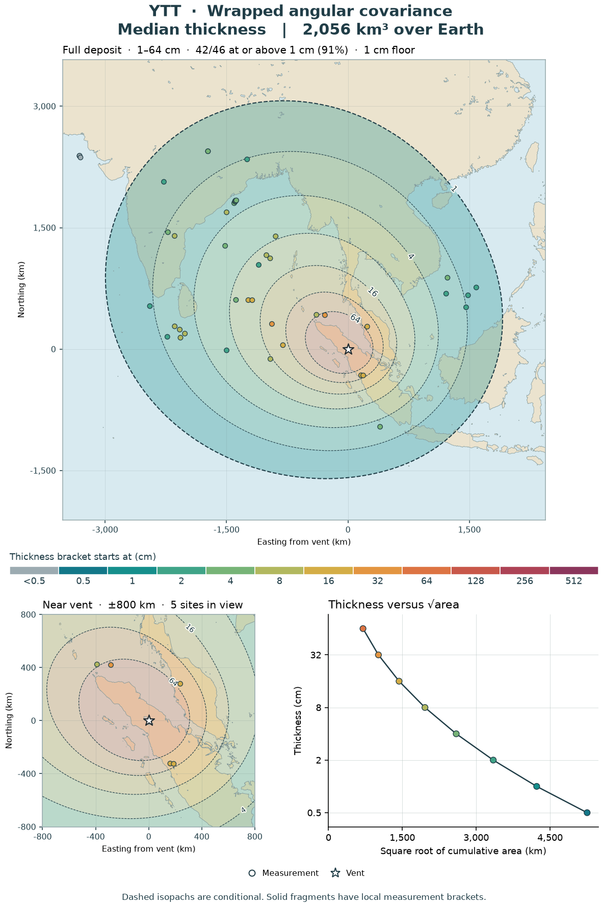
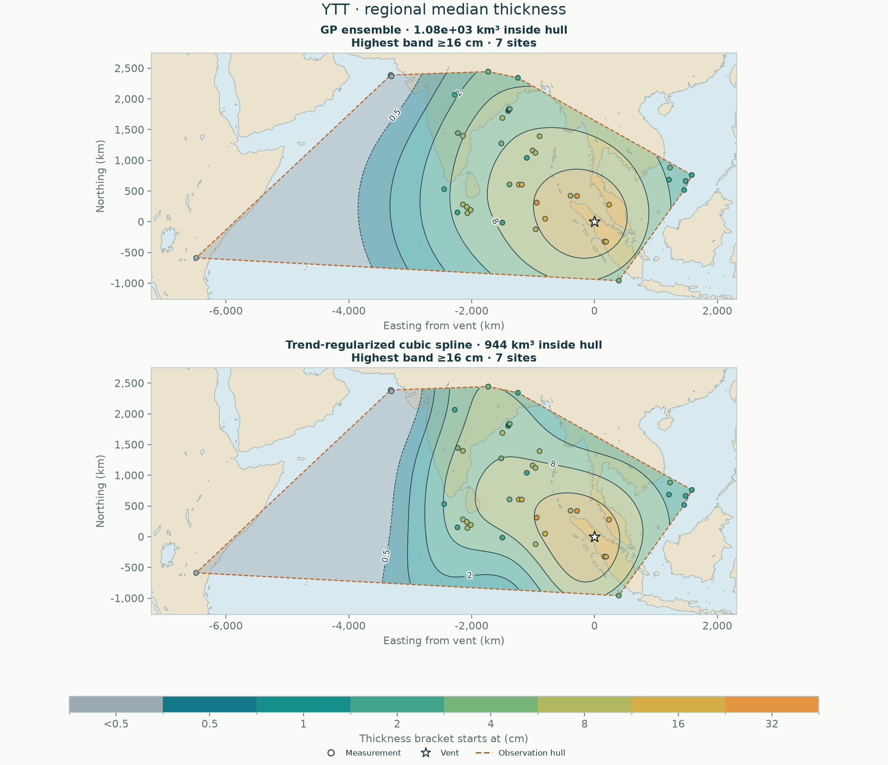

# Younger Toba Tuff (YTT) fallout reconstruction

[Principal input maps and numbered detail plates](observations/README.md)

The accepted dataset contains 46 exact measurements. The regional fits share an observation hull of 17,719,965 km². [Accepted thickness CSV](../../data/eruptions/YTT_tephra.csv) · [Row-level source audit](../../data/audits/YTT/README.md)

The northern sector has no accepted locality and accounts for **44%** of the nested median-map volume. The long northern 1 cm contour and the 1,994 km³ integral therefore depend heavily on geographic continuation. [Evidence by sector](results/nested-isopachs/footprints/sector-volumes.csv)

## Volumes and geographic prediction

Each estimate integrates the median thickness on its map. The conditional range integrates the pointwise 25th and 75th percentiles of thickness over the same area. The 50% probability refers to thickness at each location. A single probability for total volume does not follow from these endpoints.

| Method | Integration area | Median map (km³) | Q25–Q75 thickness maps (km³) | Held-out score ↓ | 95% predictive coverage |
|---|---|---:|---:|---:|---:|
| GP ensemble | observation hull | **1,079** | 799–1,460 | 1.934 | 91.3% |
| Cubic spline | observation hull | **944** | 686–1,357 | 2.153 | 82.6% |
| [Multiscale directional ensemble](results/directional/README.md) | whole Earth | **1,423** | 946–2,204 | 1.515 | 93.5% |
| [Spherical mixture](results/spherical-mixture/README.md) | whole Earth | **1,227** | 980–1,524 | 1.737 | 84.8% |
| [Bayesian nested footprints](results/nested-isopachs/README.md) | whole Earth | **1,782** | 1,124–2,994 | 1.759 | 89.1% |
| [Wrapped angular covariance](results/wrapped-angular-covariance/README.md) | whole Earth | **2,056** | 1,278–3,352 | 1.789 | 90.9% |

Lower scores indicate better geographic prediction. Coverage counts exact withheld measurements. A dagger marks a fit, integration or validation warning.

## Full deposits and near-vent detail

Each full map follows the thickest power-of-two contour enclosing at least 95% of the fitted locations, with a 1 cm minimum. The title gives the actual count, including when that minimum prevents 95% coverage. Global volumes include the thinner tail. The innermost line is the thickest doubling level enclosing an accepted location. The near-vent window expands from the proximal sites until eligible contours are visible. The curve sums all patches at each displayed thickness.

## Inside the observation hull

The GP and spline integrate over the dashed hull. Gaps inside it can still be poorly constrained. [Regional fits and numerical checks](results/README.md)

[Wrapped angular covariance at three scales](results/wrapped-angular-covariance/three-scales.png) · [Geological review and matched validation](../../comparisons/wrapped-angular-covariance/evidence.md)

The current global fits use the same audited rows. [What changed in the maps, volumes and validation](../../comparisons/global-extent/README.md) · [Continuation rules](../../docs/methods/finite-spread.md)

## Evidence and limitations

The principal selection includes the two qualified Maninjau beds and core U1445B at 8 cm. The audit records source qualifications and alternative selections. The directional full fit, four buffered refits and four quadrant refits passed. The ±100 km vent window contains no fitted locality. Its core thickness and the whole-deposit estimate are conditional on the geographic model. [Contours at three scales](../../comparisons/directional/multiscale/ytt.png)

The standard local-support footprint covers 1,196,058 km². No complete isopach band passed the support and deletion checks. [Support map, partial volumes and rejected contours](results/support/README.md)

In the [earlier fitted comparison](../../archive/2026-11-22-global-extent/README.md), the corridor fit improves buffered predictions and fares worse on withheld quadrants. The full-data fit and volume population checks retained numerical warnings. [Whole-area continuation sensitivity](results/nested-whole-area/README.md)
