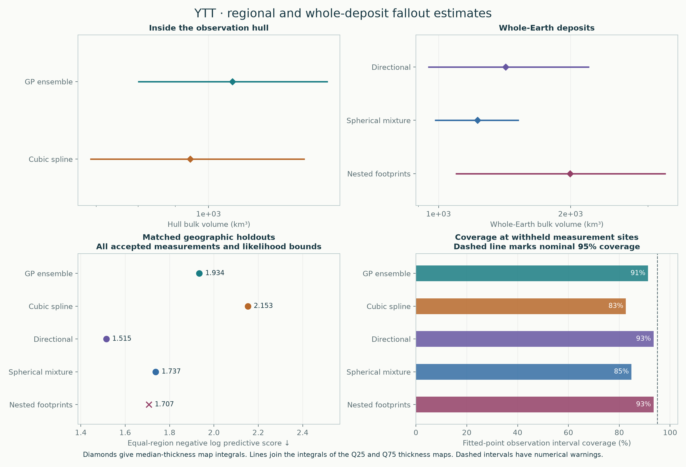

# Younger Toba Tuff (YTT) fallout reconstruction

The accepted dataset contains 46 exact measurements. The regional fits share an observation hull of 17,719,965 km². [Accepted thickness CSV](../../data/eruptions/YTT_tephra.csv) · [Row-level source audit](../../data/audits/YTT/README.md)

## Bulk fallout volume

| Model | Area | Volume summary (km³) | Conditional 95% volume interval (km³) |
|---|---|---:|---:|
| [Directional ensemble](results/directional/README.md) | Whole Earth | Median-map integral **985.7** · complete-field median 1,274.1 | 765.6–3,514.0 |
| [Spherical mixture](results/spherical-mixture/README.md) | Whole Earth | Posterior median **1,674.2** | 1,203.6–54,906.9 |
| GP ensemble | Observation hull | Expected **1,196.14** | 759.73–1,861.41 |
| Cubic spline | Observation hull | Expected **1,203.01** | 797.96–1,998.78 |

The directional interval summarizes complete simulated deposits. Measured interpolation triangles hold **19.7%** of the central directional map’s volume. The regional intervals condition on the fitted settings. [Paired regional maps and held-out tests](results/README.md)

## Evidence and limitations

The principal selection includes the two qualified Maninjau beds and core U1445B at 8 cm. The audit records source qualifications and alternative selections. All six full-data directional fits passed their checks. Two buffered geographic folds carry sampling warnings.

The standard local-support footprint covers 1,196,058 km². No complete isopach band passed the support and deletion checks. [Support map, partial volumes and rejected contours](results/support/README.md)
