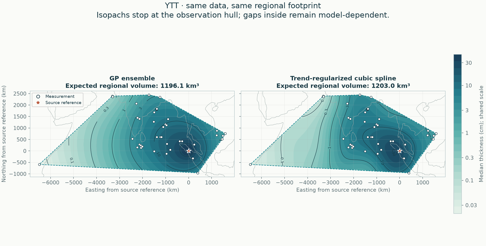
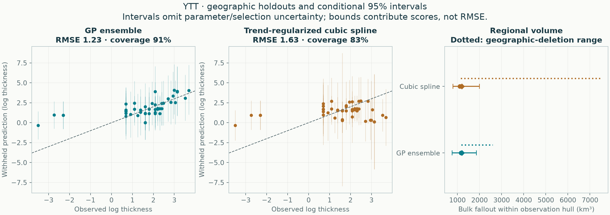

# YTT: empirical methods on one regional footprint

All methods use the same accepted observations, geographic holdouts and integration area. No method is designated preferred.

**46 exact measurements, 0 lower bounds, 0 upper limits.** The observation hull covers 17,719,965 km². The automatic validation buffer is 99.78 km.



| Quantity | GP ensemble | Trend-regularized cubic spline |
|---|---:|---:|
| Expected regional bulk fallout (km³) | 1196.14 | 1203.01 |
| Integral of median thickness surface (km³) | 1079.21 | 943.74 |
| Conditional 95% volume interval (km³) | 759.73–1861.41 | 797.96–1998.78 |
| Outer equal-region negative log score ↓ | 1.934 | 2.153 |
| Outer log-thickness RMSE ↓ | 1.229 | 1.634 |
| Outer 95% observation-interval coverage | 91.3% | 82.6% |

Lower predictive score and RMSE are better. Coverage must be read with interval width and predictive score; wider intervals alone are not improvement.



## Scope

The footprint is the convex hull of measured/bounded locations, with no source point or invented observations added. It can contain large unsampled gaps and can exclude proximal deposits. These are **regional bulk fallout volumes, not total eruption volumes or dense-rock equivalents**. No global extrapolation enters this comparison.

The mean volume integrates expected thickness. The median-surface integral is a separate quantity; it is not the median volume. Volume intervals come from complete correlated surface draws, not sums of pointwise interval endpoints.

## Fitted methods

### GP ensemble

```json
{
  "candidate": {
    "tail": "stacked"
  },
  "components": [
    {
      "weight": 1.0,
      "model": {
        "candidate": {
          "tail": "exponential",
          "length_factor": 0.75,
          "noise_ratio": 1.5
        },
        "beta": [
          4.102418204444206,
          3.3472962021927453,
          -0.8650881026329463,
          0.5403958112562828
        ],
        "radius_scale_km": 2002.9621408589132,
        "length_km": 1351.8226415234894,
        "amplitude_log": 0.7536951891563968,
        "noise_log": 1.1305427837345952,
        "jitter": 5.680564381574968e-10,
        "trend_on_constraint_boundary": false,
        "uncertainty": "conditional Gaussian"
      }
    }
  ],
  "dominant_tail": "exponential",
  "observation_discrepancy_variance_log": 0.4030464872281797,
  "trend_on_constraint_boundary": false,
  "uncertainty": "Predictive mixture; includes disagreement among retained candidates, conditional on each fit and estimated weights. Fitted-parameter uncertainty is not integrated."
}
```

### Trend-regularized cubic spline

```json
{
  "method": "spline",
  "candidate": {
    "tail": "exponential",
    "knot_intervals": 8,
    "tension": 0.5,
    "smoothing": 0.0001,
    "trend_strength": 1.0,
    "noise_ratio": 0.75
  },
  "bounds_km": [
    -6889.193019153388,
    -1129.4476109923294,
    1989.0934090078204,
    2614.1826134683147
  ],
  "knot_intervals_xy": [
    8,
    3
  ],
  "n_coefficients": 66,
  "noise_log": 0.5652713918672977,
  "amplitude_log": 0.7536951891563969,
  "trend_beta": [
    4.10241820444237,
    3.347296202179209,
    -0.8650881026248552,
    0.5403958112395629
  ],
  "trend_radius_scale_km": 2002.9621408589132,
  "trend_on_constraint_boundary": false,
  "effective_df_exact": 15.06230243766865,
  "newton_decrement": 9.105311237755345e-28,
  "newton_iterations": 0,
  "quadrature_order": 6,
  "uncertainty": "Conditional Gaussian",
  "uncertainty_omits": [
    "fitted trend",
    "noise and smoothing estimation",
    "knot/trend selection",
    "sampling and preservation bias",
    "vent location error"
  ],
  "pseudo_observations": 0
}
```

Every explored candidate is retained in the selection tables. All response-dependent choices are retuned within training folds; no hand-placed pseudo-data enter the likelihood.

## Reliability checks

- All probability intervals condition on fitted parameters and selected settings; they omit parameter/selection and preservation/sampling uncertainty.
- Four geographic outer folds evaluate the entire tuning procedure; this is development evidence, not independent external validation.
- Geographic-deletion volume ranges show refitting sensitivity and are not confidence intervals.
- Trend-regularized cubic spline: held-out 95% observation coverage is only 82.6%; uncertainty is undercovered.

## Reproduce and inspect

```sh
tephra-isopachs compare YTT --output results/new-regional-run
```

[Complete numerical report](report.json) · [Withheld predictions](heldout_predictions.csv) · [Accepted observation semantics](accepted_observations.csv) · [Selection tables](selection/README.md)

The JSON records input/source hashes, package versions, all fold memberships, regional integration refinements, conditional-volume sampling precision and geographic-deletion sensitivity. Historical GP global calculations remain separate.

## Which parts are actually supported?

Read the [local support and complete-contour audit](support/README.md) before extrapolating these hull volumes. It screens unsampled gaps, tests closure under geographic deletion, and separates interpolation from proximal/distal assumptions.

## Whole-deposit fallout

Read the [conditional global estimate and assumption sensitivity](global/README.md). Its mass is normalized on the whole Earth; these regional partial volumes and the local contour audit retain their separate meanings.
