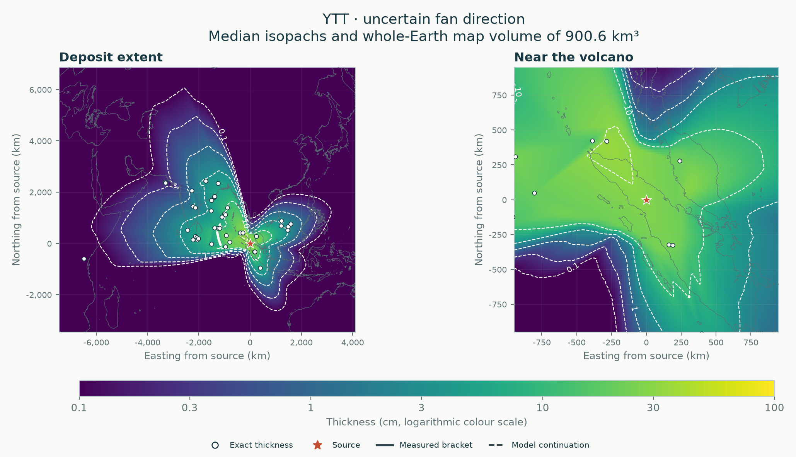
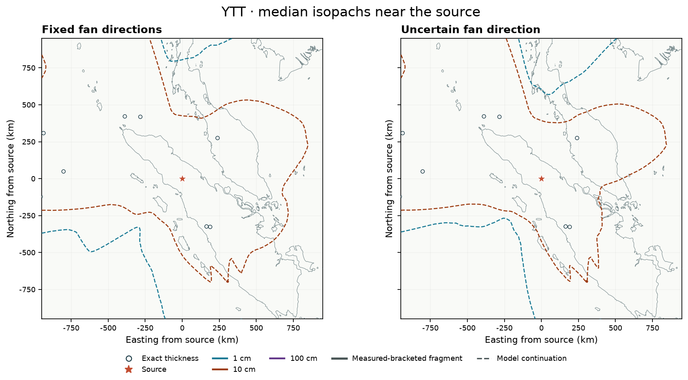
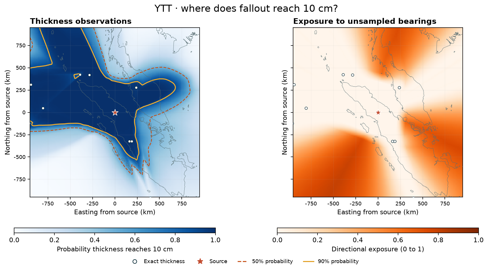

# YTT directional fallout

**900.6 km³ of bulk fallout** is the whole-Earth integral of the median thickness map. The principal fit uses 46 accepted thickness observations and bounds and allows the fan direction to vary in unsampled sectors. Fixing fan directions with the same data and structure weights gives **1,005.6 km³**.

Under uncertain azimuth, integrating each complete deposit gives a volume median of **1,272.1 km³** and a conditional 95% range of **736.5–3,660.9 km³**. Measured interpolation triangles contribute 21.7% of the median-map volume. The rest relies on continuation.

Solid marks require a triangle whose measured sites bracket the thickness and whose posterior crossing probability reaches 90%. Dashes show the remaining median contour. White circles are thickness observations. An empty sector can contain fallout.

The deposit panel includes the accepted sites and the display search for the 0.1 cm contour. [Whole-Earth thickness map](azimuth/world.png) · [Display extent and checks](azimuth/map-display.json)

## Reach from the volcano

Distances are great-circle kilometres to the first outward crossing on each compass ray. The area columns give the entire 10 cm footprint in the corresponding 45° sector, including detached areas. Together they distinguish a long point on a contour from an entire broad lobe.

| Bearing | Fixed 10 cm reach (km) | Uncertain 10 cm reach (km) | Fixed ≥10 cm area (km²) | Uncertain ≥10 cm area (km²) |
|---|---:|---:|---:|---:|
| N | 426.5 | 393.9 | 270,535 | 231,644 |
| NE | 741.1 | 714.9 | 211,216 | 195,947 |
| E | 715.9 | 543.4 | 234,043 | 156,709 |
| SE | 689.9 | 540.5 | 205,515 | 131,067 |
| S | 519.5 | 424.8 | 111,199 | 95,025 |
| SW | 322.4 | 310.8 | 51,362 | 44,083 |
| W | 1,170.3 | 1,170.3 | 506,041 | 501,320 |
| NW | 1,406.5 | 1,405.5 | 879,953 | 876,423 |

The 50% and 90% probability lines answer different questions. At a location on the 90% line, nine in ten model draws reach 10 cm. These are pointwise probabilities conditional on the model. Joint confidence over an entire region requires a different calculation.

## Withheld observations

Each row averages negative log predictive scores over equally weighted folds. Lower scores predict the withheld thicknesses and limits better. The passing-only columns exclude numerical failures. Coverage counts exact withheld thicknesses inside the uncertain-direction 95% predictive interval. A dash marks an unavailable score or coverage.

| Deletion | All estimable folds | Fixed | Uncertain | Passing folds | Fixed, passing | Uncertain, passing | Exact-site 95% coverage |
|---|---:|---:|---:|---:|---:|---:|---:|
| Geographic regions | 4 | 1.781 | 1.531 | 2 | 2.157 | 1.643 | 46/46 (100.0%) |
| Source quadrants | 4 | 3.056 | 2.969 | 4 | 3.056 | 2.969 | 19/46 (41.3%) |

[Predictions for every estimable held-out site](azimuth/heldout.csv). The numerical record includes all planned folds, row identities, unscorable directions, fit warnings and phase-integration checks.

## Checks and reproducibility

The shared contour audit found eligible bands under none of the screened support policies. Audit status is completed. [All contour decisions and deletion failures](azimuth/complete-contour-audit.json)

The spatial integration check passed at 16,384 points per scramble. The map used up to 128 posterior draws per chain and structure. Resolved contour areas passed the split-packet check. The joint-volume quantiles passed the split check.

All six full fits passed their sampling diagnostics.

[Numerical report, all sector volumes and sensitivities](azimuth/report.json) · [Complete fields and per-field volumes](azimuth/fields.npz) · [Principal map grids](azimuth/median-grids.npz) · [Near-source comparison grids](azimuth/map-grid.npz) · [Fragment decisions](azimuth/fragment-decisions.csv) · [Bracketed coordinates](azimuth/bracketed-fragments.csv) · [File hashes](azimuth/artifacts.json)

## Related directional studies

- [Earlier fixed-direction ensemble and its separate calibration](ensemble/README.md)
- [Single-structure and proximal-cap sensitivities](single-structure/README.md)
