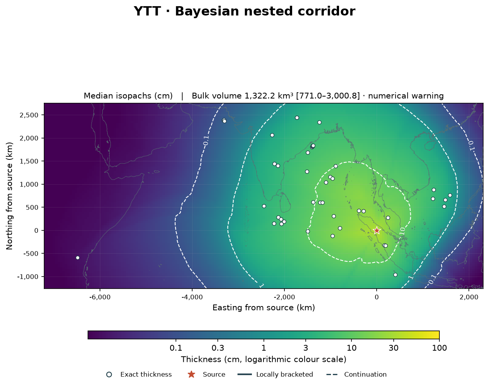

# YTT · Bayesian nested isopachs

The principal corridor estimate of bulk fallout is **1,322.2 km³** (conditional 95% interval **771.0–3,000.8**). The median thickness map integrates to 1,246.2 km³. The whole-area sensitivity gives 1,543.0 km³ (1,048.5–3,339.5).

Solid portions cross a retained triangle with thicknesses on either side at distinct measured sites and at least 90% posterior crossing probability. Dashed portions depend on the continuation. The triangles diagnose spatial coverage. The shared contour screen also checks thickness bracketing and deletion stability. [Whole-Earth field](world.png) · [Every local bracket](local-brackets.csv.gz) · [Complete contour checks](support.json)

The buffered geographic score is 1.429 for the corridor and 1.507 for the whole-area sensitivity. Lower scores indicate better predictions at withheld sites. The corridor’s 95% predictive intervals cover 45 of 46 exact withheld readings. 3 of 4 geographic fits passed their sampling checks. The full-data proposal and importance check retained a warning, the final volume populations retained a warning, and the integration check passed. The shared screen accepted a complete contour band under 0 policies. [Prediction scores and row identities](report.json) · [Full fit diagnostics](full.json)

## Where the volume lies

The full-compass view includes all bearings through the antipode. Its logarithmic distance scale makes the proximal flanks visible. Areas in the table use the physical equal-area integral.

| Compass sector | Exact sites | Bounded sites | Corridor 1 cm area (km²) | Whole-area 1 cm area (km²) | Corridor volume (km³), median [95%] |
|---|---:|---:|---:|---:|---:|
| N | 0 | 0 | 3,430,322 | 3,703,034 | 240.7 [70.9–511.5] |
| NE | 5 | 0 | 1,942,358 | 2,068,917 | 132.0 [70.1–219.5] |
| E | 1 | 0 | 910,363 | 953,976 | 61.1 [32.6–112.7] |
| SE | 2 | 0 | 608,392 | 660,741 | 47.0 [22.0–220.1] |
| S | 1 | 0 | 952,742 | 1,128,901 | 72.8 [24.2–616.4] |
| SW | 0 | 0 | 2,054,526 | 2,439,425 | 141.0 [24.3–719.0] |
| W | 11 | 0 | 3,826,045 | 3,905,238 | 290.7 [191.1–446.3] |
| NW | 26 | 0 | 4,318,766 | 4,419,929 | 340.8 [240.9–456.5] |

At 1 cm, the corridor median map encloses 18,043,514 km² and the whole-area sensitivity encloses 19,280,161 km². Of these, 16,891,811 and 18,128,458 km² fall outside the retained exact-site triangles. An unsampled sector can contain ash. Its allocation depends on the assumed continuation.

The prior assigns 25% to continuation across all bearings. The remaining probability spans three fan widths and three down-range extensions. The fitted probability of whole-bearing continuation is 25.0%. The widths and extensions are shared structural assumptions. A bound supplies a likelihood event. Only positive evidence supplies a potential dispersal corridor.

[Volume and sector draws](volume-budget.npz) · [Complete field draws](full.npz) · [Areas, assumptions, bounds and diagnostics](report.json)

## Structural uncertainty

[Corridor and whole-area maps on a common scale](paired-isopachs.png)

| Prior probability of broad continuation | Median bulk volume, km³ [conditional 95%] |
|---:|---:|
| 10% | 1,274.7 [754.3–2,855.6] |
| 25% | 1,322.2 [771.0–3,000.8] |
| 50% | 1,409.6 [796.9–3,223.7] |
| 75% | 1,467.1 [858.6–3,277.0] |

The prior odds vary under the same observed likelihood. The numerical report also gives the volume by individual corridor law where the saved draws resolve it.

[Whole-area sensitivity report, posterior and diagnostics](../nested-whole-area/README.md)
